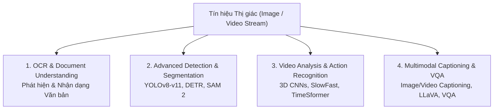

# Chương 1: Tổng quan các Bài toán Thị giác Máy tính Nâng cao (Advanced Computer Vision Overview)

---

## 1. Phân biệt CV Cơ bản & CV Nâng cao (Basic vs Advanced CV)

Trong khi các bài toán Thị giác Máy tính cơ bản chỉ dừng lại ở việc gán 1 nhãn lớp duy nhất cho toàn bộ bức ảnh (Image Classification - ví dụ: phân biệt Chó vs Mèo), các hệ thống **Computer Vision Nâng cao (Advanced CV)** trong thực tế phải giải quyết các bài toán đa chiều phức tạp hơn nhiều:

---

## 2. Bảng Tổng hợp các Bài toán CV Nâng cao

| Bài toán (Task) | Tín hiệu Đầu vào (Input) | Kết quả Đầu ra (Output) | Kiến trúc Mô hình SOTA |
| :--- | :--- | :--- | :--- |
| **OCR & Document Parsing** | Bức ảnh văn bản / PDF scan | Chuỗi chữ + Tọa độ 2D Hộp bao Bounding Box | DBNet (Detection) + CRNN / TrOCR / Donut |
| **Advanced Object Detection** | Bức ảnh 2D | Danh sách Bounding Boxes $(x, y, w, h)$ + Class | YOLOv8/v11, RT-DETR, Faster R-CNN |
| **Instance & Panoptic Segmentation** | Bức ảnh 2D | Mặt nạ điểm ảnh chi tiết (Pixel Mask) | Mask R-CNN, Segment Anything Model (SAM 2) |
| **Video Action Recognition** | Clip Video ($T$ khung hình) | Nhãn hành động (ví dụ: "Đang chạy bộ") | 3D CNN (I3D, SlowFast), TimeSformer |
| **Image Captioning** | 1 Bức ảnh | Câu văn bản mô tả nội dung bằng tiếng Việt/Anh | Vision Encoder (ViT/ResNet) + LLM (BLIP-2, LLaVA) |
| **Video Captioning** | Clip Video đa khung hình | Đoạn văn bản mô tả diễn biến video theo thời gian | Video-LLaVA, Video-ChatGPT |
| **Image / Video VQA** | Bức ảnh/Video + Câu hỏi | Câu trả lời tự do bằng ngôn ngữ tự nhiên | Qwen2-VL, LLaVA, MiniGPT-4 |

---

## 3. Kiến trúc Pipeline Chạy Thực tế

Mỗi bài toán nâng cao đòi hỏi sự kết hợp của nhiều khối xử lý:
- **Vision Encoders:** Convolutional Neural Networks (ResNet, ConvNeXt) hoặc Vision Transformers (ViT, Swin Transformer).
- **Temporal Encoders:** 3D Convolutions hoặc Temporal Self-Attention (dành cho Video).
- **Multimodal Fusion:** Cross-Attention Layers hoặc Multimodal Large Language Models (VLMs).
