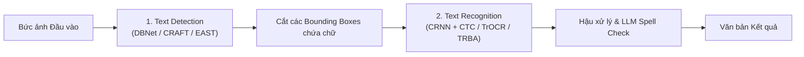

# Chương 2: Nhận dạng Văn bản & Đọc Tài liệu (OCR Text Detection & Recognition)

---

## 1. Tổng quan Pipeline OCR 2 Bước chuẩn Công nghiệp

Hệ thống OCR (Optical Character Recognition) thương mại (như PaddleOCR, EasyOCR, Tesseract) chia quy trình thành 2 công đoạn chính:



---

## 2. Mô hình Phát hiện Văn bản (Text Detection Models)

Text Detection có nhiệm vụ tìm chính xác vị trí hộp bao (Bounding Box 4 điểm hoặc Đa giác Polygon) của các dòng chữ trên bức ảnh.

### 2.1. DBNet (Differentiable Binarization Network - Real-time SOTA)
Truyền thống, bước Binarization (chuyển Probability Map thành Bounding Box nhị phân) dùng ngưỡng cố định (step function) không tính được đạo hàm. 

**DBNet** nhúng hàm Binarization xấp xỉ có thể tính đạo hàm (Differentiable Binarization) trực tiếp vào quá trình huấn luyện:

$$\hat{B}_{i,j} = \frac{1}{1 + \exp\left( -k (P_{i,j} - T_{i,j}) \right)}$$

Trong đó $P$ là Probability Map, $T$ là Threshold Map, và $k = 50$ là hệ số khuyếch đại.

```
Input Image ──► [ Feature Pyramid Network (FPN) ] ──┬──► Probability Map P
                                                    ├──► Threshold Map T
                                                    └──► [ Differentiable Binarization ] ──► Bounding Boxes
```

### 2.2. CRAFT (Character Region Awareness for Text Detection)
CRAFT dự đoán 2 bản đồ nhiệt (Heatmaps):
- **Region Score:** Xác định tâm của từng ký tự cá thể.
- **Affinity Score:** Xác định mối liên kết nối giữa các ký tự đứng cạnh nhau để nhóm thành từ/câu.

---

## 3. Mô hình Nhận dạng Văn bản (Text Recognition Models)

### 3.1. Kiến trúc CRNN + CTC (Convolutional Recurrent Neural Network + CTC Loss)

CRNN là kiến trúc tiêu chuẩn kết hợp giữa CNN (trích xuất đặc trưng hình ảnh), RNN (học ngữ cảnh từ) và CTC Loss (giải mã chuỗi ký tự).

```
Image Crop [32, 100, 3] ──► [ CNN Feature Extractor ] ──► Sequence Vectors ──► [ Bi-LSTM ] ──► [ CTC Decoder ] ──► "TEXT"
```

1. **CNN Layers:** Biến đổi ảnh dòng chữ $32 \times 100$ thành chuỗi vector đặc trưng theo trục thời gian $T$.
2. **Bi-LSTM Layers:** Học mối quan hệ chuỗi ký tự (ví dụ sau chữ `q` thường là chữ `u`).
3. **CTC Loss (Connectionist Temporal Classification):** Tự động căn chỉnh và giải mã chuỗi ký tự mà không cần nhãn vị trí pixel cho từng chữ cái.

---

### 3.2. TrOCR (Transformer OCR - Microsoft 2021)
TrOCR bỏ qua CNN và RNN, áp dụng hoàn toàn kiến trúc **Encoder-Decoder Transformer**:
- **Encoder:** Image Transformer (ViT / DeiT) cắt ảnh dòng chữ thành các patch $16 \times 16$ và chiếu thành vector tiềm ẩn.
- **Decoder:** Text Transformer Decoder (RoBERTa / BART) sinh ra từng ký tự văn bản tự hồi quy.

---

## 4. Tiền xử lý & Hậu xử lý OCR (OCR Preprocessing & Postprocessing)

### 4.1. Tiền xử lý Ảnh (Image Preprocessing):
- **Deskewing (Chống nghiêng):** Sử dụng phép biến đổi Hough Transform hoặc Minimum Area Rectangle để xoay góc ảnh về phương ngang $0^\circ$.
- **CLAHE (Contrast Limited Adaptive Histogram Equalization):** Tăng cường độ tương phản cho các hóa đơn bị mờ hoặc thiếu sáng.

### 4.2. Hậu xử lý Sửa lỗi Chính tả (Postprocessing with LLM):
Kết quả OCR thô thường bị nhầm lẫn giữa ký tự `0` và `O`, `1` và `l`/`I`. Sử dụng mô hình ngôn ngữ (như SymSpell hoặc LLM) để khôi phục từ chuẩn xác dựa trên ngữ cảnh câu.
