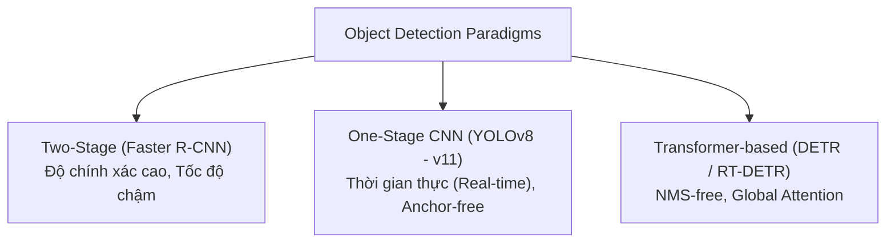
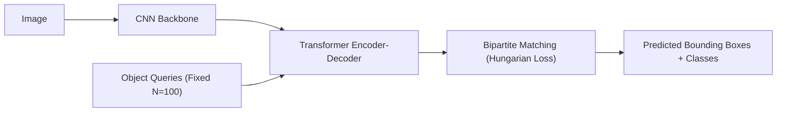

# Chương 3: Phát hiện Vật thể Nâng cao (Advanced Object Detection - YOLOv8/v11 & DETR)

---

> [!IMPORTANT]
> 📌 **TỔNG QUAN & VAI TRÒ TRONG PIPELINE AI:**
> Phân loại ảnh (Image Classification) chỉ cho biết trong bức ảnh "có vật thể gì", nhưng hoàn toàn bất lực trong việc xác định **vị trí cụ thể** của từng vật thể khi ảnh chứa nhiều đối tượng cùng lúc.
> **Mục tiêu của Chương 3** là giải thích bài toán **Phát hiện Vật thể Nâng cao (Object Detection - YOLOv8/v11 & DETR)**.
> - **Đầu vào:** Bức ảnh 2D bất kỳ (Ví dụ: Bức ảnh giao thông chứa nhiều xe cộ và người đi bộ).
> - **Xử lý:** Decoupled Head (Phân loại Class + Dự đoán Bounding Box $(x, y, w, h)$) $\to$ DFL Loss $\to$ NMS Filter / Hungarian Matching.
> - **Đầu ra:** Danh sách tọa độ các hộp bao hình chữ nhật (Bounding Boxes) kèm nhãn Class và độ tin cậy Confidence.
> - **Vai trò:** Là thành phần cốt lõi trong Xe tự lái, Giám sát an ninh, Robot tự hành và phân tích video thời gian thực!

---

## 1. Sự Tiến hóa của Mô hình Object Detection Nâng cao

Phát hiện vật thể (Object Detection) đòi hỏi mô hình vừa phải xác định **Vật thể đó là gì (Classification)**, vừa xác định **Vật thể nằm ở đâu (Localization - Bounding Box $x, y, w, h$)**.



---

## 2. Dòng mô hình YOLO Modern Architecture (YOLOv8 - YOLOv11)

Mô hình YOLO (You Only Look Once) hiện đại đã hoàn toàn chuyển đổi sang kiến trúc **Anchor-free** và **Decoupled Head**.

```
Input Image ──► [ Backbone (C2f/C3k2) ] ──► [ Neck (PAN-FPN) ] ──┬──► Classification Branch (Cls Loss: BCE / VFL)
                                                                 └──► Regression Branch (Box Loss: CIoU + DFL)
```

#### 💡 Giải thích Dễ hiểu Từng con số & Bước hoạt động của YOLOv8:

Giả sử ảnh đầu vào kích thước $640 \times 640 \times 3$.

1. **Backbone & Neck (Trích xuất Đặc trưng Đa tỷ lệ):**
   - Mạng trích xuất ra 3 bản đồ đặc trưng ở 3 tỷ lệ (P3, P4, P5):
     - **P3 ($80 \times 80$):** Nhận diện các vật thể nhỏ (ví dụ biển báo xa).
     - **P4 ($40 \times 40$):** Nhận diện các vật thể trung bình (ví dụ người đi bộ).
     - **P5 ($20 \times 20$):** Nhận diện các vật thể lớn (ví dụ ô tô tải gần).
   - Tổng số điểm dự đoán (Anchor points) $= 80 \times 80 + 40 \times 40 + 20 \times 20 = \mathbf{8,400} \text{ điểm vị trí}$.
2. **Decoupled Head (Hai Nhánh Tách biệt):**
   - Tại mỗi điểm trong $8,400$ điểm vị trí, mô hình rẽ làm 2 nhánh:
     - **Nhánh 1 (Classification Branch):** Dự đoán xác suất cho $C$ lớp vật thể (ví dụ $C=80$ lớp trong COCO).
     - **Nhánh 2 (Regression Branch):** Dự đoán khoảng cách từ điểm tâm tới 4 cạnh $(l, r, t, b)$ (left, right, top, bottom).
3. **NMS Filter (Lọc Hộp Trùng lặp):**
   - Sau khi tính toán trên $8,400$ điểm, thuật toán NMS (Non-Maximum Suppression) giữ lại hộp bao có điểm confidence cao nhất và loại bỏ các hộp bao đè lên nhau có chỉ số $\text{IoU} > 0.45$.

---

## 3. Transformer Detection: DETR & RT-DETR (Real-Time DETR)

### 3.1. DETR (DEtection TRansformer - Facebook AI 2020)
DETR loại bỏ hoàn toàn các bước thủ công như **Anchor Generation** và **NMS (Non-Maximum Suppression)**.



#### Hungarian Bipartite Matching Loss:
DETR sử dụng thuật toán Hungarian để tìm một ánh xạ 1-1 tối ưu giữa $N$ dự đoán của mô hình và $M$ vật thể thật ($N > M$), giúp mô hình **không bao giờ sinh ra các hộp bao trùng lặp**, triệt tiêu hoàn toàn nhu cầu chạy NMS!

### 3.2. RT-DETR (Real-Time DETR - Baidu 2023)
RT-DETR cải tiến DETR bằng cách thay thế Encoder nặng nề bằng **Efficient Hybrid Encoder** (kết hợp Intra-scale Feature Interaction và Cross-scale Feature Fusion), đạt tốc độ real-time $60+ \text{ FPS}$ trên GPU ngang ngửa YOLOv8.

---

## 4. Các Hàm Mất mát Bounding Box IoU (IoU Loss Family)

Giao điểm trên Hợp điểm (Intersection over Union - IoU) đo độ trùng khớp giữa Bounding Box dự đoán $B$ và Groundtruth $B^{gt}$:

$$\text{IoU} = \frac{|B \cap B^{gt}|}{|B \cup B^{gt}|}$$

### 4.1. Sự Tiến hóa của các Hàm Loss IoU:

1. **GIoU (Generalized IoU):** Giải quyết vấn đề khi 2 hộp không giao nhau ($\text{IoU} = 0$), thêm hình chữ nhật bao quanh nhỏ nhất $C$:
   $$\mathcal{L}_{\text{GIoU}} = 1 - \text{IoU} + \frac{|C \setminus (B \cup B^{gt})|}{|C|}$$

2. **DIoU (Distance IoU):** Phạt khoảng cách Euclide giữa 2 điểm tâm $\rho(b, b^{gt})$ chia cho độ dài đường chéo $c$ của hộp bao $C$:
   $$\mathcal{L}_{\text{DIoU}} = 1 - \text{IoU} + \frac{\rho^2(b, b^{gt})}{c^2}$$

3. **CIoU (Complete IoU - Chuẩn mực trong YOLO):** Phạt đồng thời khoảng cách tâm và tính nhất quán của Tỷ lệ Khung hình (Aspect Ratio $v$):
   $$\mathcal{L}_{\text{CIoU}} = 1 - \text{IoU} + \frac{\rho^2(b, b^{gt})}{c^2} + \alpha v$$
