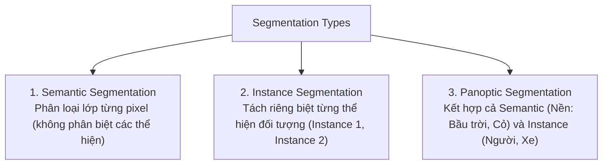
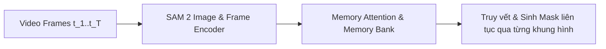

# Chương 4: Phân đoạn Đối tượng & Mô hình SAM (Instance & Semantic Segmentation & SAM)

---

## 1. Các Dạng Bài toán Phân đoạn (Segmentation Paradigms)

Khác với Bounding Box hình chữ nhật, Phân đoạn (Segmentation) gán nhãn từng **điểm ảnh đơn lẻ (Pixel-level Labeling)**.



---

## 2. Mô hình Mask R-CNN (He et al., Meta AI)

Mask R-CNN mở rộng Faster R-CNN bằng cách thêm một nhánh mạng FCN (Fully Convolutional Network) để dự đoán mặt nạ nhị phân (Binary Mask) cho từng Region of Interest (RoI).

### Kỹ thuật RoIAlign:
Khắc phục hiện tượng sương mờ/mất nét do phép làm tròn số nguyên (Quantization) của RoIPooling truyền thống bằng cách sử dụng **Nội suy song tuyến tính (Bilinear Interpolation)** để tính toán chính xác giá trị điểm ảnh tại các tọa độ số thực.

---

## 3. Segment Anything Model (SAM & SAM 2 - Meta AI 2023-2024)

SAM (Kirillov et al., Meta AI) là mô hình nền tảng (Foundation Model) đầu tiên giải quyết triệt để bài toán Phân đoạn đối tượng theo cơ chế **Promptable Zero-shot Segmentation**.

```
[ Input Image ] ──────────► [ Heavy ViT Image Encoder ] ────┐
                                                            ├─► [ Fast Mask Decoder ] ──► Predicted Masks
[ Prompts (Points/Box/Text) ] ──► [ Prompt Encoder ] ───────┘
```

### 3.1. Cấu trúc 3 Thành phần của SAM:
1. **Heavy Image Encoder (ViT-H / ViT-L):** Trích xuất ma trận đặc trưng ảnh 2D sẵn (Image Embedding). Bước này chỉ chạy 1 lần duy nhất cho mỗi bức ảnh.
2. **Flexible Prompt Encoder:** Mã hóa các gợi ý người dùng (Points, Bounding Boxes, Free-form Text, Mask Prompts).
3. **Fast Lightweight Mask Decoder:** Kết hợp Image Embedding và Prompt Embedding qua Cross-Attention để sinh ra mặt nạ Segmentation trong thời gian cực nhanh ($< 50 \text{ ms}$).

---

### 3.2. SAM 2: Segment Anything in Images and Videos (Meta AI 2024)

SAM 2 mở rộng khả năng phân đoạn đối tượng liên tục trên các đoạn **Video đa khung hình**:



- **Memory Bank:** Lưu trữ các vector ngữ cảnh đặc trưng của đối tượng ở các khung hình quá khứ.
- **Memory Attention:** Cho phép mô hình tự động cập nhật hình dạng đối tượng ngay cả khi đối tượng bị xoay góc, mờ nhòe hoặc tạm thời bị che khuất (Occlusion) rồi xuất hiện lại.
