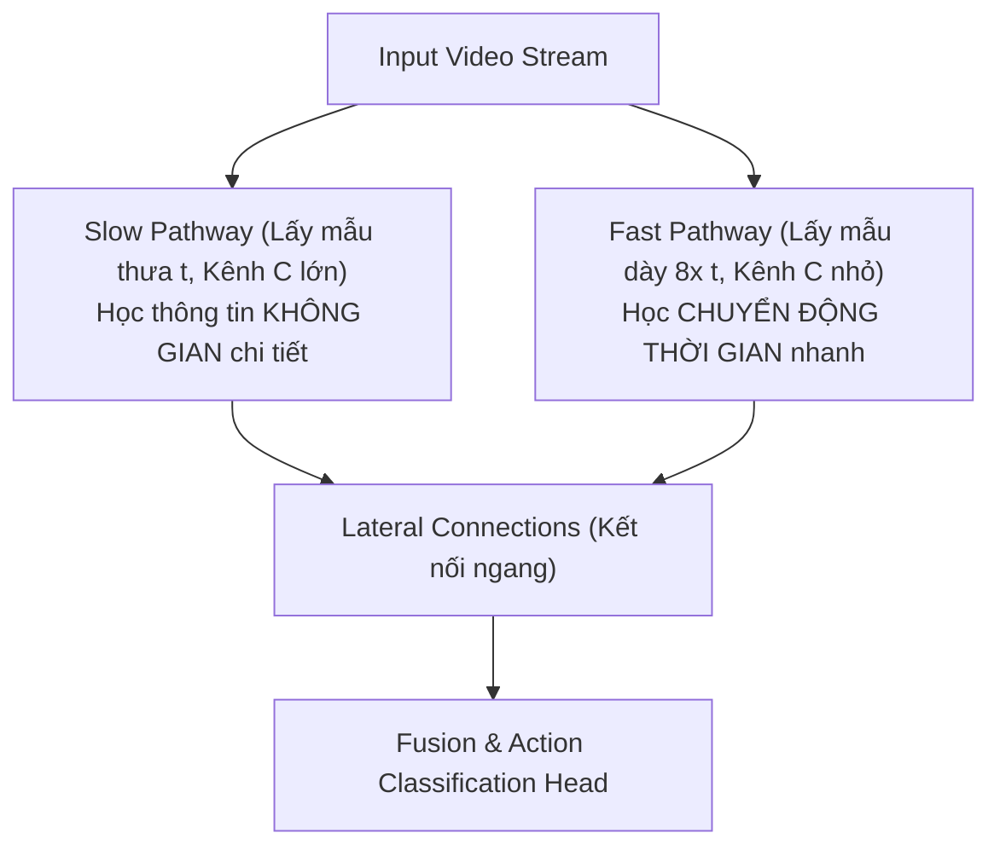

# Chương 5: Phân loại Video & Nhận dạng Hành động (Video Classification & Action Recognition)

---

## 1. Bản chất Tín hiệu Video (Spatiotemporal Signal)

Video không đơn thuần là tập hợp các bức ảnh độc lập, mà là tín hiệu 3D biến đổi theo chiều Không gian ($H, W$) và Thời gian ($T$). Tensor đại diện cho 1 clip video có dạng 5D:

$$\text{Video Tensor Shape: } [B, C, T, H, W]$$

- $B$: Batch size.
- $C$: Kênh màu (RGB = 3).
- $T$: Số lượng khung hình thời gian (Time frames).
- $H, W$: Chiều cao và chiều rộng hình ảnh.

```
Frame 1 (t=1) ──► Frame 2 (t=2) ──► ... ──► Frame T (t=T)
   [H, W]            [H, W]                   [H, W]
  └─────────────────── Không gian (Spatial) + Thời gian (Temporal) ───────────────────┘
```

---

## 2. Chiến lược Lấy mẫu Khung hình Video (Frame Sampling Strategies)

Do hạn chế VRAM GPU, ta không thể đưa toàn bộ 1000 khung hình của một video dài vào mô hình cùng lúc. Các kỹ thuật lấy mẫu bao gồm:

1. **Uniform Sampling (Lấy mẫu đều):** Lấy ngẫu nhiên hoặc cách đều $T$ khung hình (ví dụ $T = 8, 16, 32$) trên toàn bộ chiều dài video.
2. **Temporal Segment Networks (TSN):** Chia video thành $K$ phân đoạn bằng nhau, lấy ngẫu nhiên 1 khung hình từ mỗi phân đoạn.

---

## 3. Kiến trúc 3D CNNs (3D Convolutional Neural Networks)

### 3.1. C3D & I3D (Inflated 3D ConvNet - Carreira & Zisserman)
- **C3D:** Thay thế Kernel $2\text{D} \; (k_h \times k_w)$ bằng Kernel $3\text{D} \; (k_t \times k_h \times k_w)$.
- **I3D:** Nhân bản trọng số 2D CNN pre-trained trên ImageNet sang 3D bằng cách mở rộng Kernel dọc theo trục thời gian và chia nhỏ trọng số $W_{\text{3D}} = \frac{W_{\text{2D}}}{k_t}$.

---

### 3.2. Mạng SlowFast Networks (Meta AI - Feichtenhofer et al., 2019)

SlowFast là kiến trúc 3D CNN SOTA mô phỏng hệ thống thị giác sinh học của con người (gồm tế bào Parvocellular xử lý hình ảnh chậm và tế bào Magnocellular xử lý chuyển động nhanh).



- **Slow Pathway:** Nhận ít khung hình ($T_{\text{slow}} = 4-8$), học đặc trưng cấu trúc hình ảnh sắc nét.
- **Fast Pathway:** Nhận nhiều khung hình ($T_{\text{fast}} = 32-64$), hoạt động ở tốc độ khung hình cao để ghi nhận chuyển động nhanh.

---

## 4. Video Vision Transformers (TimeSformer & ViViT)

### TimeSformer (Divided Space-Time Attention - Meta AI 2021)
Thay vì tính toán Self-Attention đồng thời trên toàn bộ các điểm ảnh không gian và thời gian (gây bùng nổ chi phí tính toán $\mathcal{O}((T \times H \times W)^2)$), **TimeSformer** phân tách Attention thành 2 bước nối tiếp:

```
Input Tokens ──► [ Spatial Attention (chỉ tính trong từng Frame) ] ──► [ Temporal Attention (chỉ tính xuyên suốt các Frames) ] ──► Output
```

1. **Temporal Attention:** Chỉ tính Attention giữa các điểm ảnh ở cùng tọa độ không gian $(x, y)$ qua các bước thời gian $t = 1 \dots T$.
2. **Spatial Attention:** Chỉ tính Attention giữa các điểm ảnh nằm trong cùng 1 khung hình thời gian $t$.
