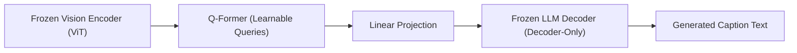

# Chương 6: Mô tả Ảnh bằng Ngôn ngữ Tự nhiên (Image Captioning & BLIP/LLaVA)

---

## 1. Bài toán Image Captioning là gì?

Image Captioning là bài toán đa thức (Cross-Modal / Multimodal Task) kết hợp giữa Máy nhìn (Computer Vision) và Ngôn ngữ Tự nhiên (NLP). Đầu vào là một bức ảnh 2D, và đầu ra là một câu văn bản mô tả lại chính xác nội dung, bối cảnh và hoạt động trong bức ảnh đó.

```
[ Input Image ] ──────────► [ Vision-Language Encoder-Decoder ] ──────────► "Một chú chó golden đang chạy trên bãi cỏ xanh."
```

---

## 2. Kiến trúc Truyền thống vs Kiến trúc VLM Hiện đại

| Đặc trưng | Kiến trúc Truyền thống (2015 - 2020) | Kiến trúc VLM SOTA (2023 - Nay) |
| :--- | :--- | :--- |
| **Vision Encoder** | CNN (ResNet, InceptionV3) | Vision Transformer (CLIP ViT-L/14, EVA-CLIP) |
| **Bridge / Projection** | Spatial Attention Layer | Q-Former / Linear MLP Projection |
| **Text Decoder** | LSTM / GRU | Large Language Model (LLaMA 3, Qwen 2.5, Vicuna) |
| **Chất lượng** | Khô cứng, dễ bị lặp từ | Tự nhiên, hiểu ngữ cảnh phức tạp và phong phú |

---

## 3. Kiến trúc BLIP-2 & Q-Former (Salesforce 2023)

BLIP-2 (Li et al., 2023) giải quyết bài toán kết nối Vision Encoder đóng đông và LLM đóng đông bằng một module trung gian gọi là **Q-Former (Querying Transformer)**.



### Vai trò của Q-Former:
1. Nhận đầu vào là một số lượng cố định các **Learned Query Tokens** (ví dụ 32 tokens).
2. Tương tác với các đặc trưng ảnh thông qua các lớp Cross-Attention.
3. Nén dữ liệu ảnh thành 32 vector có kích thước cố định để đưa sang LLM đọc mà không làm quá tải ngữ cảnh của LLM.

---

## 4. Kiến trúc LLaVA (Large Language and Vision Assistant - Liu et al., 2023)

LLaVA là kiến trúc đơn giản nhưng cực kỳ hiệu quả, mở đường cho kỷ nguyên Vision-Language LLMs mở.

```
Image ──► [ Vision Encoder: CLIP ViT-L/14 ] ──► Visual Tokens Z_v
                                                     │
                                                     ▼
                                          [ Projection Matrix W ]
                                                     │
                                                     ▼
Prompt Text ──► [ Language Tokenizer ] ───────► Word Tokens H_q ──► [ LLM (LLaMA / Qwen) ] ──► Generated Response
```

### Công thức Chiếu Tuyến tính (Projection Matrix $W$):
LLaVA sử dụng ma trận chiếu tuyến tính $W$ để biến đổi các vector đặc trưng ảnh $Z_v$ từ Vision Encoder về cùng chiều không gian biểu diễn $H_v$ của LLM:

$$H_v = Z_v \cdot W$$

Chuỗi token đưa vào LLM có dạng ghép nối: $[H_v \,;\, H_q]$ (Tokens Ảnh đứng trước, Tokens Văn bản đứng sau).
