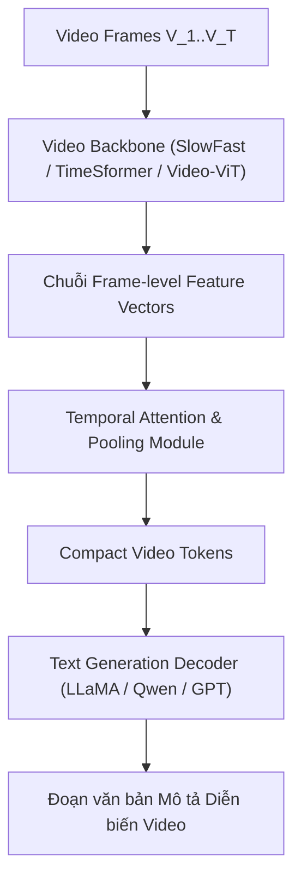

# Chương 7: Mô tả Video bằng Ngôn ngữ Tự nhiên (Video Captioning Architecture)

---

## 1. Bài toán Video Captioning

Khác với Image Captioning (chỉ mô tả 1 khoảnh khắc tĩnh), **Video Captioning** yêu cầu mô hình phải hiểu toàn bộ **diễn biến theo thời gian (Temporal Progression)** của chuỗi hành động diễn ra trong video.

```
Input Video Stream (10s) ──► [ Video Encoder + Temporal Pooling ] ──► [ Text Decoder ] ──► "Người nam giới chuẩn bị chạy, tăng tốc và nhảy qua xà ngang."
```

---

## 2. Kiến trúc Tổng quan của Hệ thống Video Captioning



---

## 3. Các Phương pháp Nén Thông tin Thời gian (Temporal Aggregation Methods)

Để đưa chuỗi $T$ khung hình vào LLM mà không làm bùng nổ số lượng tokens:

1. **Mean/Max Temporal Pooling:** Lấy trung bình vector đặc trưng của tất cả các khung hình dọc theo trục thời gian $T$.
2. **Temporal Attention Pooling:** Sử dụng cơ chế Cross-Attention để tìm ra các khung hình chứa hành động chính (Keyframes).
3. **Video-LLaVA Architecture (Lin et al., 2023):** Sử dụng Spatiotemporal Positional Encodings để liên kết thống nhất cả tokens ảnh và tokens video trong một không gian đa thức chung.
