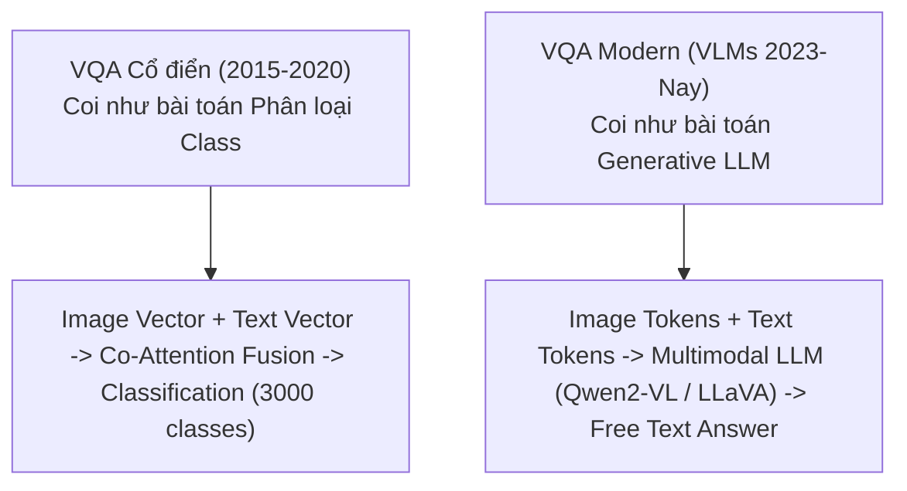

# Chương 8: Hỏi Đáp trên Hình ảnh (Image Visual Question Answering - Image VQA)

---

## 1. Bài toán Image VQA là gì?

Image VQA (Visual Question Answering) nhận đầu vào là **1 bức ảnh $I$** và **1 câu hỏi tự do bằng văn bản $Q$**, mô hình phải phân tích hình ảnh và đưa ra câu trả lời chính xác $A$.

```
Image: [Bức ảnh người đàn ông đứng cạnh chiếc xe máy màu đỏ]
Question: "Chiếc xe máy trong ảnh có màu gì?"
Answer: "Màu đỏ"
```

---

## 2. Kiến trúc VQA Cổ điển vs VQA Hiện đại (Vision-Language Models)



---

## 3. Kiến trúc VLM SOTA cho Image VQA (Qwen2-VL & LLaVA)

Các mô hình VLM hiện đại nhất (như Qwen2-VL, LLaVA 1.6) xử lý Image VQA theo quy trình:

1. **Vision Encoder (ViT):** Trích xuất ma trận các vector đặc trưng không gian $Z_v$.
2. **Dynamic Resolution Handling:** Cho phép biến đổi độ phân giải ảnh linh hoạt (Naive Dynamic Resolution) để không làm mờ các chi tiết chữ nhỏ hoặc vật thể nhỏ trong ảnh.
3. **Multimodal Fusion & Autoregressive Decoding:** Ghép nối chuỗi `[Image Tokens] [Question Tokens]` và đưa vào LLM để sinh ra câu trả lời tự do.
