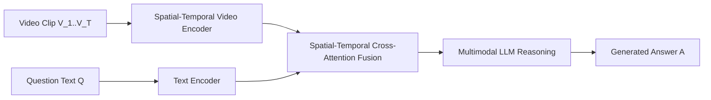

# Chương 9: Hỏi Đáp trên Video (Video Visual Question Answering - Video VQA)

---

## 1. Bài toán Video VQA & Suy luận Không thời gian

Video VQA mở rộng Image VQA lên môi trường Video đa khung hình. Mô hình phải trả lời các câu hỏi đòi hỏi **Suy luận Thời gian (Temporal Reasoning)** và **Quan hệ Nhân quả (Causal Reasoning)**:

```
Video: [Clip 30s ghi cảnh người thợ sửa chữa xe đạp]
Question: "Người thợ đã dùng dụng cụ gì trước khi tháo bánh xe?"
Answer: "Cờ-lê (Wrench)"
```

---

## 2. Kiến trúc Xử lý Suy luận Không thời gian trong Video VQA



### Các Dạng Câu hỏi Đặc trưng trong Video VQA:
1. **Descriptive:** *"Nhóm người đang làm gì ở giữa video?"*
2. **Temporal Order (Thứ tự Thời gian):** *"Hành động A xảy ra trước hay sau hành động B?"*
3. **Causal Reasoning (Nhân quả):** *"Tại sao chiếc xe lại bị trượt khỏi đường băng?"*
4. **Counterfactual:** *"Nếu người điều khiển không phanh lại thì chuyện gì sẽ xảy ra?"*
