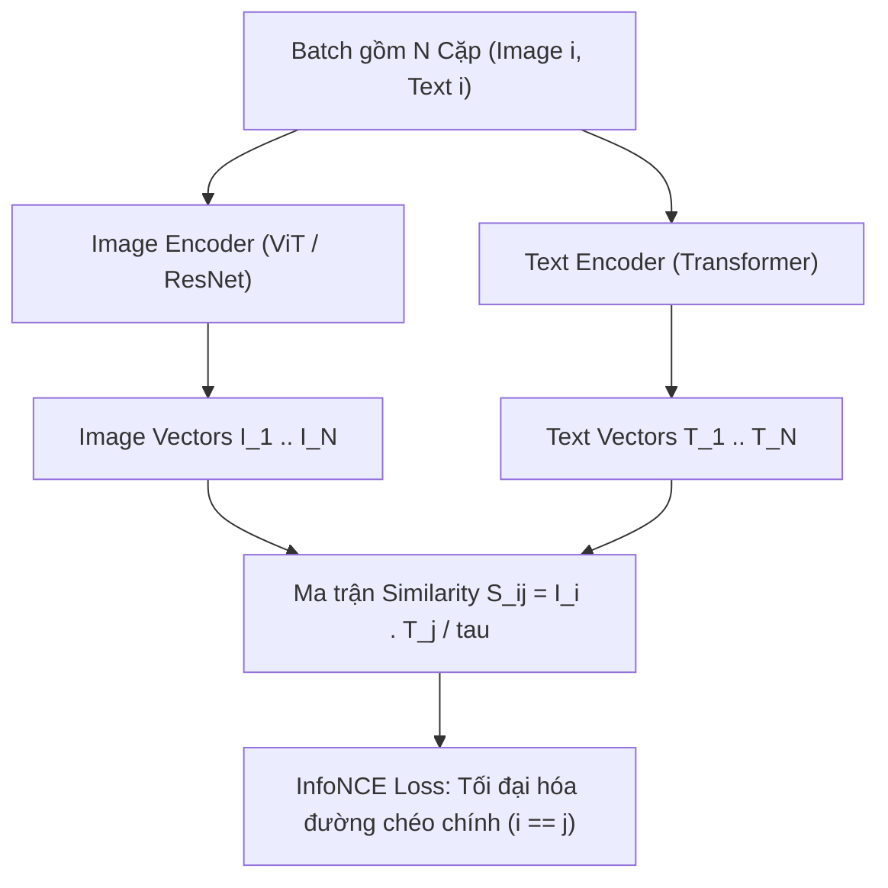

# Chương 10: Nền tảng Toán học: Multi-Modal Alignment (CLIP & Contrastive Learning)

---

## 1. Căn chỉnh Đa thức Ảnh - Văn bản (Multi-Modal Alignment)

Để các mô hình AI có thể hiểu đồng thời cả Hình ảnh (Vision) và Văn bản (Language), ta cần chiếu cả hai loại dữ liệu này về cùng một **Không gian Vector biểu diễn chung (Shared Embedding Space)**.

---

## 2. Mô hình CLIP (OpenAI - Radford et al., 2021)

CLIP (Contrastive Language-Image Pre-training) được tiền huấn luyện trên 400 triệu cặp `(Ảnh, Câu mô tả)` lấy từ Internet bằng phương pháp **Học Tương phản (Contrastive Learning)**.



---

### 2.1. Hàm Mất mát InfoNCE Loss trong CLIP:

Với một Batch gồm $N$ cặp `(Image, Text)`:
- Có $N$ cặp khớp đúng (Positive pairs $(I_i, T_i)$ nằm trên đường chéo chính).
- Có $N^2 - N$ cặp khớp sai (Negative pairs $(I_i, T_j)$ với $i \neq j$).

Hàm mất mát **InfoNCE Loss** được tính hai chiều (Image-to-Text và Text-to-Image):

$$\mathcal{L}_{I \to T} = -\frac{1}{N} \sum_{i=1}^{N} \log \frac{\exp\left( \frac{I_i \cdot T_i}{\tau} \right)}{\sum_{j=1}^{N} \exp\left( \frac{I_i \cdot T_j}{\tau} \right)}$$

$$\mathcal{L}_{T \to I} = -\frac{1}{N} \sum_{j=1}^{N} \log \frac{\exp\left( \frac{T_j \cdot I_j}{\tau} \right)}{\sum_{i=1}^{N} \exp\left( \frac{T_j \cdot I_i}{\tau} \right)}$$

$$\mathcal{L}_{\text{CLIP}} = \frac{\mathcal{L}_{I \to T} + \mathcal{L}_{T \to I}}{2}$$

Trong đó $\tau$ là tham số nhiệt độ (temperature) có thể học được.

---

### 2.2. Khả năng Phân loại Zero-Shot (Zero-Shot Classification)

CLIP cho phép phân loại ảnh vào bất kỳ tập nhãn lớp nào mà **không cần huấn luyện lại mô hình**:

```
Prompt Templates: "a photo of a [dog]", "a photo of a [cat]", "a photo of a [car]"
                      │
                      ▼
               [ Text Encoder ]
                      │
                      ▼
                Text Vectors T
                      │
Image ──► [ Image Encoder ] ──► Image Vector I ──► Cosine Sim(I, T) ──► Softmax ──► Top Class
```

1. Biến đổi danh sách nhãn lớp thành câu prompt: `"a photo of a [label]"`.
2. Đưa các câu prompt qua Text Encoder để thu được các vector $T_1, \dots, T_K$.
3. Đưa ảnh cần phân loại qua Image Encoder để thu được vector $I$.
4. Tính Cosine Similarity giữa $I$ và tất cả $T_k$. Chọn nhãn có điểm tương đồng cao nhất!
