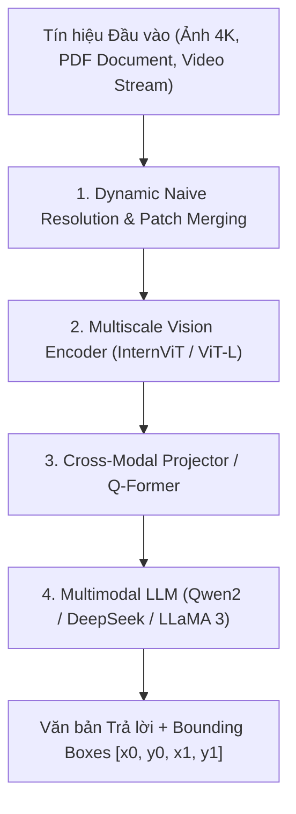

# Chương 11: Mô hình Ngôn ngữ Thị giác Hiện đại (VLM Deep Dive: Qwen2-VL, InternVL 2.5, Molmo & DeepSeek-VL2)

---

## 1. Sự Phát triển của Vision-Language Models (VLMs) Thế hệ Mới

Trong giai đoạn 2024-2026, các mô hình **Vision-Language Models (VLMs)** đã có bước nhảy vọt từ các kiến trúc chiếu tuyến tính đơn giản (như LLaVA ban đầu) sang các hệ thống đa thức có khả năng xử lý **ảnh độ phân giải siêu cao (Dynamic Resolution)**, **đọc tài liệu văn bản siêu nhỏ (Fine-grained Document OCR)** và **định vị đối tượng (Visual Grounding)**.



---

## 2. Kỹ thuật Độ phân giải Động (Dynamic Resolution & Naive Patch Merging)

Các VLM truyền thống ép mọi bức ảnh về kích thước cố định $224 \times 224$ hoặc $336 \times 336$, làm biến dạng tỷ lệ khung hình và nhòe các chi tiết chữ viết nhỏ.

### 2.1. Qwen2-VL Naive Dynamic Resolution Architecture:
- Cho phép nhận ảnh với bất kỳ độ phân giải và tỷ lệ khung hình nào.
- Ảnh được chia thành các mảnh **Patches $14 \times 14$** tùy thuộc độ phân giải thực tế.
- **Visual 3D Rotary Position Embedding (M-RoPE):** Mã hóa vị trí 3D đồng thời cho chiều Cao ($H$), chiều Rộng ($W$) và chiều Thời gian ($T$ của Video).

---

## 3. Các Mô hình VLM SOTA Hàng đầu Hiện nay

### 3.1. Qwen2-VL (Alibaba, 2024)
- **Khả năng:** Hiểu video dài nhiều phút, đọc tài liệu PDF đa trang, định vị Bounding Box của vật thể trong text space.
- **M-RoPE:** Tách vector positional embedding thành 3 thành phần (Temporal, Height, Width) để xử lý liên tục cả Ảnh và Video.

### 3.2. InternVL 2.5 (OpenGVLab, 2024)
- Sử dụng Vision Encoder mạnh mẽ **InternViT-6B** kết hợp với LLM **InternLM2.5 / LLaMA-3**.
- Sử dụng kỹ thuật **Dynamic High-Resolution Tile Crop**: Tự động cắt ảnh lớn thành các tấm gạch nhỏ (tiles $448 \times 448$) và giữ lại một ảnh thumbnail tổng thể để trích xuất cả thông tin toàn cục lẫn cục bộ.

### 3.3. Molmo (Allen Institute for AI - AI2, 2024)
- Mô hình VLM mã nguồn mở có khả năng **Visual Pointing**: Chỉ ra vị trí chính xác của vật thể bằng tọa độ $x, y$ điểm tâm thay vì Bounding Box, giúp tương tác tự nhiên trên màn hình giao diện UI.

---

## 4. Bài toán Visual Grounding trong VLM

Visual Grounding yêu cầu VLM không chỉ mô tả bức ảnh mà phải xác định vị trí tọa độ của đối tượng được nhắc tới trong câu hỏi:

```
User: "Hãy tìm vị trí của chiếc máy tính bảng trên bàn."
VLM Output: "Chiếc máy tính bảng nằm ở vị trí <box>(320, 450, 580, 620)</box>."
```
