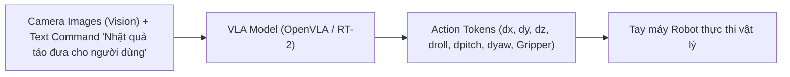

# Chương 12: Mô hình Thị giác-Ngôn ngữ-Hành động cho AI Nhập thể (VLA Models & Embodied AI)

---

## 1. Tầm nhìn Embodied AI & Khái niệm VLA Models

Trong khi các mô hình VLM truyền thống dừng lại ở việc đọc ảnh và trả lời bằng văn bản, các mô hình **Vision-Language-Action (VLA)** kết nối trực tiếp suy luận trí tuệ nhân tạo với **Thế giới Vật lý (Embodied AI / Robotics)**.

Mô hình VLA nhận đầu vào là **Ảnh từ camera quan sát của Robot** và **Câu lệnh điều khiển bằng ngôn ngữ tự nhiên**, sau đó sinh ra trực tiếp **Tín hiệu Hành động Điều khiển khớp cơ học của Robot (Robot Action Controls)**.



---

## 2. Biểu diễn Không gian Hành động Robot (Robot Action Space)

Một hành động điều khiển tay máy robot tại bước thời gian $t$ thường được biểu diễn dưới dạng vector 7 chiều:

$$a_t = \left[ \Delta x, \, \Delta y, \, \Delta z, \, \Delta \text{roll}, \, \Delta \text{pitch}, \, \Delta \text{yaw}, \, \text{Gripper} \right]$$

- $\Delta x, \Delta y, \Delta z$: Độ dịch chuyển tọa độ 3D của đầu gắp (End-effector).
- $\Delta \text{roll}, \Delta \text{pitch}, \Delta \text{yaw}$: Góc xoay 3D của cổ tay máy.
- $\text{Gripper} \in \{0, 1\}$: Trạng thái Đóng (0) hoặc Mở (1) của kẹp bàn tay.

---

## 3. Các Mô hình VLA SOTA Hàng đầu

### 3.1. RT-2 (Vision-Language-Action - Google DeepMind)
RT-2 biểu diễn các giá trị hành động số thực $\Delta x \in [-1.0, 1.0]$ thành **256 Action Tokens nhị phân** trong từ điển của LLM. Nhờ đó, PaLM-e / PaLI-X có thể được fine-tune đồng thời vừa giải toán, vừa mô tả ảnh, vừa sinh lệnh điều khiển robot!

```
Text Input: "Pick up the yellow banana"
VLA Token Output: "[210, 128, 95, 130, 128, 128, 0]"  (Tương ứng với vector hành động robot)
```

---

### 3.2. OpenVLA (Stanford University, 2024 - 7B Open-Source VLA)
OpenVLA là mô hình VLA mã nguồn mở 7B parameters được xây dựng trên nền tảng **Prismatic VLM** và **LLaMA-2**:
- Được huấn luyện trên **Open X-Embodiment Dataset** (gồm hơn 1,000,000 quỹ đạo robot từ 22 loại robot thực tế khác nhau).
- Cho phép nén 4-bit / 8-bit (QLoRA) để chạy điều khiển robot thời gian thực ($> 10 \text{ Hz}$) trên một card đồ họa GPU thương mại.

---

### 3.3. Action Chunking Transformer (ACT) & Octo Model
Để tránh hiện tượng robot bị rung lắc (jittering) khi chỉ dự đoán từng hành động ngắn 1-step, **ACT** dự đoán một **Chuỗi khối hành động (Action Chunking)** gồm $k = 10 \dots 50$ bước thời gian liên tục trong tương lai:

$$\hat{A}_t = \left( a_t, a_{t+1}, a_{t+2}, \dots, a_{t+k-1} \right)$$
