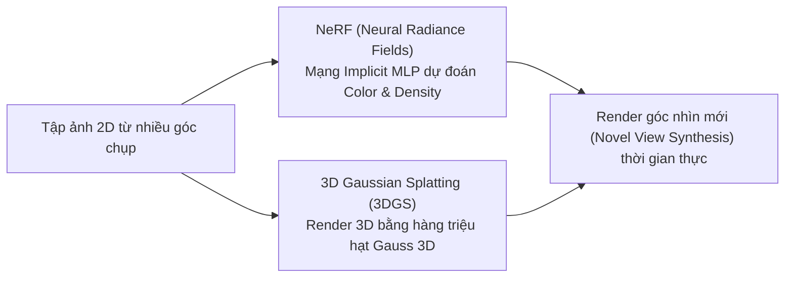

# Chương 13: Thị giác 3D & Mô hình Sinh Video (3D Vision, 3D Gaussian Splatting & Video Diffusion)

---

## 1. Sự Phát triển của Thị giác 3D (3D Computer Vision)

Thị giác 3D chuyển đổi các bức ảnh 2D tĩnh thành mô hình không gian 3D tương tác liên tục:

---

## 2. 3D Gaussian Splatting (3DGS - Kerbl et al., SIGGRAPH 2023)

Khác với NeRF tốn hàng giờ tính toán ray-marching, **3D Gaussian Splatting (3DGS)** biểu diễn cảnh 3D bằng tập hợp các **Hạt 3D Gaussian Ellipsoids ($\mu, \Sigma, c, \alpha$)**:

$$\Sigma = R S S^T R^T$$

- $\mu \in \mathbb{R}^3$: Vị trí tâm điểm 3D.
- $\Sigma \in \mathbb{R}^{3 \times 3}$: Ma trận hiệp phương sai quy định độ xoay $R$ và độ giãn $S$ của hạt 3D.
- $c \in \mathbb{R}^k$: Màu sắc theo hàm Spherical Harmonics.
- $\alpha \in [0, 1]$: Độ trong suốt (Opacity).

**Ưu điểm:** Cho phép Render cảnh 3D với chất lượng cực nét ở tốc độ **$> 100 \text{ FPS}$** trên GPU thông thường!

---

## 3. Các Mô hình Sinh Video SOTA (Video Diffusion Models)

Các mô hình sinh Video tiên tiến nhất (như Sora, Runway Gen-3, CogVideoX, Stable Video Diffusion) mở rộng kiến trúc **Diffusion Transformers (DiT)** lên chuỗi khung hình Không thời gian (Spatiotemporal Latent Space).
