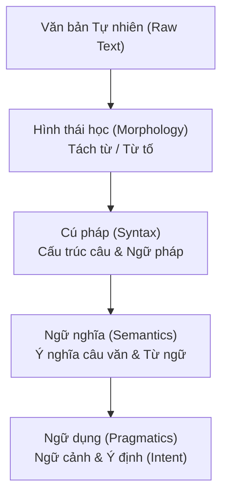
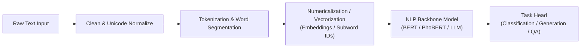

# Chương 1: Bản chất Ngôn ngữ & Nền tảng Xử lý Ngôn ngữ Tự nhiên (NLP Fundamentals)

---

## 1. Ngôn ngữ Tự nhiên là gì? (What is Natural Language Processing?)

**Xử lý Ngôn ngữ Tự nhiên (Natural Language Processing - NLP)** là một nhánh giao thoa giữa Khoa học Máy tính, Trí tuệ Nhân tạo (AI) và Ngôn ngữ học (Linguistics). Mục tiêu của NLP là giúp máy tính có khả năng đọc, hiểu, phân tích, dịch thuật và sinh ra ngôn ngữ con người một cách tự nhiên và chính xác.



---

## 2. Các Cấp độ Phân tích Ngôn ngữ trong NLP

1. **Hình thái học (Morphology):** Cấu trúc của từ. Một từ có thể được cấu tạo từ các **từ tố (morphemes)** gồm căn tố (root), tiền tố (prefix) và hậu tố (suffix).
   - *Ví dụ (Tiếng Anh):* $\text{un-believe-able} \implies \text{Unbelievable}$.
2. **Cú pháp (Syntax):** Quy tắc kết hợp các từ thành câu đúng ngữ pháp. Phân tích cú pháp tạo ra **Cây cú pháp (Parse Tree)**.
3. **Ngữ nghĩa (Semantics):** Ý nghĩa thực sự của từ và câu không phụ thuộc vào ngữ cảnh.
4. **Ngữ dụng (Pragmatics):** Ý nghĩa của câu trong một ngữ cảnh giao tiếp cụ thể (ví dụ câu *"Bạn có thể mở cửa giúp tôi không?"* về mặt ngữ nghĩa là câu hỏi khả năng, nhưng về mặt ngữ dụng là một **lời yêu cầu**).

---

## 3. Các Thử thách Cốt lõi trong NLP

### 3.1. Tính Nhập nhằng (Ambiguity)
Một từ hoặc một câu có thể mang nhiều ý nghĩa hoàn toàn khác nhau tùy thuộc vào vị trí và ngữ cảnh:
- **Nhập nhằng từ vựng (Lexical Ambiguity):** Từ "bank" trong tiếng Anh vừa có nghĩa là *ngân hàng*, vừa có nghĩa là *bờ sông*.
- **Nhập nhằng cú pháp (Syntactic Ambiguity):** Câu *"I saw the man with a telescope"* có thể hiểu là:
  - Tôi dùng kính thiên văn để nhìn người đàn ông.
  - Tôi nhìn người đàn ông đang cầm kính thiên văn.

### 3.2. Hiện tượng Out-of-Vocabulary (OOV - Từ ngoài từ điển)
Trong thực tế, người dùng liên tục tạo ra các từ mới, từ lóng (slang), tên riêng, lỗi chính tả. Nếu mô hình chỉ học từ vựng cố định, nó sẽ không thể xử lý các từ OOV này.

---

## 4. Thử thách Đặc thù của Xử lý Ngôn ngữ Tiếng Việt (Vietnamese NLP)

Tiếng Việt là ngôn ngữ **đơn lập (Isolating Language)**, có những đặc trưng hoàn toàn khác biệt so với các ngôn ngữ hòa kết như tiếng Anh hay tiếng Pháp:

```
Tiếng Anh: Space = Word boundary ("Natural Language Processing" -> 3 words)
Tiếng Việt: Space = Syllable boundary ("Xử lý ngôn ngữ tự nhiên" -> 5 tiếng / 3 từ)
```

### 4.1. Thử thách Tách từ (Vietnamese Word Segmentation)
Khoảng trắng trong tiếng Việt chỉ là ranh giới giữa các **tiếng (syllables)**, chứ không phải ranh giới giữa các **từ (words)**.
- **Từ đơn (Single-syllable word):** *học, sách, bàn, xe*.
- **Từ ghép / Từ phức (Compound word):** *học sinh, sinh học, thị trường, chợ Bến Thành*.

> [!IMPORTANT]
> **Hiện tượng Nhập nhằng Ranh giới Từ:**
> Câu kinh điển: **"Học sinh học sinh học."**
> - Cách tách 1: **"Học sinh / học / sinh học."** (Học sinh đang học môn sinh học $\rightarrow$ ĐÚNG).
> - Cách tách 2: **"Học / sinh học / sinh học."** (Học môn sinh học rồi lại sinh học $\rightarrow$ SAI).

### 4.2. Dấu Thanh & Chuẩn hóa Unicode Tiếng Việt
Tiếng Việt có **6 thanh điệu** (Ngang, Huyền, Hỏi, Ngã, Sắc, Nặng). Khi xử lý dữ liệu văn bản thực tế, hiện tượng sai lệch mã hóa Unicode xảy ra rất phổ biến:
- **Chuẩn hóa Tổ hợp (NFD) vs Dựng sẵn (NFC):** Ký tự `à` có thể biểu diễn bằng 1 code point `U+00E0` (NFC) hoặc 2 code points `a` + `U+0300` (NFD).
- **Vị trí đặt dấu thanh:** `hòa` (chuẩn mới) vs `hoà` (chuẩn cũ). Toàn bộ văn bản phải được quy chuẩn hóa về định dạng **Unicode NFC chuẩn** trước khi huấn luyện!

---

## 5. Kiến trúc Tổng quan của một Hệ thống NLP Pipeline chuẩn Production


