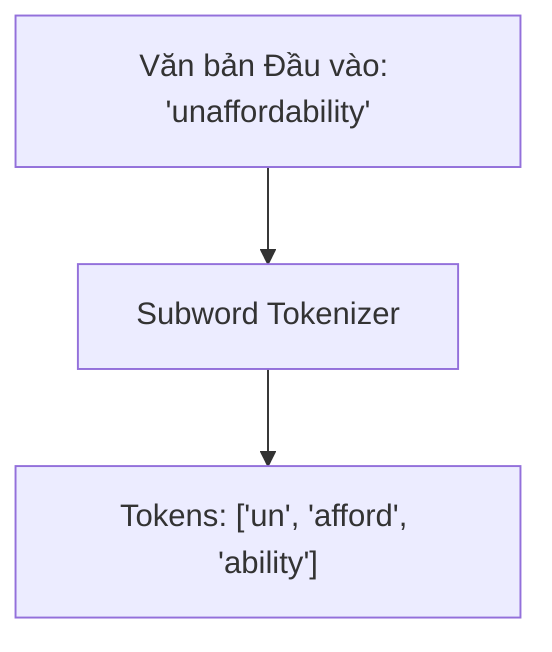

# Chương 2: Tiền xử lý Văn bản & Thuật toán Tách từ (Text Preprocessing & Tokenization)

---

> [!IMPORTANT]
> 📌 **TỔNG QUAN & VAI TRÒ TRONG PIPELINE AI:**
> Mô hình ngôn ngữ (như Transformer, BERT, GPT-4) hoàn toàn không biết đọc chữ cái hay ký tự từ vựng của con người — các mạng nơ-ron chỉ hoạt động trên các con số và vector toán học.
> **Mục tiêu của Chương 2** là giải thích bước chuyển đổi cầu nối: **Tokenization (Tách từ & Chuyển văn bản thành mã số Token IDs)**.
> - **Đầu vào:** Chuỗi văn bản chữ viết thô (Ví dụ: `"Trường Đại học Bách Khoa"`).
> - **Xử lý:** Chuẩn hóa Unicode $\to$ Tách từ subwords (BPE / WordPiece / Unigram).
> - **Đầu ra:** Dãy số nguyên đại diện Token IDs (Ví dụ: `[102, 451, 8920, 14]`).
> - **Vai trò:** Đây là bước mở đầu bắt buộc trong mọi pipeline NLP. Nếu không có Tokenization, không thể nạp văn bản vào Embedding layer hay Transformer!

---

## 1. Tiền xử lý & Chuẩn hóa Văn bản (Text Cleaning & Normalization)

Dữ liệu văn bản thô từ Internet (Social media, web scraping) chứa rất nhiều nhiễu như thẻ HTML, URL, ký tự ẩn, lỗi phông chữ và mã hóa Unicode không nhất quán.

### 1.1. Quy trình Chuẩn hóa Unicode Tiếng Việt
Trong tiếng Việt, một từ có chứa dấu (như `ệ`) có thể được lưu trữ dưới 2 hình thức mã hóa Unicode khác nhau:
- **NFC (Canonical Decomposition, followed by Canonical Composition):** Ký tự dựng sẵn (ví dụ: `ệ` = `U+1EC7`).
- **NFD (Canonical Decomposition):** Ký tự tổ hợp (ví dụ: `ê` + `_̣` = `U+00EA` + `U+0323`).

#### Code Python chuẩn hóa Unicode NFC & Loại bỏ HTML/URL:

```python
import re
import unicodedata

def clean_and_normalize_text(text: str) -> str:
    """Chuẩn hóa văn bản về Unicode NFC, xóa HTML, URL và khoảng trắng thừa."""
    if not text:
        return ""
    
    # 1. Quy chuẩn hóa về Unicode NFC
    text = unicodedata.normalize("NFC", text)
    
    # 2. Xóa các thẻ HTML
    text = re.sub(r"<[^>]+>", " ", text)
    
    # 3. Xóa các liên kết URL
    text = re.sub(r"https?://\S+|www\.\S+", " ", text)
    
    # 4. Gom nhiều khoảng trắng liên tiếp thành 1 khoảng trắng
    text = re.sub(r"\s+", " ", text).strip()
    
    return text
```

---

### 1.2. NLTK & spaCy Utilities (Stemming, Lemmatization, POS Tagging, Dependency Parsing)

#### 1. NLTK (Natural Language Toolkit):
- **Stemming (Chặt gốc từ):** Sử dụng `PorterStemmer` cắt bỏ phần đuôi từ một cách thô bạo (ví dụ: *running* $\rightarrow$ *run*).
- **Lemmatization (Đưa về từ nguyên mẫu):** Sử dụng `WordNetLemmatizer` để biến đổi từ về dạng gốc từ điển chính xác.
- **POS Tagging (Gán nhãn Từ loại):** Phân loại từ thành danh từ (NN), động từ (VB), tính từ (JJ), trạng từ (RB).

```python
import nltk
from nltk.tokenize import word_tokenize
from nltk.stem import PorterStemmer, WordNetLemmatizer
from nltk import pos_tag

text = "The quick brown foxes were running very fast."
tokens = word_tokenize(text)

# Stemming & Lemmatization
stemmer = PorterStemmer()
lemmatizer = WordNetLemmatizer()

stems = [stemmer.stem(w) for w in tokens]
lemmas = [lemmatizer.lemmatize(w, pos="v") for w in tokens]
pos_tags = pos_tag(tokens)

print("Tokens:", tokens)
print("Stems:", stems)
print("Lemmas:", lemmas)
print("POS Tags:", pos_tags)
```

#### 2. spaCy Pipeline (Modern Industrial NLP):
spaCy cung cấp pipeline tốc độ cao bằng C/Cython hỗ trợ **Dependency Parsing (Phân tích cú pháp phụ thuộc)** và **NER (Nhận dạng thực thể tên)**:

```python
import spacy

nlp = spacy.load("en_core_web_sm")
doc = nlp("Apple is buying a startup in London for $1 billion.")

# Token level info: Lemma, POS, Dependency head
for token in doc:
    print(f"{token.text:12} -> Lemma: {token.lemma_:10} | POS: {token.pos_:6} | Dep: {token.dep_:8} | Head: {token.head.text}")

# Named Entities
for ent in doc.ents:
    print(f"Entity: {ent.text:15} | Label: {ent.label_}")
```

---

## 2. Tách từ Tiếng Việt (Vietnamese Word Segmentation)

Vì tiếng Việt không dùng khoảng trắng để phân định từ ghép, bước tách từ ghép (Word Segmentation) là bắt buộc trước khi đưa vào các mô hình học máy truyền thống.

### 2.1. Sử dụng thư viện `PyVi` & `Underthesea`:

Các từ ghép sau khi tách sẽ được nối bằng dấu gạch dưới `_`:
- Văn bản gốc: `"Học sinh học môn sinh học tại Bến Thành."`
- Sau tách từ: `"Học_sinh học môn sinh_học tại Bến_Thành ."`

```python
from pyvi import ViTokenizer
from underthesea import word_tokenize

text = "Học sinh học môn sinh học tại Trường Đại học Bách Khoa."

# Tách từ bằng PyVi
pyvi_tokens = ViTokenizer.tokenize(text)
print("PyVi Result:", pyvi_tokens)

# Tách từ bằng Underthesea
uts_tokens = word_tokenize(text, format="text")
print("Underthesea Result:", uts_tokens)
```

---

## 3. Các Thuật toán Tách từ phụ (Subword Tokenization Algorithms)

Đối với các mô hình Deep Learning hiện đại (như Transformer, BERT, GPT), người ta sử dụng **Subword Tokenization** để giải quyết vấn đề OOV và hạn chế dung lượng từ điển.



---

### 3.1. Byte-Pair Encoding (BPE - Sennrich et al. / OpenAI)

BPE là thuật toán nén n-gram phổ biến nhất được sử dụng trong GPT-2, GPT-3, RoBERTa và LLaMA.
- Đếm tần suất cặp ký tự bi-gram xuất hiện nhiều nhất và gộp (merge) dần dần.

---

### 3.2. WordPiece Tokenization (Wu et al., Google BERT)

WordPiece tương tự BPE nhưng chọn cặp token làm **tăng xác suất Likelihood của mô hình ngôn ngữ cao nhất** khi được gộp lại.
- Ký hiệu subword đứng đằng sau trong WordPiece được đánh dấu bằng tiền tố **`##`**.
- Ví dụ từ `unaffordable` được tách thành `["un", "afford", "##able"]`.

#### Code Python minh họa WordPiece Tokenizer từ đầu (`src/models/wordpiece_bpe_demo.py`):

```python
from src.models.wordpiece_bpe_demo import WordPieceTokenizerFromScratch

vocab = {"un", "afford", "##able", "##ing", "[UNK]"}
tokenizer = WordPieceTokenizerFromScratch(vocab=vocab)

word_tokens = tokenizer.tokenize_word("unaffordable")
print("WordPiece Tokens:", word_tokens)
# Output: ['un', 'afford', '##able']
```

---

### 3.3. Unigram Language Model (Kudo / SentencePiece)

Trái ngược với BPE (đi từ các ký tự nhỏ nhất gộp lại), **Unigram** khởi tạo một từ điển cực lớn chứa tất cả các chuỗi con khả dĩ, sau đó tỉa dần (prune) các token sao cho hàm mất mát Unigram Language Model thay đổi ít nhất.
