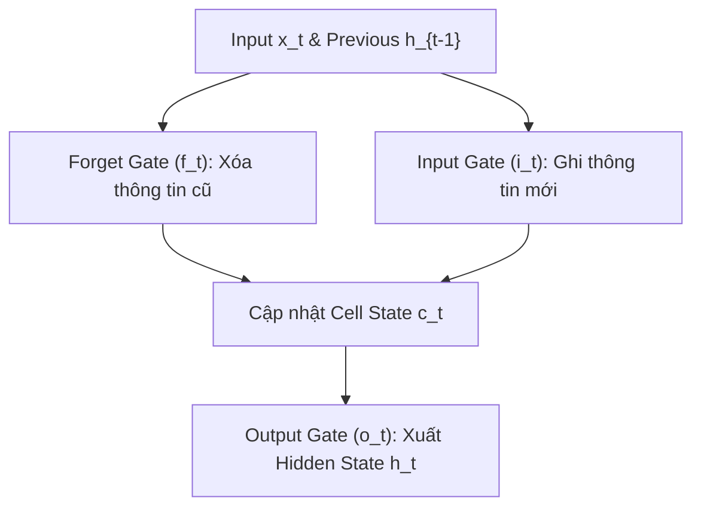

# Chương 4: Mô hình Chuỗi RNN, LSTM, GRU & Cơ chế Attention Cổ điển (Sequential Models)

---

## 1. Mạng nơ-ron Hồi quy (Recurrent Neural Network - RNN)

Văn bản là dữ liệu chuỗi (Sequential Data), trong đó thứ tự của các từ quyết định ý nghĩa của toàn bộ câu. Khác với mạng Feed-Forward truyền thống, mạng **RNN** có bộ nhớ trong (Hidden State $h_t$) để lưu trữ thông tin của các từ xuất hiện trước đó.

```
       x_1         x_2                 x_T
        │           │                   │
        ▼           ▼                   ▼
     ┌─────┐     ┌─────┐             ┌─────┐
───► │ RNN │ ──► │ RNN │ ──► ... ──► │ RNN │ ──► Output
     └─────┘     └─────┘             └─────┘
      h_1         h_2                 h_T
```

### 1.1. Công thức Lan truyền RNN:
$$h_t = \tanh(W_{hh} h_{t-1} + W_{xh} x_t + b_h)$$
$$\hat{y}_t = \text{softmax}(W_{hy} h_t + b_y)$$

### 1.2. Hiện tượng Biến mất Gradient (Vanishing Gradient Problem)
Khi chuỗi văn bản quá dài ($T > 20-30$ từ), thuật toán lan truyền ngược theo thời gian (BPTT - Backpropagation Through Time) bị triệt tiêu đạo hàm $\frac{\partial h_t}{\partial h_1} \approx 0$. Mạng RNN quên mất thông tin ở đầu câu khi đọc tới cuối câu!

---

## 2. Mô hình LSTM (Long Short-Term Memory) & GRU (Gated Recurrent Unit)

LSTM (Hochreiter & Schmidhuber, 1997) giải quyết triệt tiêu gradient bằng cách thêm đường truyền **Cell State ($c_t$)** đóng vai trò như một đường cao tốc thông tin xuyên suốt chuỗi thời gian, được điều khiển bởi 3 cổng (Gates).



### 2.1. Các Công thức của LSTM:

1. **Forget Gate ($f_t$):** Quyết định bao nhiêu % thông tin từ Cell State cũ $c_{t-1}$ sẽ bị xóa bỏ:
   $$f_t = \sigma(W_f \cdot [h_{t-1}, x_t] + b_f)$$

2. **Input Gate ($i_t$ & $\tilde{c}_t$):** Quyết định thông tin mới nào được nạp vào Cell State:
   $$i_t = \sigma(W_i \cdot [h_{t-1}, x_t] + b_i)$$
   $$\tilde{c}_t = \tanh(W_c \cdot [h_{t-1}, x_t] + b_c)$$

3. **Cập nhật Cell State ($c_t$):**
   $$c_t = f_t \odot c_{t-1} + i_t \odot \tilde{c}_t$$

4. **Output Gate ($o_t$) & Hidden State ($h_t$):**
   $$o_t = \sigma(W_o \cdot [h_{t-1}, x_t] + b_o)$$
   $$h_t = o_t \odot \tanh(c_t)$$

---

### 2.2. Gated Recurrent Unit (GRU - Cho et al., 2014)
GRU là phiên bản đơn giản hóa của LSTM, gộp Cell State và Hidden State thành 1 state duy nhất $h_t$, chỉ sử dụng 2 cổng: **Reset Gate ($r_t$)** và **Update Gate ($z_t$)**, giúp giảm số lượng tham số và tăng tốc độ huấn luyện.

---

### 2.3. Bi-LSTM (Bidirectional LSTM)
Đọc câu theo cả 2 hướng:
- **Forward LSTM ($\vec{h}_t$):** Đọc từ Trái sang Phải.
- **Backward LSTM ($\overleftarrow{h}_t$):** Đọc từ Phải sang Trái.
Vector biểu diễn cuối cùng tại bước $t$: $h_t = [\vec{h}_t \,;\, \overleftarrow{h}_t]$. Bi-LSTM nắm bắt trọn vẹn cả ngữ cảnh trước và sau của một từ.

---

## 3. Kiến trúc Seq2Seq & Cơ chế Attention Mechanism Cổ điển

Trong các bài toán Dịch máy Seq2Seq cổ điển (Sutskever et al., 2014), Encoder nén toàn bộ câu đầu vào thành một **Vector Ngữ cảnh cố định (Context Vector $C$)**. 

- **Nút thắt cổ chai (Bottleneck):** Vector $C$ kích thước cố định (ví dụ 512 chiều) không thể chứa hết thông tin của một câu dài 50 từ!

```
[ Context Vector C (Bottleneck) ] ◄── Cố nén toàn bộ câu dài vào 1 vector duy nhất
```

### 3.1. Cơ chế Attention của Bahdanau (Additive Attention - 2014)
Thay vì dùng 1 vector cố định $C$, Attention cho phép Decoder tính toán **Trọng số Chú ý (Attention Weights $\alpha_{t, i}$)** linh hoạt cho từng từ của Encoder tại mỗi bước dịch:

$$e_{t, i} = v_a^T \tanh(W_a s_{t-1} + U_a h_i)$$
$$\alpha_{t, i} = \frac{\exp(e_{t, i})}{\sum_{k=1}^{T_x} \exp(e_{t, k})}$$
$$c_t = \sum_{i=1}^{T_x} \alpha_{t, i} h_i$$

- $s_{t-1}$: Hidden State của Decoder tại bước $t-1$.
- $h_i$: Hidden State của Encoder tại vị trí $i$.
- $c_t$: Dynamic Context Vector dành riêng cho bước dịch thứ $t$.
