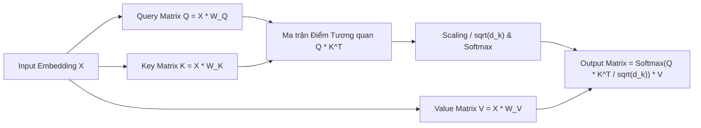

# Chương 5: Phân tích Chuyên sâu Kiến trúc Transformer (Transformer Architecture Deep-Dive)

---

## 1. Sự Ra đời của Transformer: "Attention Is All You Need" (Google 2017)

Trước năm 2017, các mô hình NLP đều dựa trên kiến trúc RNN/LSTM. Tuy nhiên, RNN có 2 điểm yếu chí mạng:
1. **Không thể song song hóa (No Parallelization):** Phải tính lần lượt từng từ $t=1 \to t=T$, làm việc huấn luyện trên các tập dữ liệu khổng lồ bị tắc nghẽn.
2. **Khoảng cách dài (Long-range Dependency):** Thông tin truyền qua quá nhiều bước thời gian vẫn bị giảm hiệu năng.

**Transformer (Vaswani et al., Google 2017)** loại bỏ hoàn toàn các lớp hồi quy RNN, chỉ dựa duy nhất vào **Cơ chế Self-Attention**!

```
RNN: Sequential processing O(T) steps  ---> Rất chậm, không song song hóa được trên GPU
Transformer: Parallel processing O(1) step ---> Tính toán song song cực nhanh trên GPU!
```

---

## 2. Scaled Dot-Product Attention

Cơ chế Attention cho phép mỗi từ trong câu "nhìn" và tương tác trực tiếp với toàn bộ các từ còn lại trong câu để xác định mối quan hệ ngữ nghĩa.



### 2.1. Bộ ba Ma trận $Q$, $K$, $V$:
Từ vector đầu vào $X$, mô hình chiếu qua 3 ma trận trọng số $W_Q, W_K, W_V$:
- **Query ($Q$):** Vector đại diện cho từ đang đi "tìm kiếm" thông tin.
- **Key ($K$):** Vector đại diện cho từ được "truy vấn" (đánh nhãn).
- **Value ($V$):** Vector chứa nội dung thông tin thực sự của từ.

#### 💡 Giải thích Dễ hiểu Từng con số Tensor Shape & Phép toán:

Giả sử câu văn bản đầu vào có $N=4$ từ: `"Con mèo ngồi trên"`. Định dạng vector ẩn $d_{\text{model}} = 512$.

1. **Ma trận Đầu vào $X \in \mathbb{R}^{4 \times 512}$:** Mỗi hàng đại diện cho 1 từ dưới dạng vector 512 chiều.
2. **Tạo Bộ ba $Q, K, V \in \mathbb{R}^{4 \times 64}$:**
   - Nhân $X$ với ma trận trọng số $W_Q, W_K, W_V \in \mathbb{R}^{512 \times 64}$.
   - **Query ($Q$ - Câu hỏi):** Từ `"Con"` đi tìm các từ liên quan đến nó.
   - **Key ($K$ - Nhãn chìa khóa):** Các từ `"Con"`, `"mèo"`, `"ngồi"`, `"trên"` đưa ra chìa khóa nhãn của mình.
   - **Value ($V$ - Giá trị thông tin):** Nội dung ngữ nghĩa thực sự của từng từ.
3. **Tính Ma trận Điểm Tương quan $Q K^T \in \mathbb{R}^{4 \times 4}$:**
   - Phép nhân ma trận $(4 \times 64) \times (64 \times 4) = (4 \times 4)$.
   - Điểm số tại hàng 1, cột 2 chính là độ tương quan giữa từ `"Con"` và từ `"mèo"`!
4. **Chia $\sqrt{d_k} = \sqrt{64} = 8$ & Hàm Softmax:**
   - Nếu không chia cho 8, các giá trị tích $Q K^T$ sẽ vọt lên quá to ($> 100$), làm hàm Softmax bị bão hòa làm gradient bằng 0.
   - Hàm `Softmax` biến từng hàng của ma trận $4 \times 4$ thành **Phân phối Xác suất Attention Weights (tổng mỗi hàng = $1.0$)**. Ví dụ hàng 1: `[0.1, 0.8, 0.05, 0.05]` $\implies$ từ `"Con"` chú ý $80\%$ vào từ `"mèo"`!
5. **Nhân với Value Matrix $V \in \mathbb{R}^{4 \times 64}$:**
   - Trọng số $80\%$ nhân với thông tin của từ `"mèo"`, tạo ra Vector đại diện mới chứa đầy đủ ngữ cảnh `"Con mèo"`!

---

## 3. Multi-Head Attention (MHA - Attention Nhiều Đầu)

Thay vì chỉ tính toán Attention 1 lần, Multi-Head Attention chia $Q, K, V$ thành $h$ phần nhỏ (Heads) độc lập (thường chọn $h = 8$ hoặc $16$). Mỗi Head học một loại mối quan hệ ngữ nghĩa khác nhau (ví dụ: Head 1 học quan hệ Chủ ngữ - Động ngữ, Head 2 học quan hệ Đại từ thay thế).

$$\text{MultiHead}(Q, K, V) = \text{Concat}(\text{head}_1, \text{head}_2, \dots, \text{head}_h) W^O$$
$$\text{head}_i = \text{Attention}\left( Q W_i^Q, \, K W_i^K, \, V W_i^V \right)$$

---

## 4. Mã hóa Vị trí (Positional Encoding)

Vì Transformer xử lý toàn bộ các từ song song đồng thời, nó **hoàn toàn không có khái niệm thứ tự trước/sau** của các từ. Để cung cấp thông tin vị trí thứ tự, người ta cộng thêm **Vector Positional Encoding ($PE$)** vào Vector Embedding đầu vào.

### Positional Encoding hình sin (Sinusoidal PE):
$$PE_{(pos, 2i)} = \sin\left( \frac{pos}{10000^{\frac{2i}{d_{\text{model}}}}} \right)$$
$$PE_{(pos, 2i+1)} = \cos\left( \frac{pos}{10000^{\frac{2i}{d_{\text{model}}}}} \right)$$

Trong đó $pos$ là vị trí từ trong câu ($0, 1, 2, \dots$), và $i$ là chỉ số chiều không gian embedding.

---

## 5. Cấu trúc Khối Transformer Encoder (Pre-LN vs Post-LN)

Mỗi khối Transformer Encoder chuẩn bao gồm:
1. **Multi-Head Self-Attention Layer**
2. **Residual Connection (Kết nối tắt):** $x + \text{SubLayer}(x)$
3. **Layer Normalization (LayerNorm)**
4. **Position-wise Feed-Forward Network (FFN):** Mạng MLP 2 tầng với hàm kích hoạt GELU/ReLU:
   $$\text{FFN}(x) = \max(0, x W_1 + b_1) W_2 + b_2$$

```
[ Pre-LN Transformer Layer ]
x ────┬───► [ LayerNorm ] ──► [ Multi-Head Attention ] ──► (+) ────┬───► [ LayerNorm ] ──► [ FFN ] ──► (+) ──► Output
      │                                                     ▲      │                                   ▲
      └─────────────────────────────────────────────────────┘      └───────────────────────────────────┘
```
