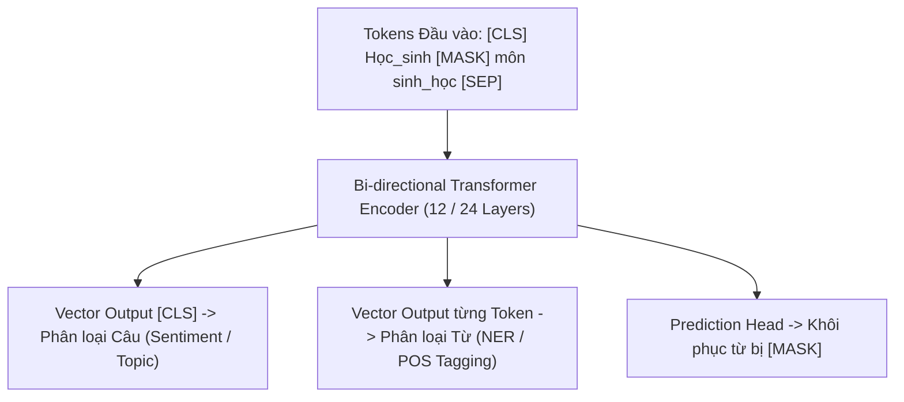

# Chương 6: BERT & Các Mô hình Encoder Ngữ cảnh hai chiều (BERT & Encoder Models)

---

## 1. Tổng quan về Họ mô hình Encoder-Only

Các mô hình **Encoder-Only** (như BERT, RoBERTa, PhoBERT) chỉ sử dụng nhánh Encoder của Transformer. Đặc điểm cốt lõi của họ mô hình này là **Self-Attention hai chiều (Bidirectional Self-Attention)** - mỗi từ tại bước $t$ có thể quan sát ngữ cảnh ở cả phía trước và phía sau nó trong câu.



---

## 2. Mô hình BERT (Devlin et al., Google 2018)

BERT là cuộc cách mạng lớn nhất trong NLP năm 2018, thiết lập kỷ lục SOTA trên 11 bài toán NLP khác nhau nhờ phương pháp Tiền huấn luyện không giám sát (Self-Supervised Pre-training).

### 2.1. Hai Nhiệm vụ Tiền huấn luyện (Pre-training Objectives):

#### 1. Masked Language Modeling (MLM - 80/10/10 Rule):
Ẩn ngẫu nhiên $15\%$ tổng số tokens trong câu và ép mô hình đoán lại token gốc dựa trên ngữ cảnh xung quanh:
- **$80\%$ trường hợp:** Thay token được chọn bằng ký tự đặc biệt `[MASK]`.
- **$10\%$ trường hợp:** Thay token được chọn bằng một từ ngẫu nhiên trong từ điển (để ép mô hình không phụ thuộc hoàn toàn vào token `[MASK]`).
- **$10\%$ trường hợp:** Giữ nguyên từ đúng (để giữ lại biểu diễn thực tế).

$$\mathcal{L}_{\text{MLM}}(\theta) = -\sum_{i \in \text{Masked}} \log P_\theta(x_i \mid \tilde{X})$$

#### 2. Next Sentence Prediction (NSP):
Huấn luyện mô hình hiểu mối quan hệ giữa 2 câu A và B:
- $50\%$ trường hợp: Câu B là câu tiếp theo thực sự của câu A (Nhãn `IsNext`).
- $50\%$ trường hợp: Câu B là câu lấy ngẫu nhiên từ văn bản khác (Nhãn `NotNext`).

---

## 3. Các Biến thể Cải tiến của BERT

### 3.1. RoBERTa (Robustly Optimized BERT Approach - Meta AI 2019)
Meta chứng minh BERT bị huấn luyện chưa tới (under-trained). RoBERTa cải tiến BERT bằng cách:
1. **Loại bỏ nhiệm vụ NSP:** Việc dự đoán câu tiếp theo làm giảm hiệu năng mô hình.
2. **Dynamic Masking:** Thay vì cố định vị trí `[MASK]` trong suốt quá trình huấn luyện (Static Masking), RoBERTa tạo lại các vị trí mask ngẫu nhiên mới mỗi khi đưa dữ liệu vào epoch.
3. **Huấn luyện với Batch Size lớn (8,000) trên 160GB dữ liệu.**

### 3.2. DeBERTa (Disentangled Attention - Microsoft 2021)
DeBERTa phân tách biểu diễn của mỗi từ thành 2 vector riêng biệt: Vector Ngữ nghĩa (Content) và Vector Vị trí tương đối (Relative Position). Điểm Attention giữa 2 từ được tính dựa trên 4 ma trận tích tương quan giữa Content-to-Content, Content-to-Position, Position-to-Content.

---

## 4. PhoBERT: Mô hình Ngôn ngữ Tiền huấn luyện cho Tiếng Việt (VinAI / Nguyen et al., 2020)

PhoBERT là mô hình SOTA dựa trên kiến trúc **RoBERTa**, được tiền huấn luyện trên **20GB dữ liệu văn bản tiếng Việt thô** (khoảng 3 tỷ từ từ tin tức Báo Mới và Wikipedia).

### 4.1. Quy trình Tiền xử lý Dữ liệu của PhoBERT:
- Tắt phân biệt hoa thường / Giữ chữ hoa chữ thường tùy phiên bản.
- Tất cả văn bản bắt buộc phải qua bước **Tách từ tiếng Việt (`PyVi` hoặc `RDRSegmenter`)** trước khi đưa vào PhoBERT Tokenizer.
- PhoBERT gồm 2 phiên bản: `phobert-base` (135M params) và `phobert-large` (370M params).

### 4.2. Code Python ví dụ Fine-tuning PhoBERT với Hugging Face:

```python
import torch
from transformers import AutoTokenizer, AutoModelForSequenceClassification

def load_vietnamese_phobert_classifier(num_labels: int = 3):
    """Load pretrained PhoBERT cho bài toán Phân loại Văn bản tiếng Việt."""
    model_name = "vinai/phobert-base"
    
    print(f"--> Loading PhoBERT Tokenizer & Model from '{model_name}'...")
    tokenizer = AutoTokenizer.from_pretrained(model_name)
    model = AutoModelForSequenceClassification.from_pretrained(model_name, num_labels=num_labels)
    
    return tokenizer, model

# Thử nghiệm Tokenizer
tokenizer, model = load_vietnamese_phobert_classifier(num_labels=3)
text = "Sản_phẩm dùng rất tốt , đóng_gói cẩn_thận !" # Đã qua bước tách từ _
inputs = tokenizer(text, return_tensors="pt")
print("Input IDs:", inputs["input_ids"])
```
