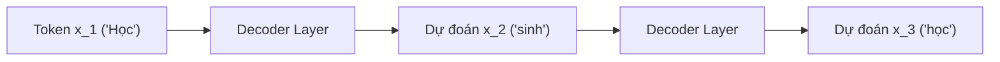
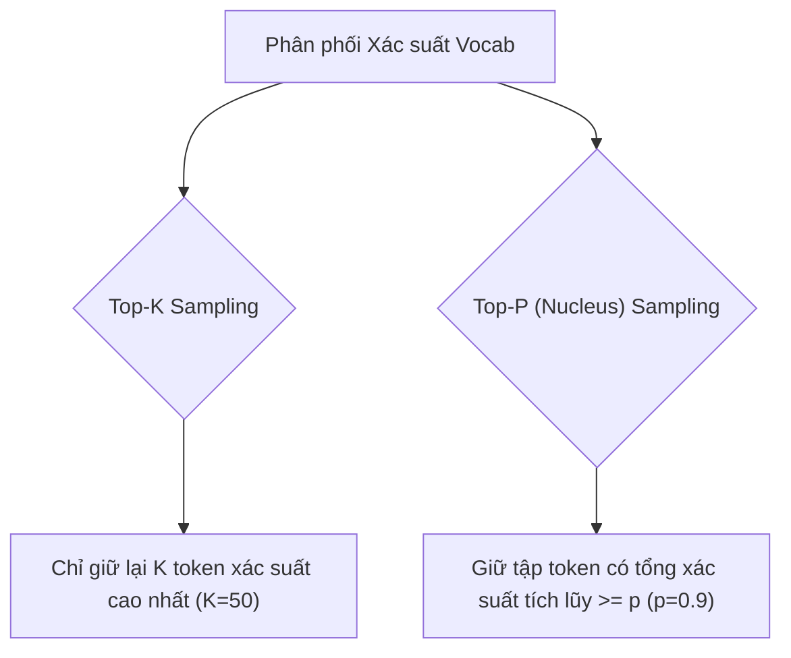

# Chương 7: GPT & Các Mô hình Decoder Sinh Tự hồi quy (GPT & LLM Autoregressive Models)

---

## 1. Tổng quan về Họ mô hình Decoder-Only

Khác với mô hình Encoder (BERT) nhìn thấy ngữ cảnh 2 chiều, các mô hình **Decoder-Only** (như GPT-2, GPT-3, GPT-4, LLaMA, Mistral, Qwen) chỉ cho phép mô hình nhìn thấy các từ **nằm ở quá khứ $x_{<t}$**. Đây là nền tảng cốt lõi của các Mô hình Ngôn ngữ Lớn (LLMs) chuyên về sinh văn bản.



---

## 2. Dòng Mô hình GPT (OpenAI) & Causal Masked Attention

### 2.1. Causal Masking (Mặt nạ Causal)
Trong tầng Self-Attention của Decoder, ma trận Attention Score được nhân với một **Ma trận Tam giác dưới (Lower Triangular Mask)** để gán giá trị $-\infty$ cho toàn bộ các token nằm ở tương lai ($j > i$):

```
Attention Matrix (Future Masking):
[  0.8    -inf   -inf   -inf  ]  <-- Token 1 chỉ thấy chính nó
[  0.3    0.7    -inf   -inf  ]  <-- Token 2 thấy Token 1, 2
[  0.1    0.2    0.7    -inf  ]  <-- Token 3 thấy Token 1, 2, 3
[  0.05   0.15   0.3    0.5   ]  <-- Token 4 thấy toàn bộ quá khứ
```

### 2.2. Mục tiêu Tiền huấn luyện (Causal Language Modeling Loss):
Tối đại hóa Log-Likelihood sinh từ tiếp theo dựa trên chuỗi quá khứ:

$$\mathcal{L}_{\text{CLM}}(\theta) = -\sum_{t=1}^{T} \log P_\theta(x_t \mid x_1, x_2, \dots, x_{t-1})$$

---

## 3. Các Chiến lược Giải mã Sinh Văn bản (Decoding Strategies)

Khi sinh văn bản tự động, từ logits dự đoán $z_t$, mô hình phải đưa ra quyết định chọn token tiếp theo như thế nào?

### 3.1. Greedy Search (Tìm kiếm Tham lam)
Luôn luôn chọn token có xác suất cao nhất:
$$x_t = \arg\max_{w} P(w \mid x_{<t})$$
- **Nhược điểm:** Văn bản bị lặp từ (repetitive loop) và câu văn bị lặp lại nhàm chán.

### 3.2. Beam Search (Tìm kiếm Chùm)
Duy trì một chùm $B$ câu ứng viên có tổng log-probability cao nhất tại mỗi bước:
$$\text{Score}(x_1, \dots, x_t) = \sum_{i=1}^{t} \log P(x_i \mid x_{<i})$$

---

### 3.3. Temperature Sampling (Lấy mẫu Nhiệt độ)
Biến đổi độ nhọn của hàm phân phối xác suất Softmax bằng tham số nhiệt độ $T > 0$:

$$P(x_i) = \frac{\exp(z_i / T)}{\sum_j \exp(z_j / T)}$$

- **$T \to 0$ (Nhiệt độ thấp):** Phân phối trở nên cực kỳ nhọn $\rightarrow$ Kết quả logic, ít sáng tạo, chính xác.
- **$T > 1.0$ (Nhiệt độ cao):** Phân phối phẳng ra $\rightarrow$ Kết quả phong phú, sáng tạo hơn nhưng dễ nói nhảm.

---

### 3.4. Top-K Sampling & Top-P (Nucleus) Sampling



- **Top-K Sampling:** Cắt tỉa và chỉ giữ lại $K$ token có điểm xác suất cao nhất (ví dụ $K = 50$), sau đó tính lại phân phối Softmax trên $K$ token này.
- **Top-P (Nucleus) Sampling (Holtzman et al., 2020):** Thay vì cố định số $K$, Top-P chọn tập hợp token nhỏ nhất sao cho tổng xác suất của chúng nạp đầy ngưỡng $p$ (ví dụ $p = 0.9$).

---

## 4. Code Python Minh họa Sinh Văn bản với Transformer Pipelines

```python
import torch
from transformers import AutoTokenizer, AutoModelForCausalLM

class TextGeneratorLLM:
    """Class bọc mô hình Causal LM cho nhiệm vụ sinh văn bản tự động."""
    
    def __init__(self, model_name: str = "gpt2", device: str = None):
        self.device = device or ("cuda" if torch.cuda.is_available() else "cpu")
        print(f"Loading Causal LM '{model_name}' on device '{self.device}'...")
        
        self.tokenizer = AutoTokenizer.from_pretrained(model_name)
        self.model = AutoModelForCausalLM.from_pretrained(model_name).to(self.device)
        self.model.eval()

    def generate(
        self,
        prompt: str,
        max_new_tokens: int = 50,
        temperature: float = 0.7,
        top_p: float = 0.9,
        top_k: int = 50
    ) -> str:
        """Sinh chuỗi văn bản tiếp theo từ Prompt đầu vào."""
        input_ids = self.tokenizer.encode(prompt, return_tensors="pt").to(self.device)

        with torch.no_grad():
            output_ids = self.model.generate(
                input_ids,
                max_new_tokens=max_new_tokens,
                do_sample=True,
                temperature=temperature,
                top_p=top_p,
                top_k=top_k,
                pad_token_id=self.tokenizer.eos_token_id
            )

        generated_text = self.tokenizer.decode(output_ids[0], skip_special_tokens=True)
        return generated_text
```
