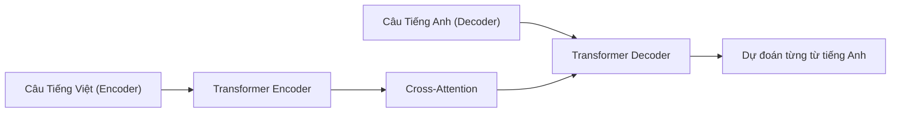

# Chương 8: Các Bài toán Cốt lõi trong NLP (Core NLP Tasks & Architectures)

---

Chương này trình bày chi tiết kiến trúc và phương pháp giải quyết 5 bài toán cốt lõi nhất của Xử lý Ngôn ngữ Tự nhiên trong môi trường sản xuất.

---

## 1. Phân loại Văn bản & Phân tích Cảm xúc (Text Classification & Sentiment Analysis)

### 1.1. Kiến trúc Mô hình
Đưa câu văn bản qua mô hình Encoder (BERT / PhoBERT), lấy Vector đầu ra tại vị trí ký tự đặc biệt `[CLS]` (hoặc lấy Mean Pooling của toàn bộ tokens) và đưa qua một tầng Tuyến tính (Linear Classifier) kết hợp hàm Softmax/Sigmoid.

```
Input Text ──► [ PhoBERT Encoder ] ──► [CLS] Vector (768d) ──► [ Dense + Softmax ] ──► [ Tích cực / Tiêu cực ]
```

- **Hàm mất mát (Loss):** Binary / Categorical Cross-Entropy Loss:
  $$\mathcal{L} = -\sum_{i=1}^{C} y_i \log \hat{y}_i$$

---

## 2. Nhận dạng Thực thể Tên (Named Entity Recognition - NER)

NER là bài toán trích xuất các thực thể quan trọng trong câu như Tên người (PER), Địa điểm (LOC), Tổ chức (ORG), Thời gian (TIME).

### 2.1. Định dạng Nhãn BIO Tagging Scheme:
- `B-Type` (Begin): Đánh dấu từ bắt đầu của thực thể.
- `I-Type` (Inside): Đánh dấu các từ tiếp theo nằm bên trong thực thể.
- `O` (Outside): Từ không thuộc thực thể nào.

```
Văn bản:  Nguyễn_Văn_A  sống  tại  Hà_Nội .
Nhãn BIO:  B-PER         O     O    B-LOC  O
```

### 2.2. Kiến trúc Bi-LSTM-CRF / BERT-CRF
Đưa output của từng token qua một tầng **Conditional Random Field (CRF)** để đảm bảo tính hợp lệ của chuỗi nhãn (ví dụ nhãn `I-PER` không bao giờ đứng ngay sau nhãn `B-LOC`).

---

## 3. Dịch Máy (Neural Machine Translation - NMT)

NMT là bài toán chuyển đổi một câu từ Ngôn ngữ Nguồn (Source Language $S$) sang Ngôn ngữ Đích (Target Language $T$).



### 3.1. Cơ chế Cross-Attention trong Transformer Seq2Seq:
Trong Decoder của mô hình NMT:
- $Q$ (Query): Lấy từ trạng thái ẩn của **Decoder** (những từ tiếng Anh đã dịch trước đó).
- $K$ (Key) và $V$ (Value): Lấy từ trạng thái ẩn đầu ra của **Encoder** (toàn bộ câu tiếng Việt nguồn).

---

## 4. Hỏi Đáp Trích xuất (Extractive Question Answering - QA)

Cho một câu hỏi $Q$ và một đoạn văn ngữ cảnh $C$ (Context), mô hình phải tìm chính xác vị trí **Start Token Index ($s$)** và **End Token Index ($e$)** chứa câu trả lời nằm trong đoạn $C$.

```
Context: "Trường Đại học Bách Khoa Hà Nội được thành lập vào năm 1956."
Question: "Bách Khoa Hà Nội thành lập năm nào?"
Output Span: [Start: 12, End: 12] -> "1956"
```

### 4.1. Công thức Tính toán Span Probabilities:
Ghép chuỗi đầu vào theo dạng `[CLS] Question [SEP] Context [SEP]`. Đưa qua Transformer Encoder để thu được vector biểu diễn $h_i$ cho từng token $i$:

$$P_{\text{start}}(i) = \frac{\exp(h_i \cdot w_s)}{\sum_j \exp(h_j \cdot w_s)}, \quad P_{\text{end}}(j) = \frac{\exp(h_j \cdot w_e)}{\sum_k \exp(h_k \cdot w_e)}$$

Trong đó $w_s$ và $w_e$ là 2 vector trọng số cần học của lớp Start & End Classifier.

---

## 5. Tóm tắt Văn bản (Text Summarization)

1. **Tóm tắt Rút trích (Extractive Summarization):** Phân tích tầm quan trọng của từng câu và trích xuất nguyên văn các câu quan trọng nhất hợp thành đoạn tóm tắt.
2. **Tóm tắt Diễn dịch (Abstractive Summarization):** Mô hình đọc toàn bộ bài viết và tự **viết lại câu tóm tắt mới** bằng cấu trúc từ ngữ hoàn toàn khác (sử dụng các mô hình Seq2Seq như BART, T5).
