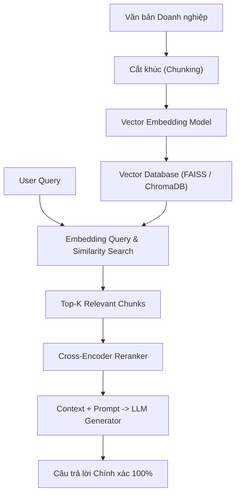

# Chương 9: RAG & Kỹ thuật Fine-Tuning LLM (RAG, PEFT LoRA, QLoRA & DPO)

---

## 1. Retrieval-Augmented Generation (RAG - Thế hệ Sinh có Truy vấn)

Các Mô hình Ngôn ngữ Lớn (LLMs) thường gặp 2 hạn chế lớn: **Hiện tượng Ảo giác (Hallucination - nói dối có vẻ thuyết phục)** và **Dữ liệu tri thức bị đóng băng tại thời điểm huấn luyện (Knowledge cutoff)**.

**RAG** kết hợp sức mạnh của hệ thống tìm kiếm thông tin (Information Retrieval) và mô hình sinh LLM để truy xuất dữ liệu doanh nghiệp chính xác theo thời gian thực.



---

### 1.1. Các Chiến lược Cắt khúc Văn bản (Chunking Strategies):
- **Fixed-size Chunking:** Cắt đoạn cố định 512 tokens với overlap 50 tokens.
- **Recursive Character Chunking:** Cắt đoạn ưu tiên theo phân cấp đoạn văn (`\n\n`), câu (`.`), từ (` `).
- **Semantic Chunking:** Cắt đoạn dựa trên sự biến đổi ngữ nghĩa đột ngột giữa các câu (tính bằng Cosine Distance giữa các sentence embeddings).

### 1.2. Reranking với Cross-Encoder:
Thay vì chỉ dựa vào Bi-Encoder Vector Search (nhanh nhưng độ chính xác vừa phải), bước **Reranking** đưa cặp `(Query, Chunk)` trực tiếp qua một mô hình Cross-Encoder để tính toán lại điểm phù hợp chính xác tuyệt đối.

---

## 2. Fine-Tuning LLM với PEFT (Parameter-Efficient Fine-Tuning)

Huấn luyện tinh chỉnh toàn bộ trọng số (Full Fine-Tuning) một mô hình LLM 7 tỷ tham số (LLaMA 7B) đòi hỏi hàng trăm GB VRAM GPU và rất dễ bị hiện tượng **Quên thảm hại (Catastrophic Forgetting)**. Các kỹ thuật PEFT cho phép tinh chỉnh LLM chỉ với $0.1\% - 1\%$ số lượng tham số!

---

### 2.1. Kỹ thuật LoRA (Low-Rank Adaptation - Microsoft 2021)

LoRA đóng đông toàn bộ ma trận trọng số gốc $W_0 \in \mathbb{R}^{d \times k}$ của mô hình. Với mỗi lớp Linear, LoRA thêm một nhánh song song gồm 2 ma trận phân tích thứ cấp thấp: $A \in \mathbb{R}^{r \times k}$ và $B \in \mathbb{R}^{d \times r}$ với rank $r \ll \min(d, k)$ (thường chọn $r = 8$ hoặc $16$).

```
                h = W_0 * x + (alpha / r) * (B * A) * x
                
               ┌──────────────────────────────┐
               │    W_0 (Frozen Baseline)     │
               └──────────────┬───────────────┘
                              │
    x ────────────────────────┼────────────────────────► (+) ──► h
                              │
               ┌──────────────┴───────────────┐
               │  A (r x k)  -->  B (d x r)   │  <-- Chỉ huấn luyện ma trận A & B!
               └──────────────────────────────┘
```

#### Công thức Biến đổi Trọng số:
$$W = W_0 + \Delta W = W_0 + \frac{\alpha}{r} (B \cdot A)$$

- Khi lưu trữ, ta chỉ cần lưu file adapter gọn nhẹ (chỉ khoảng $10\text{MB} - 50\text{MB}$) mà vẫn giữ nguyên $99\%$ hiệu năng so với Full Fine-Tuning!

---

### 2.2. QLoRA (Quantized LoRA - Dettmers et al., 2023)

QLoRA đưa LoRA lên một tầm cao mới bằng cách:
1. **Mã hóa Lượng tử 4-bit NormalFloat (NF4):** Lượng tử hóa toàn bộ trọng số gốc $W_0$ về định dạng 4-bit chuẩn.
2. **Double Quantization:** Lượng tử hóa cả các hệ số scale của lượng tử để tiết kiệm thêm VRAM.
3. **Paged Optimizers:** Đẩy bộ nhớ trạng thái Optimizer sang RAM hệ thống khi VRAM bị tràn.

> [!TIP]
> QLoRA cho phép fine-tune một mô hình LLaMA 7B / 13B ngay trên **1 card GPU thương mại duy nhất** (như RTX 3090 / 4090 24GB VRAM).

---

## 3. Căn chỉnh Hành vi LLM (Alignment: DPO & RLHF)

Sau khi được fine-tune指令 (Instruction Tuning), mô hình LLM cần được căn chỉnh để trở nên an toàn, trung thực và hữu ích (Helpful, Honest, Harmless).

### Direct Preference Optimization (DPO - Rafailov et al., 2023)
DPO thay thế quy trình RLHF phức tạp (cần mô hình PPO và Reward Model riêng) bằng một hàm mất mát duy nhất tối ưu hóa trực tiếp trên cặp dữ liệu phản hồi thích ($y_w$) và không thích ($y_l$):

$$\mathcal{L}_{\text{DPO}}(\theta; \pi_{\text{ref}}) = -\mathbb{E}_{(x, y_w, y_l)} \left[ \log \sigma \left( \beta \log \frac{\pi_\theta(y_w \mid x)}{\pi_{\text{ref}}(y_w \mid x)} - \beta \log \frac{\pi_\theta(y_l \mid x)}{\pi_{\text{ref}}(y_l \mid x)} \right) \right]$$
