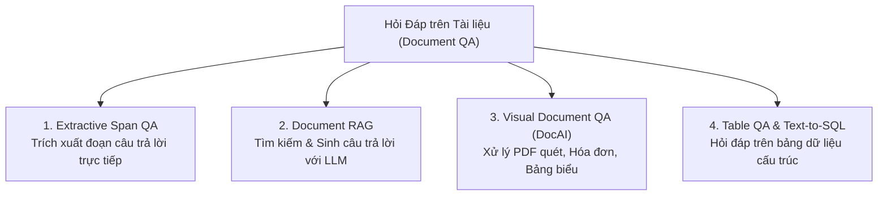
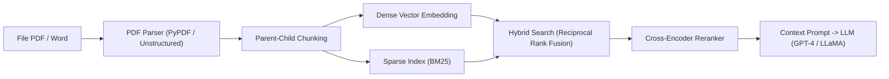

# Chương 11: Hỏi Đáp trên Tài liệu (Document Question Answering & Document RAG)

---

Hỏi Đáp trên Tài liệu (Document Question Answering - DocQA) là một trong những ứng dụng AI quan trọng nhất hiện nay trong các doanh nghiệp, cho phép người dùng tự động trích xuất thông tin, tra cứu và hỏi đáp trực tiếp trên các tài liệu dạng **PDF, Word, Hóa đơn, Hợp đồng, Báo cáo tài chính và Bảng biểu phức tạp**.

---

## 1. Phân loại các Dạng Bài toán Hỏi Đáp trên Tài liệu



---

## 2. Dạng 1: Extractive Span QA (Hỏi Đáp Trích xuất)

Dành cho các tài liệu văn bản thuần túy (Text-only documents):
- Cho trước câu hỏi $Q$ và một đoạn văn tài liệu $C$ (Context).
- Mô hình không sinh ra từ mới mà dự đoán chính xác cặp chỉ số **Start Index ($s$)** và **End Index ($e$)** chứa đoạn văn bản câu trả lời nằm trực tiếp trong $C$.

### Công thức Toán học:
Ghép chuỗi đầu vào theo chuẩn: `[CLS] Câu_hỏi [SEP] Văn_bản_tài_liệu [SEP]`.
Vector ẩn đầu ra $h_i$ của mỗi token $i$ được chiếu qua 2 vector trọng số $W_s$ và $W_e$:

$$P_{\text{start}}(i) = \frac{\exp(h_i \cdot W_s)}{\sum_j \exp(h_j \cdot W_s)}, \quad P_{\text{end}}(j) = \frac{\exp(h_j \cdot W_e)}{\sum_k \exp(h_k \cdot W_e)}$$

---

## 3. Dạng 2: Pipeline Document RAG chuẩn Enterprise

Dành cho hệ thống tra cứu trên hàng ngàn file tài liệu PDF/Word dung lượng lớn:



### 3.1. Kỹ thuật Cắt khúc Phân cấp (Parent-Child / Hierarchical Chunking):
- **Child Chunks (Khúc nhỏ 100-200 tokens):** Dùng để tính toán vector embedding và tìm kiếm similarity chính xác.
- **Parent Chunks (Khúc lớn 1000 tokens):** Khi tìm thấy Child Chunk phù hợp, hệ thống sẽ trả về toàn bộ Parent Chunk tương ứng cho LLM đọc để đảm bảo không bị mất ngữ cảnh xung quanh!

### 3.2. Tìm kiếm Kép Hybrid Search (Dense Embeddings + Sparse BM25):
- **Dense Vector Search (Cosine Similarity):** Hiểu ngữ nghĩa tương đương (ví dụ *"chi phí"* $\approx$ *"ngân sách"*).
- **Sparse BM25 Search:** Bắt chính xác các mã số hợp đồng, tên riêng, mã sản phẩm hoặc số liệu đặc thù.
- **Reciprocal Rank Fusion (RRF):** Trộn kết quả từ Dense và BM25 theo công thức:
  $$\text{RRF\_Score}(d) = \sum_{m \in \{\text{Dense}, \text{BM25}\}} \frac{1}{k + r_m(d)}$$

---

## 4. Dạng 3: Visual Document QA (Document AI - Xử lý Hóa đơn, PDF Quét & Hợp đồng)

Các tài liệu thực tế (như Hóa đơn VAT, Báo cáo tài chính, Hợp đồng scan) chứa cả **Chữ (Text)**, **Bố cục 2D (Spatial Layout Bounding Boxes)** và **Hình ảnh (Logos, Con dấu, Bảng biểu)**. Các mô hình NLP truyền thống xem tài liệu thành 1 chuỗi 1D sẽ thất bại hoàn toàn vì làm mất vị trí bố cục!

```
[ Visual Document AI Architecture ]
Text Tokens + 2D Bounding Boxes (x0, y0, x1, y1) + Image Patches ──► [ Multimodal Transformer ]
```

---

### 4.1. Mô hình LayoutLMv3 (Microsoft, 2022)

LayoutLMv3 tích hợp cả 3 nguồn thông tin vào một kiến trúc Transformer thống nhất:
1. **Text Embeddings:** Vector đại diện cho từ ngữ trích xuất qua OCR.
2. **2D Spatial Positional Embeddings:** Tọa độ hộp bao 2D của từ trên trang giấy `(x0, y0, x1, y1)`.
3. **Visual Embeddings:** Các mảnh ảnh 2D (Image Patches $16 \times 16$) trích xuất qua Vision Transformer (ViT).

```python
# Ví dụ 2D Bounding Box Embedding trong LayoutLM:
# x0, y0: Tọa độ góc trên bên trái (chuẩn hóa từ 0 đến 1000)
# x1, y1: Tọa độ góc dưới bên phải
bbox = [120, 450, 300, 480]  # [x0, y0, x1, y1]
```

---

### 4.2. Thế hệ Mô hình Visual LLMs cho Tài liệu (Donut, Nougat & ColPali)

- **Donut (OCR-free Document Understanding Transformer):** Loại bỏ hoàn toàn công đoạn OCR đắt đỏ. Donut nhận đầu vào là ảnh chụp tài liệu qua **Swin Transformer Encoder** và sinh trực tiếp câu trả lời dạng JSON/Markdown qua **BART Decoder**.
- **Nougat (Meta AI):** Mô hình chuyên dụng chuyển đổi các file PDF bài báo khoa học chứa công thức toán học $\LaTeX$ phức tạp thành định dạng Markdown.
- **ColPali (Vasilyev et al., 2024):** Mô hình Vision Retriever SOTA cho PDF. ColPali dùng Vision LLM (PaliGemma) trích xuất trực tiếp ma trận Multi-Vector đại diện cho toàn bộ trang PDF ảnh mà không cần OCR hay text extraction!

---

## 5. Dạng 4: Table QA & Text-to-SQL (Hỏi đáp trên Bảng biểu)

### 5.1. TAPAS (Table Parser - Google)
TAPAS mở rộng BERT để hỏi đáp trực tiếp trên các Bảng dữ liệu cấu trúc (Tables):
- Thêm các **Table Positional Embeddings:** `Column ID`, `Row ID`, `Rank ID`.
- Dự đoán câu trả lời bằng cách chọn các ô (Cells) trong bảng và dự đoán Phép toán Số học cần áp dụng (`SUM`, `AVERAGE`, `COUNT`, `NONE`).

### 5.2. Text-to-SQL
Chuyển câu hỏi ngôn ngữ tự nhiên của người dùng (ví dụ: *"Liệt kê danh sách 5 khách hàng có doanh số cao nhất năm 2024"*) thành câu lệnh SQL chuẩn:

```sql
SELECT customer_name, SUM(revenue) AS total_revenue 
FROM sales 
WHERE year = 2024 
GROUP BY customer_name 
ORDER BY total_revenue DESC 
LIMIT 5;
```
