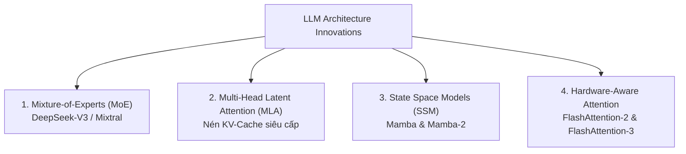

# Chương 12: Kiến trúc LLM Hiện đại: Mixture of Experts (MoE), DeepSeek-V3 & State Space Models (Mamba)

---

## 1. Sự Tiến hóa Kiến trúc LLM (2024-2026 SOTA)

Các mô hình LLM hiện đại nhất ngày nay (như DeepSeek-V3, Mixtral, Mamba-2) đã vượt khỏi giới hạn của kiến trúc Dense Transformer truyền thống để giải quyết 2 bài toán lớn nhất: **Tốc độ suy luận (Inference Speed)** và **Ngữ cảnh siêu dài (Long Context Window 1M+ tokens)**.



---

## 2. Kiến trúc Mixture-of-Experts (MoE) & DeepSeek-V3

### 2.1. Bản chất của MoE (Mixture of Experts):
Thay vì bắt tất cả các tham số (parameters) trong mạng nơ-ron phải tính toán cho mọi token, MoE thay thế tầng FFN (Feed-Forward Network) bằng $N$ chuyên gia (**Experts**). Một mạng cổng **Router / Gating Network** sẽ chọn ngẫu nhiên $K$ chuyên gia phù hợp nhất ($K \ll N$) cho mỗi token.

```
Token Input ──► [ Router Gating Network ] ──┬──► Expert 1 (Active)
                                            ├──► Expert 4 (Active)
                                            └──► (Experts 2, 3, 5... Inactive)
```

- **Ưu điểm:** Cho phép mô hình có dung lượng tổng 671 Tỷ tham số (671B Parameters) nhưng chỉ kích hoạt 37B Parameters cho mỗi token, giúp tốc độ suy luận nhanh gấp 5 lần so với Dense Model!

### 2.2. Các Đột phá trong DeepSeek-V3 MoE:
1. **Auxiliary-Loss-Free Load Balancing:** Loại bỏ hàm loss phụ cân bằng tải truyền thống (gây suy giảm hiệu năng mô hình), thay bằng hệ số bias có thể điều chỉnh linh hoạt cho từng expert.
2. **Multi-Head Latent Attention (MLA):** Nén toàn bộ Key-Value (KV) Cache thành một Vector ẩn liên kết Low-Rank nén (Latent Vector $c_t^{KV}$), giúp giảm dung lượng RAM/VRAM cho KV Cache tới $93.3\%$, hỗ trợ phục vụ hàng ngàn người dùng đồng thời!

---

## 3. State Space Models (SSM) & Mamba / Mamba-2

Transformer có độ phức tạp tính toán theo chiều dài chuỗi là **Bậc hai $\mathcal{O}(N^2)$**. **Mamba (Gu & Dao, 2023-2024)** thay thế Attention bằng kiến trúc **Selective State Space Model (SSM)** đạt độ phức tạp **Tuyến tính $\mathcal{O}(N)$**.

$$\begin{aligned}
h'(t) &= A h(t) + B x(t) \\
y(t) &= C h(t)
\end{aligned}$$

- **Mamba-2 (State Space Duality - SSD):** Kết nối toán học giữa SSM và Structured Attention, cho phép tính toán song song cực nhanh trên phần cứng GPU Tensor Cores.
