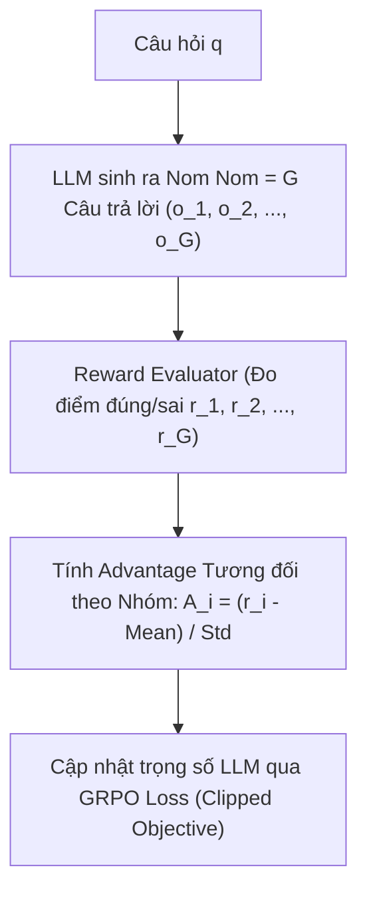

# Chương 13: Mô hình LLM Suy luận (Reasoning LLMs: DeepSeek-R1, GRPO & LLM Agents)

---

## 1. Kỷ nguyên Mô hình Suy luận (Reasoning Models & Test-Time Compute)

Một bước ngoặt lớn của NLP hiện đại (đại diện bởi OpenAI o1/o3 và **DeepSeek-R1**) là chuyển dịch từ mở rộng mô hình lúc huấn luyện sang **Mở rộng Thời gian Suy nghĩ (Test-Time Compute Expansion)**.

Mô hình học cách sinh ra một chuỗi suy luận dài **Chain-of-Thought (CoT)** bên trong thẻ `<think> ... </think>`, tự đặt giả thuyết, tự kiểm tra lỗi sai và tự sửa đổi trước khi đưa ra câu trả lời cuối cùng.

```
Question: "Giải phương trình 2x + 5 = 15"
Model Output:
<think>
Trừ 5 từ cả hai vế: 2x = 10.
Chia cả hai vế cho 2: x = 5.
Kiểm tra lại: 2(5) + 5 = 15 (Chính xác!).
</think>
Phương trình có nghiệm x = 5.
```

---

## 2. Thuật toán GRPO (Group Relative Policy Optimization - DeepSeek 2025)

Huấn luyện LLM suy luận bằng PPO truyền thống đòi hỏi một mạng Critic $V(s)$ cồng kềnh có cùng kích thước với LLM (tốn gấp đôi VRAM GPU).

**DeepSeek-R1** giới thiệu thuật toán **GRPO**, loại bỏ hoàn toàn mạng Critic $V(s)$!



### Công thức Advantage Tương đối trong GRPO:

$$A_i = \frac{r_i - \text{mean}(\{r_1, r_2, \dots, r_G\})}{\text{std}(\{r_1, r_2, \dots, r_G\}) + 1e-8}$$

### Hàm Mất mát GRPO Loss:

$$\mathcal{L}_{\text{GRPO}}(\theta) = \frac{1}{G} \sum_{i=1}^{G} \left[ \min\left( \frac{\pi_\theta(o_i \mid q)}{\pi_{\theta_{\text{old}}}(o_i \mid q)} A_i, \, \text{clip}\left( \frac{\pi_\theta(o_i \mid q)}{\pi_{\theta_{\text{old}}}(o_i \mid q)}, 1-\epsilon, 1+\epsilon \right) A_i \right) - \beta \, D_{\text{KL}}(\pi_\theta \parallel \pi_{\text{ref}}) \right]$$

---

## 3. LLM Agent Frameworks & Tool Use

Các hệ thống **LLM Agents** nâng tầm LLM thành một trợ lý tự chủ có khả năng sử dụng công cụ (Tools), tìm kiếm Web và viết code.

### 3.1. Mô hình ReAct (Reasoning + Acting):
1. **Thought (Suy nghĩ):** LLM tự phân tích bước cần làm tiếp theo.
2. **Action (Hành động):** LLM gọi một công cụ bên ngoài (ví dụ `Calculator(2+2)` hoặc `SearchWeb("Thời tiết Hà Nội")`).
3. **Observation (Quan sát):** LLM nhận kết quả trả về từ công cụ và tiếp tục chu trình.
