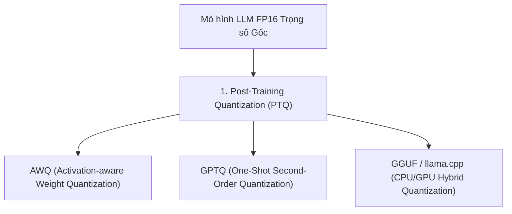

# Chương 14: Lượng tử hóa & Chưng cất Mô hình LLM (LLM Quantization AWQ, GPTQ, GGUF & Distillation)

---

## 1. Tại sao cần Lượng tử hóa LLM (Quantization)?

Một mô hình LLM 70B tham số ở định dạng 16-bit Floating Point (FP16) đòi hỏi **140 GB VRAM GPU** chỉ để nạp trọng số. **Lượng tử hóa (Quantization)** nén trọng số từ FP16 xuống **INT8 hoặc INT4**, giúp giảm dung lượng bộ nhớ từ 140 GB xuống còn **35 GB** mà giữ lại $98\%$ hiệu năng!

---

## 2. Các Thuật toán Lượng tử hóa SOTA

### 2.1. AWQ (Activation-aware Weight Quantization - Lin et al., MIT):
- AWQ phát hiện ra rằng **không phải tất cả các trọng số đều có tầm quan trọng như nhau**. Chỉ có $1\%$ trọng số liên kết với các Kích hoạt (Activations) lớn mới thực sự quyết định độ chính xác.
- AWQ giữ nguyên $1\%$ trọng số quan trọng này và lượng tử hóa $99\%$ trọng số còn lại xuống INT4, giúp giữ nguyên độ chính xác của LLM.

### 2.2. GGUF (llama.cpp Format):
- Định dạng nén file chuẩn mực hỗ trợ chạy LLM trên cả CPU và GPU máy tính cá nhân (với các định dạng nén 2-bit, 3-bit, 4-bit, 5-bit, 6-bit và 8-bit).

---

## 3. Chưng cất Tri thức LLM (Knowledge Distillation)

Chưng cất tri thức chuyển giao năng lực suy luận từ một **Mô hình Giáo viên lớn (Teacher Model - ví dụ DeepSeek-R1 671B)** sang một **Mô hình Học sinh nhỏ (Student Model - ví dụ DeepSeek-R1-Distill-Qwen-1.5B/7B)** bằng cách học theo phân phối xác suất logits hoặc chuỗi suy luận CoT.
