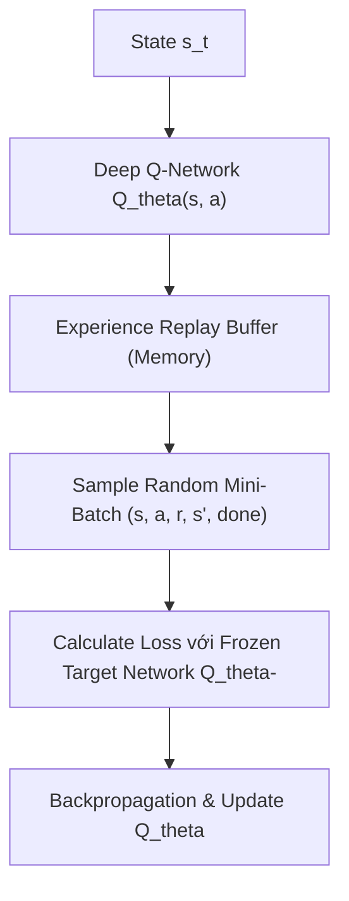

# Chương 2: Phương pháp Dựa trên Giá trị & Deep Q-Networks (Q-Learning, DQN & Double DQN)

---

## 1. Học Học theo Sai khác Thời gian (Temporal Difference - TD Learning)

Khi Agent không biết mô hình xác suất chuyển trạng thái $P(s' \mid s, a)$ của môi trường (Model-Free RL), Agent không thể áp dụng quy hoạch động Bellman trực tiếp. Thay vào đó, nó cập nhật hàm giá trị bằng **Temporal Difference (TD) Learning**:

$$\text{TD Target: } y_t = r_{t+1} + \gamma V(s_{t+1})$$
$$\text{TD Error: } \delta_t = y_t - V(s_t)$$

---

## 2. Thuật toán Q-Learning (Watkins 1989 - Off-Policy TD Control)

Q-Learning là thuật toán **Model-Free Off-Policy** ước lượng trực tiếp hàm $Q^*(s, a)$ tối ưu mà không cần phụ thuộc vào policy đang dùng để thu thập dữ liệu:

$$Q(s_t, a_t) \leftarrow Q(s_t, a_t) + \alpha \left[ r_t + \gamma \max_{a'} Q(s_{t+1}, a') - Q(s_t, a_t) \right]$$

### Cân bằng Khám phá & Khai thác ($\epsilon$-Greedy Strategy):
- Xác suất $1 - \epsilon$: **Khai thác (Exploitation)** - Chọn hành động có điểm $Q$ cao nhất $a = \arg\max Q(s, a)$.
- Xác suất $\epsilon$: **Khám phá (Exploration)** - Chọn một hành động ngẫu nhiên để tìm kiếm phần thưởng mới.

---

## 3. Deep Q-Networks (DQN - DeepMind, Mnih et al., Nature 2015)

DQN thay thế Q-table bằng một Mạng Nơ-ron Deep Learning $Q_\theta(s, a)$ để xử lý không gian trạng thái liên tục hoặc hình ảnh 2D (như chơi các game Atari).

### 3.1. Hai Kỹ thuật Cốt lõi giúp DQN Ổn định:

1. **Bộ đệm Trải nghiệm (Experience Replay Buffer $\mathcal{D}$):**
   - Lưu trữ các bước chuyển trạng thái $e_t = (s_t, a_t, r_t, s_{t+1}, \text{done})$.
   - Khi huấn luyện, lấy mẫu ngẫu nhiên không liên tục một Mini-Batch từ $\mathcal{D}$.
   - **Tác dụng:** Phá vỡ tính tương quan thời gian giữa các mẫu liên tiếp (Break temporal correlation) và tái sử dụng dữ liệu cũ hiệu quả.

2. **Target Network Độc lập ($Q_{\theta^-}$):**
   - Sử dụng một mạng $Q_{\theta^-}$ riêng biệt để tính TD Target $y_t$.
   - Trọng số $\theta^-$ được giữ cố định và chỉ copy từ $\theta$ sau mỗi $C$ bước huấn luyện (ví dụ $C = 1000$).
   - **Tác dụng:** Tránh hiện tượng mục tiêu TD Target bị dịch chuyển liên tục (Moving Target Problem) gây bùng nổ gradient.

### 3.2. Hàm Mất mát DQN Loss:

$$\mathcal{L}_{\text{DQN}}(\theta) = \mathbb{E}_{(s, a, r, s', \text{done}) \sim \mathcal{D}} \left[ \left( r + \gamma (1 - \text{done}) \max_{a'} Q_{\theta^-}(s', a') - Q_\theta(s, a) \right)^2 \right]$$

---

## 4. Các Biến thể DQN Nâng cao (Double DQN & Dueling DQN)

### 4.1. Double DQN (van Hasselt et al., DeepMind 2016)
- **Vấn đề:** Phép toán $\max_{a'} Q(s', a')$ trong DQN truyền thống luôn bị lỗi **Đánh giá cao quá mức (Overestimation Bias)** do nhiễu số liệu.
- **Giải pháp:** Tách biệt phép **Chọn hành động** (dùng mạng Online $\theta$) và phép **Đánh giá giá trị** (dùng mạng Target $\theta^-$):

$$y_t^{\text{DoubleDQN}} = r_t + \gamma (1 - \text{done}) Q_{\theta^-}\left( s_{t+1}, \, \arg\max_{a'} Q_\theta(s_{t+1}, a') \right)$$

---

### 4.2. Dueling DQN (Wang et al., DeepMind 2016)
Dueling DQN tách mạng nơ-ron thành 2 nhánh phía cuối:
- **Nhánh State-Value $V(s)$:** Đánh giá trạng thái $s$ tốt hay xấu như thế nào bất kể hành động nào.
- **Nhánh Advantage $A(s, a)$:** Đánh giá lợi thế tương đối của hành động $a$ so với các hành động khác.

$$Q(s, a; \theta, \alpha, \beta) = V(s; \theta, \beta) + \left( A(s, a; \theta, \alpha) - \frac{1}{|\mathcal{A}|} \sum_{a'} A(s, a'; \theta, \alpha) \right)$$
