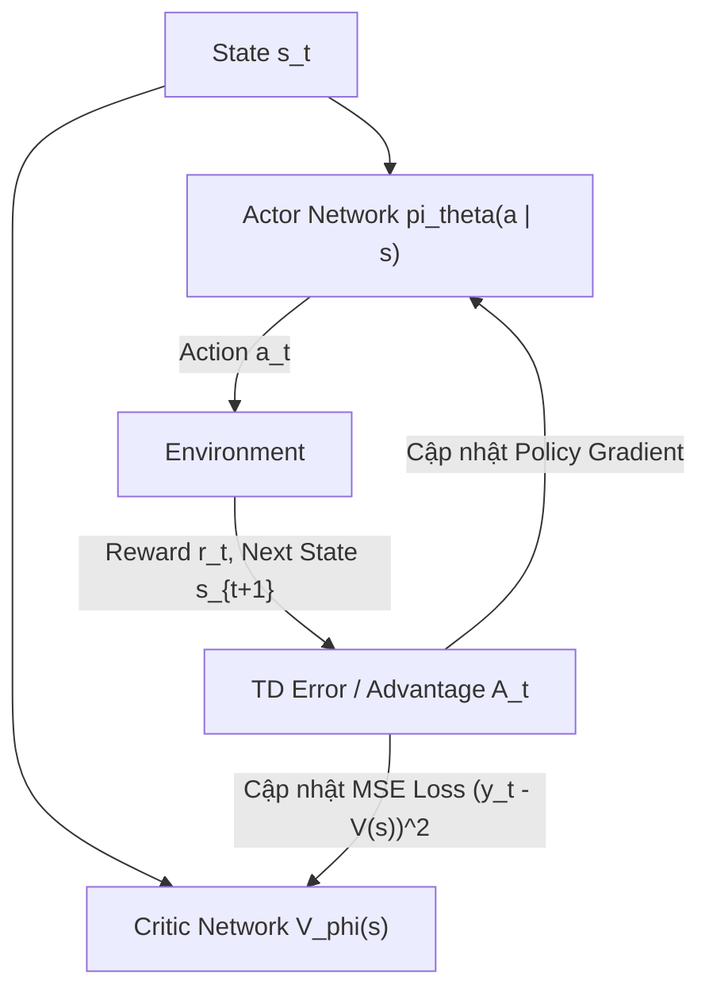

# Chương 4: Kiến trúc Actor-Critic (Actor-Critic Framework, A2C & A3C)

---

## 1. Kiến trúc Actor-Critic là gì?

Để kết hợp ưu điểm của **Policy Gradient** (xử lý hành động liên tục, học policy trực tiếp) và **Value-Based** (biến động thấp, cập nhật từng bước TD), kiến trúc **Actor-Critic** chia mô hình thành 2 mạng nơ-ron:

1. **Actor ($\pi_\theta(a \mid s)$):** Đảm nhận vai trò "Diễn viên" chọn hành động $a_t$. Trọng số $\theta$ được cập nhật theo hướng tăng xác suất các hành động có **Advantage $A_t > 0$**.
2. **Critic ($V_\phi(s)$):** Đảm nhận vai trò "Giám khảo" đánh giá xem trạng thái $s_t$ đạt được phần thưởng như thế nào. Trọng số $\phi$ được cập nhật bằng MSE Loss dựa trên TD Error.

---

## 2. Hàm Advantage Function ($A(s, a)$)

Advantage đại diện cho **Mức độ vượt trội** của hành động $a$ so với trung bình các hành động khác tại trạng thái $s$:

$$A^\pi(s, a) = Q^\pi(s, a) - V^\pi(s)$$

Trong thực tế, ta xấp xỉ Advantage bằng **1-step Temporal Difference (TD) Error**:

$$\hat{A}_t = r_t + \gamma V_\phi(s_{t+1}) - V_\phi(s_t)$$

---

## 3. Công thức Huấn luyện Actor-Critic

### 3.1. Loss của Actor Network ($\mathcal{L}_{\text{Actor}}$):
$$\mathcal{L}_{\text{Actor}}(\theta) = -\log \pi_\theta(a_t \mid s_t) \cdot \hat{A}_t - \beta \, \mathcal{H}(\pi_\theta(\cdot \mid s_t))$$

Trong đó $\mathcal{H}$ là hàm Entropy của Policy giúp duy trì khả năng khám phá (Exploration).

### 3.2. Loss của Critic Network ($\mathcal{L}_{\text{Critic}}$):
$$\mathcal{L}_{\text{Critic}}(\phi) = \left( r_t + \gamma V_\phi(s_{t+1}) - V_\phi(s_t) \right)^2$$

---

## 4. Thuật toán A2C (Advantage Actor-Critic) & A3C (DeepMind 2016)

- **A3C (Asynchronous Advantage Actor-Critic):** Sử dụng nhiều luồng CPU (Worker threads) chạy bất đồng bộ trên các môi trường song song độc lập. Mỗi worker cập nhật gradient trực tiếp lên một **Global Network** chung mà không cần Replay Buffer!
- **A2C (Synchronous Advantage Actor-Critic):** Chờ tất cả các worker hoàn thành $N$ bước môi trường rồi mới tổng hợp Mini-batch tính toán gradient đồng bộ trên GPU. A2C cho hiệu năng GPU cao hơn A3C trên phần cứng hiện đại.
