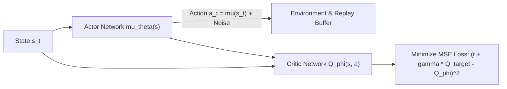

# Chương 6: RL trên Không gian Hành động Liên tục & Thuật toán DDPG / TD3

---

## 1. Thử thách của Không gian Hành động Liên tục (Continuous Action Spaces)

Trong các ứng dụng thực tế như điều khiển Robot tay máy, góc lái ô tô tự hành hay tay điều khiển máy bay, hành động $a$ là một **Vector số thực liên tục (Continuous Vector $a \in \mathbb{R}^d$)**.

Các thuật toán dựa trên Q-Learning (như DQN) không thể thực hiện phép tính $\max_{a'} Q(s', a')$ khi $a'$ là không gian số thực vô hạn. Do đó, ta cần các thuật toán chuyên dụng cho **Continuous Control**.

---

## 2. DDPG (Deep Deterministic Policy Gradient - DeepMind 2016)

DDPG là thuật toán Off-policy Actor-Critic sử dụng một **Deterministic Policy Network $a = \mu_\theta(s)$** sinh ra trực tiếp giá trị hành động liên tục $a$.

### 2.1. Cập nhật Mềm Trọng số Target (Polyak Soft Update):
DDPG không copy cứng trọng số Target Network sau mỗi $C$ steps như DQN, mà cập nhật mềm liên tục ở mỗi step với hệ số $\tau = 0.005$:

$$\theta^- \leftarrow \tau \theta + (1 - \tau) \theta^-$$
$$\phi^- \leftarrow \tau \phi + (1 - \tau) \phi^-$$

---

## 3. Thuật toán TD3 (Twin Delayed DDPG - Fujimoto et al., ICML 2018)

TD3 khắc phục 3 nhược điểm lớn khiến DDPG hay bị sụp đổ gradient:

### 3.1. Clipped Double Q-Learning:
Sử dụng 2 mạng Critic độc lập $Q_{\phi_1}$ và $Q_{\phi_2}$. Khi tính TD Target, lấy giá trị **nhỏ nhất (Minimum)** giữa 2 Critic để triệt tiêu hoàn toàn lỗi đánh giá cao quá mức Overestimation:

$$y_t = r_t + \gamma \min_{i=1,2} Q_{\phi_i^-} \left( s_{t+1}, \, \mu_{\theta^-}(s_{t+1}) + \epsilon \right)$$

### 3.2. Target Policy Smoothing (Làm mịn Hành động Target):
Thêm nhiễu Gauss được cắt ngắn $\epsilon \sim \text{clip}(\mathcal{N}(0, \sigma), -c, c)$ vào hành động mục tiêu để tránh mô hình khai thác các đỉnh nhiễu sắc nhọn của Q-function.

### 3.3. Delayed Policy Updates (Cập nhật Trễ cho Actor):
Cập nhật mạng Actor $\theta$ và các Target Networks với tần suất thưa hơn mạng Critic (ví dụ: cứ 2 lần cập nhật Critic $\phi$ mới thực hiện 1 lần cập nhật Actor $\theta$).
