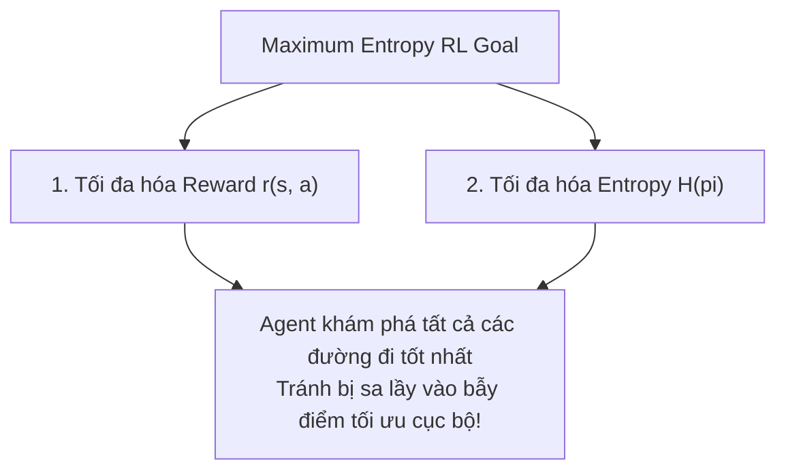

# Chương 7: Thuật toán Soft Actor-Critic & Maximum Entropy RL (SAC SOTA)

---

## 1. Khung lý thuyết Maximum Entropy Reinforcement Learning

Trong RL truyền thống, mục tiêu chỉ đơn thuần là tìm chiến lược $\pi$ tối đại hóa tổng phần thưởng $\sum r_t$. Điều này khiến Agent dễ rơi vào tình trạng **Khai thác quá sớm (Premature Convergence)** và mắc kẹt ở nghiệm tối ưu cục bộ (Local Optima).

**Maximum Entropy RL** thay đổi hàm mục tiêu, buộc Agent phải vừa tối đa hóa phần thưởng vừa **tối đa hóa độ ngẫu nhiên Entropy $\mathcal{H}(\pi(\cdot \mid s_t))$** của hành vi:

$$J(\pi) = \sum_{t=0}^{T} \mathbb{E}_{(s_t, a_t) \sim \rho_\pi} \left[ r(s_t, a_t) + \alpha \mathcal{H}(\pi(\cdot \mid s_t)) \right]$$

- $\mathcal{H}(\pi(\cdot \mid s_t)) = \mathbb{E}_{a \sim \pi} [-\log \pi(a \mid s_t)]$: Đo mức độ ngẫu nhiên/khám phá của Policy.
- $\alpha$: Tham số nhiệt độ (Temperature parameter) cân bằng giữa Phần thưởng và Khám phá.

---

## 2. Thuật toán Soft Actor-Critic (SAC - Haarnoja et al., UC Berkeley 2018)

SAC là thuật toán Off-policy Actor-Critic SOTA dành cho không gian hành động liên tục, kết hợp sức mạnh của Replay Buffer (Off-policy efficiency) và Maximum Entropy RL.

### 2.1. Ba Thành phần Cốt lõi trong Kiến trúc SAC:

1. **Dual Soft Q-Networks ($Q_{\psi_1}, Q_{\psi_2}$):** Sử dụng 2 mạng Soft Q-Function để khắc phục hiện tượng Overestimation Bias.
2. **Gaussian Policy Network ($\pi_\phi(a \mid s)$):** Dự đoán Trung bình $\mu_\phi(s)$ và Độ lệch chuẩn $\sigma_\phi(s)$ của phân phối Gaussian.
3. **Automatic Temperature Tuning ($\alpha$):** Tự động điều chỉnh tham số nhiệt độ $\alpha$ bằng Gradient Descent dựa trên mức Target Entropy $\bar{\mathcal{H}} = -|\mathcal{A}|$.

---

### 2.2. Kỹ thuật Reparameterization Trick trong SAC

Để tính đạo hàm qua phân phối xác suất ngẫu nhiên của Actor Network, SAC áp dụng **Reparameterization Trick**:

$$a_t = f_\phi(\epsilon_t; s_t) = \tanh \left( \mu_\phi(s_t) + \sigma_\phi(s_t) \odot \epsilon_t \right), \quad \epsilon_t \sim \mathcal{N}(0, I)$$

Phép nhân và cộng với vector nhiễu chuẩn $\epsilon_t$ giúp luồng Gradient truyền qua trực tiếp từ Q-Network về Actor Network $\phi$ mà không bị đứt đoạn!

---

### 2.3. Các Hàm Mất mát trong SAC:

#### 1. Critic Loss ($\mathcal{L}_Q(\psi_i)$):
$$y_t = r_t + \gamma \left( \min_{j=1,2} Q_{\bar{\psi}_j}(s_{t+1}, \tilde{a}_{t+1}) - \alpha \log \pi_\phi(\tilde{a}_{t+1} \mid s_{t+1}) \right)$$
$$\mathcal{L}_Q(\psi_i) = \mathbb{E}_{(s_t, a_t, r_t, s_{t+1})} \left[ \frac{1}{2} \left( Q_{\psi_i}(s_t, a_t) - y_t \right)^2 \right]$$

#### 2. Actor Loss ($\mathcal{L}_\pi(\phi)$):
$$\mathcal{L}_\pi(\phi) = \mathbb{E}_{s_t \sim \mathcal{D}, \epsilon_t \sim \mathcal{N}} \left[ \alpha \log \pi_\phi(\tilde{a}_t \mid s_t) - \min_{i=1,2} Q_{\psi_i}(s_t, \tilde{a}_t) \right]$$
