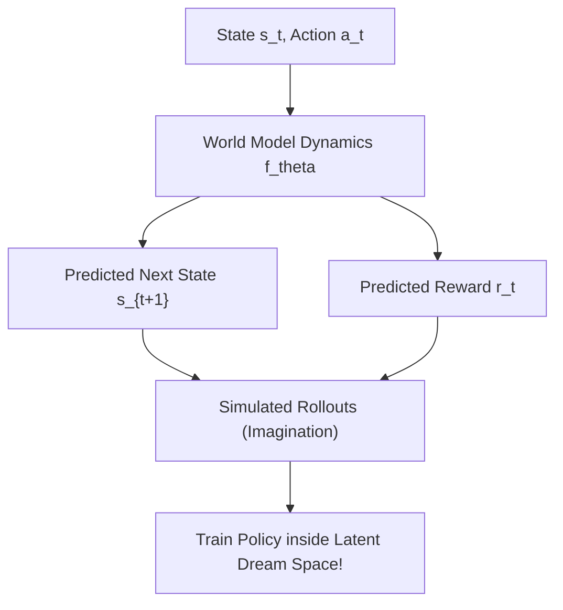

# Chương 8: Học Tăng cường Dựa trên Mô hình Môi trường (Model-Based RL & World Models)

---

## 1. Model-Free vs Model-Based Reinforcement Learning

| Đặc điểm | Model-Free RL (DQN, PPO, SAC) | Model-Based RL (MBRL / World Models) |
| :--- | :--- | :--- |
| **Cách hoạt động** | Tương tác trực tiếp với môi trường thật để học Q-function hoặc Policy | Học một **World Model** mô phỏng môi trường, sau đó lập kế hoạch (Planning) |
| **Hiệu quả Mẫu (Sample Efficiency)** | Rất thấp (Cần $10^6 - 10^9$ bước tương tác môi trường) | Rất cao (Tiết kiệm gấp 10-100 lần số mẫu nhờ huấn luyện trong trí tưởng tượng) |
| **Thử thách** | Tốn thời gian thực thi trong môi trường thực | Mô hình thế giới bị lỗi sai lệch (Model Bias / Exploitation of inaccuracy) |

---

## 2. Mô hình Động lực học Thế giới (Dynamics Model / World Model)

Mô hình thế giới $f_\theta$ nhận đầu vào là trạng thái hiện tại $s_t$ và hành động $a_t$, có nhiệm vụ dự đoán trạng thái tiếp theo $\hat{s}_{t+1}$ và phần thưởng tương ứng $\hat{r}_t$:

$$\hat{s}_{t+1}, \hat{r}_t = f_\theta(s_t, a_t)$$

---

## 3. Các Thuật toán Model-Based RL SOTA

### 3.1. Monte Carlo Tree Search (MCTS - AlphaGo / AlphaZero / MuZero - DeepMind)
MCTS kết hợp tìm kiếm cây quyết định ngẫu nhiên với Mạng Nơ-ron:
1. **Selection:** Duyệt qua cây chọn các nút có chỉ số UCT (Upper Confidence Bound for Trees) cao nhất.
2. **Expansion:** Mở rộng nút trạng thái mới.
3. **Evaluation:** Dùng Neural Network đánh giá giá trị $V(s)$ và xác suất Policy $P(a \mid s)$.
4. **Backup:** Cập nhật ngược giá trị lên các nút cha.

---

### 3.2. Mạng DreamerV3 (Hafner et al., DeepMind 2023)
DreamerV3 học một **Recurrent State Space Model (RSSM)** nén hình ảnh và tín hiệu cảm biến phức tạp thành các vector tiềm ẩn. Sau đó, nó huấn luyện mạng Actor-Critic hoàn toàn bên trong "Trí tưởng tượng" (Latent Imagination) của World Model mà không cần tương tác thêm với môi trường thật!
