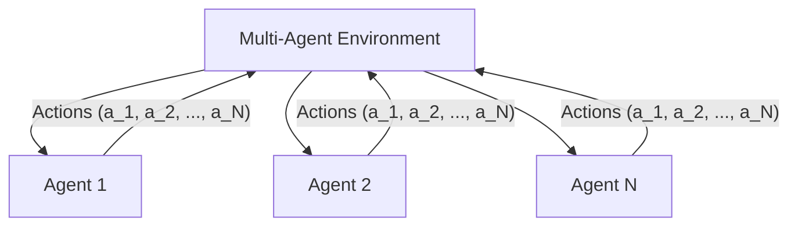

# Chương 9: Học Tăng cường Đa Agent (Multi-Agent Reinforcement Learning - MARL)

---

## 1. Bản chất của Multi-Agent RL (MARL)

Trong các bài toán thực tế như điều khiển Đàn xe tự lái (Autonomous Fleets), Đội hình Robot kho hàng, hoặc các trò chơi chiến thuật đồng đội (StarCraft II, Dota 2), có nhiều **Agent AI ($N \ge 2$)** cùng hoạt động và tương tác đồng thời trong một môi trường chung.



---

## 2. Thử thách Tính Không ổn định (Non-Stationarity)

Trong Single-Agent RL, môi trường có xác suất chuyển trạng thái $P(s' \mid s, a)$ cố định.

Tuy nhiên trong MARL, từ góc nhìn của Agent 1, xác suất $P(s' \mid s, a_1, a_2, \dots, a_N)$ liên tục bị thay đổi vì các Agent khác ($2 \dots N$) cũng đang học và thay đổi Policy của họ từng giây. Điều này vi phạm tính chất Markov và khiến môi trường trở nên **Không ổn định (Non-Stationary)**!

---

## 3. Khung Kiến trúc CTDE (Centralized Training with Decentralized Execution)

Để giải quyết vấn đề Non-Stationarity, ngành công nghiệp thống nhất áp dụng nguyên lý **CTDE**:

- **Centralized Training (Huấn luyện Tập trung):** Trong quá trình huấn luyện trên máy chủ/GPU, các mạng Critic được quyền truy cập toàn bộ thông tin toàn cục (Global State $S$ và Hành động của tất cả các Agents $a_1, \dots, a_N$).
- **Decentralized Execution (Thực thi Phân tán):** Khi triển khai hệ thống thực tế, mạng Actor của mỗi Agent chỉ nhận quan sát cục bộ của riêng mình $o_i$ để quyết định hành động mà không cần giao tiếp mạng với các Agent khác.

---

## 4. Thuật toán MADDPG (Multi-Agent DDPG - OpenAI 2017)

MADDPG mở rộng DDPG cho môi trường Đa Agent dựa trên khung CTDE:

```
[ Centralized Critic Q_i(S, a_1, a_2, ..., a_N) ] ──► Học điểm Q toàn cục (Off-line Training)
                                                           │
                                                           ▼
[ Decentralized Actor pi_i(o_i) ] ─────────────────► Chỉ nhận quan sát cục bộ o_i để ra quyết định!
```

### Công thức Gradient của Actor trong MADDPG:

$$\nabla_{\theta_i} J(\theta_i) = \mathbb{E}_{x, a \sim \mathcal{D}} \left[ \nabla_{\theta_i} \mu_{\theta_i}(o_i) \left. \nabla_{a_i} Q_i^{\mu}(x, a_1, \dots, a_N) \right|_{a_i = \mu_{\theta_i}(o_i)} \right]$$
