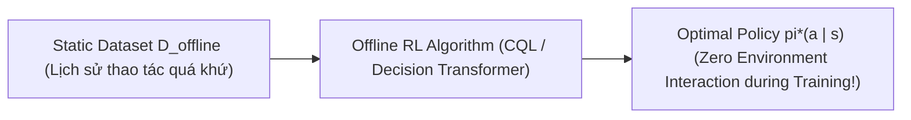

# Chương 11: Học Tăng cường Ngoại tuyến & Decision Transformer (Offline RL & Decision Transformer)

---

## 1. Bản chất của Offline Reinforcement Learning (Batch RL)

Trong Online RL (như PPO, SAC), Agent được tự do tương tác liên tục với môi trường để thử-và-sai. Tuy nhiên, trong các bài toán thực tế nghiêm ngặt như **Y tế (Medical Treatment)**, **Xe tự lái (Autonomous Driving)** hoặc **Vận hành Nhà máy Hóa chất**, ta không thể cho phép Agent chạy ngẫu nhiên vì nguy cơ tổn hại tính mạng và chi phí khổng lồ.

**Offline RL (Học Tăng cường Ngoại tuyến)** yêu cầu Agent học một Policy tối ưu hoàn toàn từ một **Tập dữ liệu tĩnh $\mathcal{D}_{\text{offline}}$** được thu thập từ trước bởi các chiến lược khác, **mà không được phép tương tác thêm bất kỳ một bước nào với môi trường thực tế!**



---

## 2. Thử thách Sai lệch Phân phối (Distribution Shift & Out-of-Distribution Actions)

Khi học từ dataset tĩnh, nếu mạng Q-Network đánh giá một hành động $a$ nằm ngoài tập dữ liệu (Out-of-Distribution - OOD Action), phép toán $\max_a Q(s, a)$ sẽ bị **Lỗi đánh giá cao quá mức bất hợp lý (Overestimation)**. Trong Online RL, Agent chỉ cần thực hiện hành động đó và nhận phần thưởng xấu để tự sửa sai, nhưng trong Offline RL, Agent không bao giờ tương tác với môi trường để biết rằng đó là hành động sai!

---

## 3. Thuật toán Conservative Q-Learning (CQL - Kumar et al., UC Berkeley)

CQL khắc phục lỗi OOD Action bằng cách thêm một khoản phạt âm cho giá trị Q-value của các hành động không có trong dataset:

$$\min_Q \alpha \, \mathbb{E}_{s \sim \mathcal{D}} \left[ \log \sum_{a} \exp(Q(s, a)) - \mathbb{E}_{a \sim \mathcal{D}} [Q(s, a)] \right] + \frac{1}{2} \mathbb{E}_{(s, a, s') \sim \mathcal{D}} \left[ \left( Q(s, a) - \mathcal{B} Q(s, a) \right)^2 \right]$$

---

## 4. Mô hình Decision Transformer (Chen et al., UC Berkeley 2021)

Decision Transformer thay đổi hoàn toàn tư duy của RL: **Coi bài toán Offline RL như một bài toán Autoregressive Sequence Modeling!**

```
Sequence Prompt: (Target Return R_1, State s_1, Action a_1, Target Return R_2, State s_2, Action a_2, ...)
                          │
                          ▼
             [ Causal Transformer Decoder ]
                          │
                          ▼
               Action Output a_t cho Robot!
```

### Cách hoạt động:
1. Chuỗi tokens đưa vào Transformer gồm: **Return-to-Go $R_t = \sum_{k=t}^{T} r_k$**, **State $s_t$**, và **Action $a_t$**.
2. Khi suy luận thực tế (Inference), ta chỉ cần cung cấp phần thưởng kỳ vọng mong muốn (ví dụ $R_1 = 500$ cho kết quả tối đa), Transformer sẽ tự động giải mã các chuỗi hành động $a_t$ dẫn tới phần thưởng mong muốn đó!
