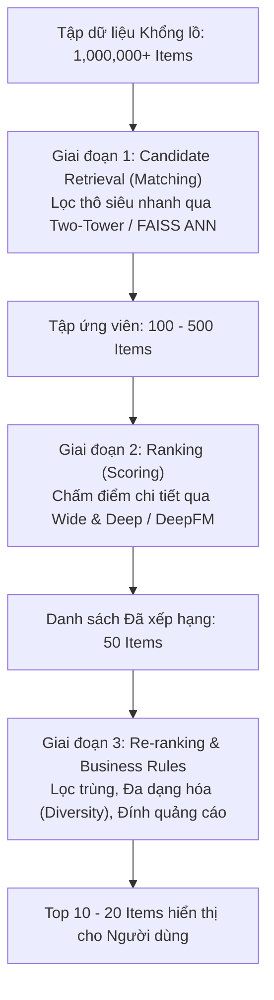

# Chương 1: Nền tảng & Kiến trúc Tổng quan Hệ thống Gợi ý (RecSys Fundamentals & Paradigms)

---

## 1. Hệ thống Gợi ý (Recommendation Systems - RecSys) là gì?

Trong kỷ nguyên bùng nổ thông tin (Information Overload), người dùng bị choợp ngợp trước hàng triệu sản phẩm trên các nền tảng thương mại điện tử (Amazon, Shopee), video (YouTube, TikTok) hoặc âm nhạc (Spotify). 

**Hệ thống Gợi ý (RecSys)** có nhiệm vụ tự động dự đoán sở thích của người dùng và hiển thị danh sách các sản phẩm/nội dung phù hợp nhất cho từng cá nhân (Personalization).

---

## 2. Kiến trúc 2 Giai đoạn Tiêu chuẩn Công nghiệp (Industrial Two-Stage Pipeline)

Trên các hệ thống thực tế phục vụ hàng trăm triệu người dùng và hàng chục triệu sản phẩm, không một mô hình Deep Learning nào có thể tính toán điểm tương thích cho toàn bộ sản phẩm trong vài miligiây. Do đó, ngành công nghiệp quy định **Pipeline 2 giai đoạn**:

### 2.1. Giai đoạn 1: Candidate Retrieval (Matching)
- **Mục tiêu:** Rút gọn quy mô từ hàng triệu items xuống còn vài trăm items tiềm năng nhất.
- **Yêu cầu:** Tốc độ phản hồi cực nhanh ($\le 10 \text{ ms}$).
- **Công nghệ:** Two-Tower Models (DSSM), Matrix Factorization, Tìm kiếm Láng giềng Xấp xỉ (FAISS ANN / HNSW).

### 2.2. Giai đoạn 2: Ranking (Scoring)
- **Mục tiêu:** Chấm điểm và xếp hạng chính xác từng candidate item.
- **Yêu cầu:** Độ chính xác cao, tính toán các đặc trưng phức tạp (User features, Item features, Cross features, Context).
- **Công nghệ:** Wide & Deep, DCN-v2, MMOE.

---

## 3. Các Loại hình Phản hồi (Explicit vs Implicit Feedback)

| Đặc điểm | Explicit Feedback (Phản hồi Trực tiếp) | Implicit Feedback (Phản hồi Gián tiếp) |
| :--- | :--- | :--- |
| **Dạng dữ liệu** | Chấm điểm 1-5 sao, Viết review, Nút Like/Dislike | Lịch sử Click, Thời gian xem (Watch time), Thêm vào giỏ hàng, Lượt mua |
| **Ưu điểm** | Thể hiện chính xác độ thích/ghét của người dùng | Dữ liệu thu thập khổng lồ, tự động không cần người dùng thao tác |
| **Nhược điểm** | Cực kỳ thưa thớt (Sparsity $> 99.9\%$) | Chứa nhiều nhiễu (Click nhầm, xem vì tò mò nhưng không thích) |

---

## 4. Các Thử thách Cốt lõi trong RecSys

1. **Cold-Start Problem (Thử thách Khởi động Lạnh):**
   - **New User:** Người dùng mới chưa có lịch sử tương tác $\longrightarrow$ Giải pháp: Gợi ý các sản phẩm phổ biến nhất (Popularity-based) hoặc theo thông tin nhân khẩu học (Demographics).
   - **New Item:** Sản phẩm mới chưa có ai click $\longrightarrow$ Giải pháp: Content-Based Filtering dựa trên đặc trưng văn bản/hình ảnh sản phẩm.
2. **Data Sparsity (Độ thưa dữ liệu):** Ma trận tương tác User-Item thực tế có đến $99.9\%$ ô trống.
3. **Filter Bubble & Serendipity:** Tránh hiện tượng chỉ gợi ý lặp lại những gì người dùng đã xem, tạo ra hiện tượng "bọc bộ lọc" loại bỏ tính bất ngờ thú vị (Serendipity).
