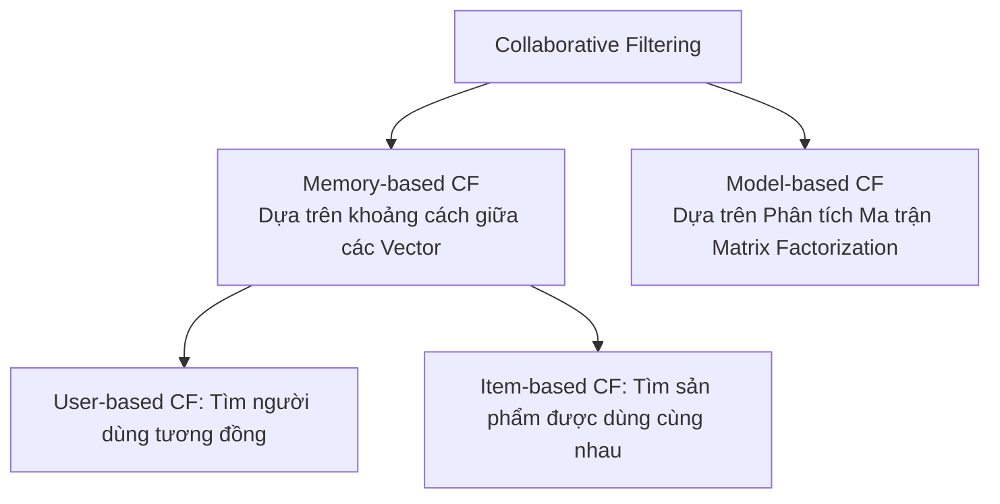

# Chương 2: Lọc Cộng tác & Phân tích Ma trận (Collaborative Filtering & Matrix Factorization)

---

## 1. Lọc Cộng tác (Collaborative Filtering - CF)

Lọc cộng tác dựa trên triết lý: *"Nếu người dùng A có sở thích giống người dùng B trong quá khứ, thì người dùng A nhiều khả năng sẽ thích các sản phẩm mà B lựa chọn trong tương lai."*



---

## 2. Phân tích Ma trận (Matrix Factorization - MF)

Matrix Factorization biểu diễn cả người dùng và sản phẩm trong cùng một **Không gian Vector tiềm ẩn (Latent Factor Space)** kích thước $K$ (thường $K \in [32, 128]$).

```
   Ma trận Tương tác R (M x N)  ≈  Ma trận User U (M x K)  x  Ma trận Item V^T (K x N)
```

### 2.1. Công thức Dự đoán Điểm tương tác:

$$\hat{r}_{u, i} = \mathbf{u}_u^T \mathbf{v}_i + b_u + b_i + \mu$$

- $\mathbf{u}_u \in \mathbb{R}^K$: Vector tiềm ẩn của người dùng $u$.
- $\mathbf{v}_i \in \mathbb{R}^K$: Vector tiềm ẩn của sản phẩm $i$.
- $b_u, b_i$: Sai lệch (Bias) riêng của người dùng $u$ (người khó tính vs dễ tính) và sản phẩm $i$.
- $\mu$: Điểm đánh giá trung bình trên toàn hệ thống.

---

## 3. Bayesian Personalized Ranking (BPR - Rendle et al., 2009)

Đối với dữ liệu **Implicit Feedback** (chỉ có lượt click, không có điểm đánh giá 1-5 sao), các thuật toán xếp hạng pointwise thông thường sẽ thất bại. **BPR** là phương pháp SOTA cho bài toán **Pairwise Ranking**.

```
  Dữ liệu tương tác BPR Triplet (u, i, j):
  - User u đã click Item i (Observed Positive)
  - User u CHƯA click Item j (Unobserved Negative)
  ===> BPR ép điểm: Score(u, i) > Score(u, j)
```

### 3.1. Hàm Mất mát BPR Loss:

$$\mathcal{L}_{\text{BPR}} = -\sum_{(u, i, j) \in D} \ln \sigma \left( \hat{x}_{u, i} - \hat{x}_{u, j} \right) + \lambda \left( \|\mathbf{u}_u\|^2 + \|\mathbf{v}_i\|^2 + \|\mathbf{v}_j\|^2 \right)$$

Trong đó $\hat{x}_{u, i} = \mathbf{u}_u^T \mathbf{v}_i$ và $\hat{x}_{u, j} = \mathbf{u}_u^T \mathbf{v}_j$, $\sigma(x) = \frac{1}{1 + e^{-x}}$ là hàm Sigmoid.

- Khi $\hat{x}_{u, i} \gg \hat{x}_{u, j}$, hiệu số $\hat{x}_{u, i} - \hat{x}_{u, j} > 0 \implies \sigma \approx 1 \implies \ln \sigma \approx 0$ (Loss bằng 0).
- Khi mô hình đoán sai $\hat{x}_{u, i} < \hat{x}_{u, j}$, hàm BPR Loss sẽ phạt cực nặng bằng Gradient Descent để điều chỉnh trọng số!
