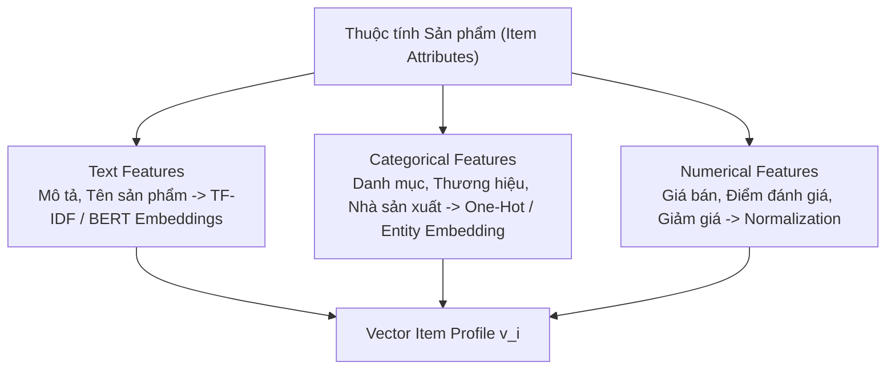

# Chương 3: Lọc Dựa trên Nội dung (Content-Based Filtering)

---

## 1. Bản chất của Content-Based Filtering

Trái ngược với Lọc cộng tác (Collaborative Filtering) chỉ phụ thuộc vào hành vi lịch sử người dùng khác, **Content-Based Filtering** tập trung phân tính trực tiếp các thuộc tính nội dung và đặc trưng của bản thân sản phẩm (Item Attributes) cũng như sở thích người dùng (User Profile).

```
User u thích "Phim Hành động Hollywood" ──► Hệ thống tìm các Phim có thuộc tính "Hành động", "Hollywood" ──► Gợi ý cho User u
```

---

## 2. Quy trình Xây dựng Vector Đặc trưng Nội dung (Item Profile Vector)

Một sản phẩm $i$ được biểu diễn bằng vector nén tập hợp các thuộc tính đa dạng:



---

## 3. Tạo Hồ sơ Người dùng (User Profile Vector) & Tính tương đồng

Vector hồ sơ người dùng $\mathbf{u}_u$ được tạo ra bằng cách lấy trung bình có trọng số (Weighted Mean) của các vector đặc trưng của sản phẩm mà người dùng đã từng thích trong quá khứ:

$$\mathbf{u}_u = \frac{\sum_{i \in \text{Liked}(u)} w_{u, i} \cdot \mathbf{v}_i}{\sum_{i \in \text{Liked}(u)} w_{u, i}}$$

Điểm phù hợp giữa người dùng $u$ và sản phẩm mới $k$ được tính bằng **Cosine Similarity**:

$$\text{Score}(u, k) = \text{Cosine Sim}(\mathbf{u}_u, \mathbf{v}_k) = \frac{\mathbf{u}_u \cdot \mathbf{v}_k}{\|\mathbf{u}_u\| \|\mathbf{v}_k\|}$$

---

## 4. Ưu và Nhược điểm của Content-Based Filtering

### Ưu điểm:
1. **Khắc phục Cold-Start cho Item mới:** Ngay khi một sản phẩm mới được đăng bán, hệ thống đã có thể gợi ý sản phẩm đó cho người dùng dựa vào mô tả và thuộc tính mà không cần đợi ai click trước.
2. **Khả năng Giải thích (Explainability):** Dễ dàng giải thích cho người dùng lý do sản phẩm được gợi ý (*"Bạn nhận được gợi ý này vì bạn đã từng xem các sản phẩm thuộc danh mục Giày Thể Thao"*).

### Nhược điểm:
1. **Thiếu tính mạo hiểm / Bất ngờ (Lack of Serendipity):** Người dùng chỉ nhận được các gợi ý tương tự những gì họ đã xem trong quá khứ, tạo ra "bọc bộ lọc" (Filter Bubble).
