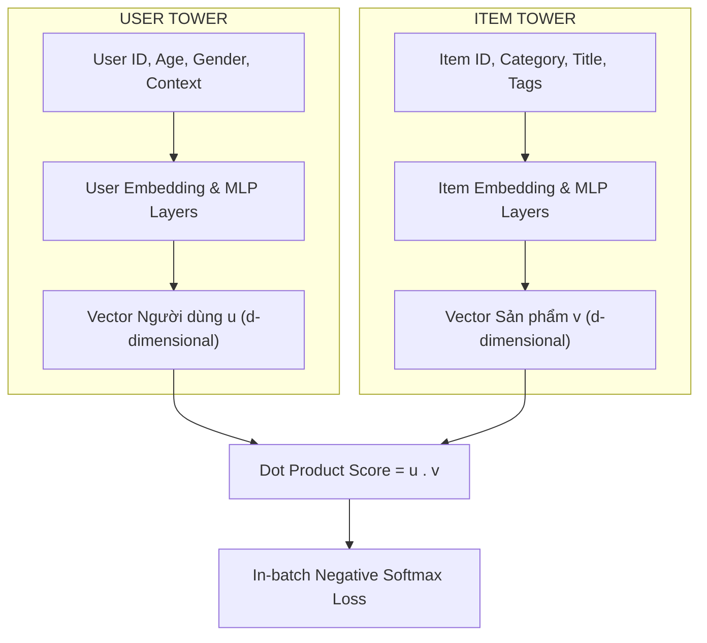

# Chương 4: Kiến trúc Two-Tower & Deep Learning trong Candidate Retrieval (Google DSSM)

---

> [!IMPORTANT]
> 📌 **TỔNG QUAN & VAI TRÒ TRONG PIPELINE AI:**
> Khi cơ sở dữ liệu có $10,000,000+$ sản phẩm, hệ thống không bao giờ có thể chạy một mô hình Deep Learning phức tạp để tính điểm cho từng sản phẩm trong vài miligiây được.
> **Mục tiêu của Chương 4** là giải thích bài toán **Candidate Retrieval (Matching / Lọc thô)** sử dụng **Kiến trúc Hai tháp (Google Two-Tower DSSM)**.
> - **Đầu vào:** Thông tin người dùng $x_{\text{user}}$ và toàn bộ sản phẩm $x_{\text{item}}$.
> - **Xử lý:** User Tower $\mathbf{u} = \text{MLP}(x_{\text{user}})$ và Item Tower $\mathbf{v} = \text{MLP}(x_{\text{item}})$ $\to$ Tính điểm $\mathbf{u}^T \mathbf{v}$ $\to$ In-batch Softmax Loss.
> - **Đầu ra:** Tập hợp 100 - 500 sản phẩm ứng viên phù hợp nhất thu được sau phép tìm kiếm vector siêu tốc $< 5\text{ms}$.
> - **Vai trò:** Là bước đầu tiên bắt buộc (Stage 1) trong mọi hệ thống gợi ý quy mô lớn thực tế!

---

## 1. Sự Cần thiết của Kiến trúc Two-Tower (Hai Tháp)

Trong giai đoạn **Candidate Retrieval (Matching)** của các hệ thống gợi ý lớn (như YouTube, TikTok, Shopee), mục tiêu là lọc thô 100-500 sản phẩm tiềm năng nhất từ tập hợp 10,000,000+ sản phẩm trong thời gian dưới $10 \text{ ms}$.

Mô hình **Two-Tower (Hai Tháp)** do Google phát triển (dựa trên mô hình DSSM - Deep Structured Semantic Model) là chuẩn mực công nghiệp hàng đầu cho giai đoạn này.

---

## 2. Chi tiết Cấu trúc Mô hình Two-Tower

### 2.1. Tháp Người dùng (User Tower):
Nhận toàn bộ thông tin thuộc tính và lịch sử tương tác của người dùng $x_{\text{user}}$, đưa qua các tầng nơ-ron liên kết đầy đủ (MLP) với hàm kích hoạt ReLU/GELU và lớp chuẩn hóa L2-Normalization:

$$\mathbf{u} = \text{L2\_Normalize}\left( \text{MLP}_{\text{user}}(x_{\text{user}}) \right) \in \mathbb{R}^d$$

### 2.2. Tháp Sản phẩm (Item Tower):
Nhận toàn bộ thuộc tính của sản phẩm $x_{\text{item}}$ (ID, danh mục, từ khóa mô tả) và chiếu về cùng không gian không gian vector $d$ chiều:

$$\mathbf{v} = \text{L2\_Normalize}\left( \text{MLP}_{\text{item}}(x_{\text{item}}) \right) \in \mathbb{R}^d$$

#### 💡 Giải thích Dễ hiểu Từng con số & Quy trình Hoạt động Offline/Online:

##### 1. Quá trình Huấn luyện (Training Stage):
- **User Tower:** Nạp thuộc tính (Tuổi=25, Giới tính=Nam, Lịch sử xem 10 video gần nhất) $\to$ Đưa qua MLP $\to$ Vector $\mathbf{u} \in \mathbb{R}^{128}$.
- **Item Tower:** Nạp thuộc tính video (ID=7892, Thể loại=Hành động, Title="Inception") $\to$ Đưa qua MLP $\to$ Vector $\mathbf{v} \in \mathbb{R}^{128}$.
- **In-Batch Negative Loss:** Với batch size $= 1024$ cặp người dùng-video, mô hình dùng 1 item đúng làm Positive và 1023 items của người dùng khác trong batch làm Negatives $\to$ Tối ưu hóa Softmax Loss.

##### 2. Quá trình Phục vụ Thực tế (Serving Stage $< 5\text{ms}$):
- **Bước Offline (Tính trước 10,000,000 items):**
  - Tháp Item Tower chạy trước cho tất cả $10,000,000$ video trong kho dữ liệu $\to$ Lưu $10,000,000$ vector $\mathbf{v}_i \in \mathbb{R}^{128}$ vào chỉ mục tìm kiếm siêu tốc **FAISS HNSW Index**.
- **Bước Online (Khi người dùng mở App):**
  - Tháp User Tower chỉ tính duy nhất 1 lần để tạo ra vector người dùng hiện tại $\mathbf{u} \in \mathbb{R}^{128}$.
  - Đưa vector $\mathbf{u}$ vào FAISS Index bắn ra **Top 100 - 500 video có tích vô hướng $\mathbf{u} \cdot \mathbf{v}_i$ cao nhất trong đúng $2 \text{ ms}$!**

---

## 3. Hàm Mất mát In-batch Negative Softmax Loss

Thay vì phải tạo mẫu âm (negative samples) thủ công đắt đỏ, Two-Tower tận dụng chính các sản phẩm của các người dùng khác nằm trong cùng một Batch làm **Negative Samples (In-batch Negatives)**.

Với một Batch gồm $B$ cặp tương tác $(u_1, v_1), (u_2, v_2), \dots, (u_B, v_B)$:

$$\mathcal{L}_{\text{InBatchSoftmax}} = -\frac{1}{B} \sum_{i=1}^{B} \log \frac{\exp\left( \frac{\mathbf{u}_i^T \mathbf{v}_i}{\tau} \right)}{\sum_{j=1}^{B} \exp\left( \frac{\mathbf{u}_i^T \mathbf{v}_j}{\tau} \right)}$$

Trong đó $\tau$ là tham số nhiệt độ (temperature scaling factor).

---

## 4. Tại sao Two-Tower lại cho Tốc độ Tìm kiếm Siêu tốc?

Biểu diễn tách biệt giữa 2 tháp tạo ra lợi thế vận hành cực lớn trong môi trường sản xuất (Production Deployment):

1. **Offline Pre-computation:** Chiếu toàn bộ 10,000,000 sản phẩm qua **Item Tower** ở chế độ offline (hàng đêm) để thu được 10 triệu vectors $\mathbf{v}_i$, sau đó nạp vào cơ sở dữ liệu vector **FAISS / HNSW**.
2. **Online Inference (< 5ms):** Khi người dùng truy cập ứng dụng, hệ thống chỉ cần tính vector $\mathbf{u}$ của người dùng đó bằng **User Tower** và thực hiện phép nhân ma trận tìm kiếm ANN trong vài miligiây!
