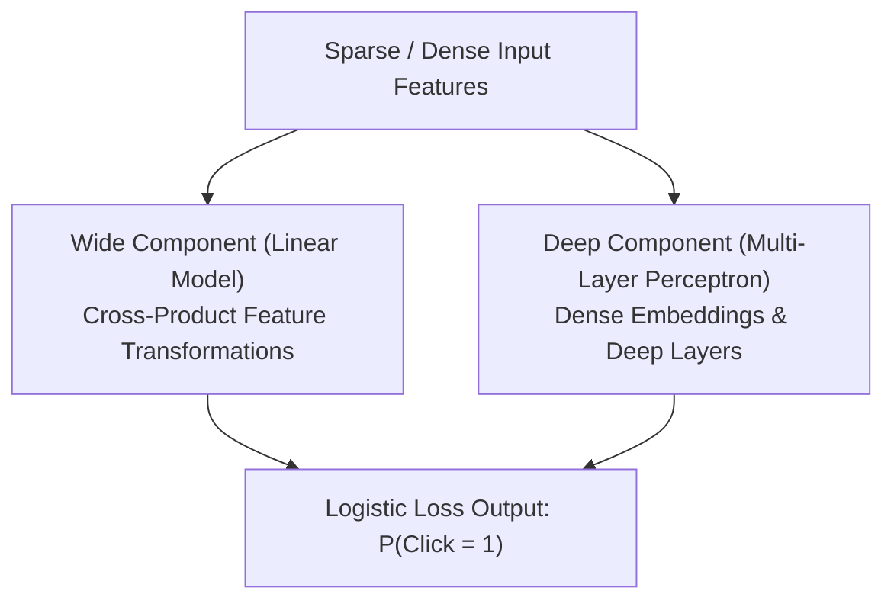

# Chương 5: Mô hình Wide & Deep và Deep & Cross trong Ranking (Wide & Deep & DCN-v2)

---

## 1. Bài toán Ranking & Hai khái niệm: Memorization vs Generalization

Trong giai đoạn **Ranking (Scoring)**, mô hình phải dự đoán xác suất Click (CTR - Click-Through Rate) hoặc xác suất mua hàng của người dùng đối với danh sách các Candidate Items thu được từ giai đoạn Retrieval.

Google phát hiện ra rằng một mô hình gợi ý hoàn hảo cần kết hợp 2 năng lực:
1. **Ghi nhớ (Memorization):** Khả năng học các mối tương quan đặc thù xuất hiện trực tiếp và dồn dập trong dữ liệu lịch sử (ví dụ: người xem tin tức thể thao rất hay nhấp vào quảng cáo giày Nike).
2. **Tổng quát hóa (Generalization):** Khả năng khám phá và gợi ý các tương tác hoàn toàn mới chưa từng thấy dựa trên sự tương đồng ngữ nghĩa.

---

## 2. Mô hình Wide & Deep (Google - Cheng et al., 2016)

Wide & Deep kết hợp một **Mô hình Tuyến tính Rộng (Wide Component)** và một **Mạng Nơ-ron Sâu (Deep Component)** trong một kiến trúc thống nhất.

### 2.1. Wide Component (Nhánh Rộng):
Dùng mô hình Generalized Linear Model với các biến đổi tích chéo đặc trưng thủ công (Cross-Product Transformations):

$$\phi_k(x) = \prod_{j=1}^{d} x_j^{c_{kj}}, \quad c_{kj} \in \{0, 1\}$$

- *Ví dụ:* Nếu `user_installed_app = Netflix` và `impression_app = Hulu`, thì $\phi_k(x) = 1$, ngược lại bằng $0$.

### 2.2. Deep Component (Nhánh Sâu):
Chuyển đổi các đặc trưng thưa (Categorical IDs) thành các Dense Embeddings nén, sau đó đưa qua các tầng nơ-ron đa lớp (MLP):

$$a^{(l+1)} = \text{ReLU}\left( W^{(l)} a^{(l)} + b^{(l)} \right)$$

### 2.3. Công thức Kết hợp Đầu ra:

$$P(Y = 1 \mid x) = \sigma \left( \mathbf{w}_{\text{wide}}^T [x, \phi(x)] + \mathbf{w}_{\text{deep}}^T a^{(L)} + b \right)$$

---

## 3. Deep & Cross Network (DCN & DCN-v2 - Google 2017/2021)

Nhược điểm của Wide & Deep là phần Wide vẫn đòi hỏi các kỹ sư phải xây dựng thủ công các bộ tương tác chéo (Feature Crosses).

**DCN-v2 (Wang et al., Google 2021)** thay thế phần Wide bằng một **Cross Network** có khả năng tự động học các tương tác đặc trưng bậc cao ($x_1 \times x_2 \times x_3 \dots$) một cách tự động và hiệu quả:

$$x_{l+1} = x_0 \odot \left( W_l x_l + b_l \right) + x_l$$

Trong đó $\odot$ là phép nhân Hadamard từng phần tử và $x_0$ là vector embedding ban đầu.
