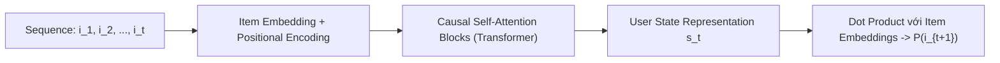

# Chương 6: Gợi ý theo Chuỗi & Session (Sequential & Session-Based Recommendation - SASRec)

---

## 1. Bản chất của Sequential Recommendation

Trong nhiều kịch bản thực tế (như trang mua sắm thương mại điện tử, ứng dụng nghe nhạc), sở thích của người dùng thay đổi liên tục theo thời gian thực dựa trên các hành vi vừa thực hiện gần nhất.

**Sequential Recommendation** coi lịch sử tương tác của người dùng như một chuỗi thời gian:

$$S_u = \left( i_1, i_2, \dots, i_t \right)$$

Mục tiêu là dự đoán sản phẩm tiếp theo $i_{t+1}$ mà người dùng sẽ click dựa trên chuỗi quá khứ $S_u$.

```
Lịch sử Click: [Điện thoại iPhone] ──► [Kính cường lực] ──► [Ốp lưng] ──► Dự đoán Item tiếp theo: ? (Sạc MagSafe)
```

---

## 2. Mô hình GRU4Rec (Hidasi et al., ICLR 2016)

GRU4Rec áp dụng mạng nơ-ron hồi quy **GRU (Gated Recurrent Unit)** cho dữ liệu phiên làm việc (Session-based data):
- **Session-Parallel Mini-Batches:** Xử lý song song các session có độ dài khác nhau.
- **Pairwise Ranking Loss (TOP1 / BPR Loss):** Ép điểm sản phẩm thực sự được click cao hơn các sản phẩm ngẫu nhiên.

---

## 3. Mô hình SASRec (Self-Attention Based Sequential Recommendation - Kang & McAuley, ICDM 2018)

SASRec áp dụng kiến trúc **Transformer Causal Self-Attention** cho chuỗi hành vi tương tác của người dùng.



### 3.1. Các Ưu điểm Vượt trội của SASRec:
1. **Causal Masked Self-Attention:** Cho phép vị trí bước $t$ quan sát toàn bộ các tương tác quá khứ $< t$ để đưa ra dự đoán.
2. **Cân bằng giữa Ngắn hạn & Dài hạn:**
   - Khi ít tương tác: Hoạt động giống như **Matrix Factorization** (học sở thích dài hạn).
   - Khi nhiều tương tác: Hoạt động giống như **Markov Chains** (học xu hướng ngắn hạn vừa diễn ra).

---

## 4. Code Python Minh họa Kiến trúc SASRec trong PyTorch

```python
import torch
import torch.nn as nn

class SASRecBlock(nn.Module):
    """Một khối Causal Self-Attention Layer cho SASRec."""
    def __init__(self, hidden_dim: int, num_heads: int, dropout: float = 0.2):
        super().__init__()
        self.attention = nn.MultiheadAttention(embed_dim=hidden_dim, num_heads=num_heads, batch_first=True)
        self.layer_norm1 = nn.LayerNorm(hidden_dim)
        self.layer_norm2 = nn.LayerNorm(hidden_dim)
        self.ffn = nn.Sequential(
            nn.Linear(hidden_dim, hidden_dim * 4),
            nn.ReLU(),
            nn.Linear(hidden_dim * 4, hidden_dim),
            nn.Dropout(dropout)
        )

    def forward(self, x: torch.Tensor, attn_mask: torch.Tensor) -> torch.Tensor:
        # Self-attention với Causal Mask
        attn_out, _ = self.attention(x, x, x, attn_mask=attn_mask)
        x = self.layer_norm1(x + attn_out)
        ffn_out = self.ffn(x)
        x = self.layer_norm2(x + ffn_out)
        return x
```
