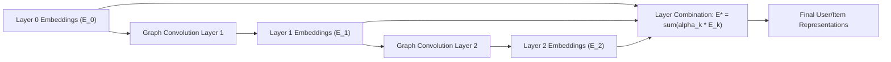

# Chương 7: Mạng Nơ-ron Đồ thị trong RecSys (Graph Neural Networks & LightGCN)

---

## 1. Biểu diễn Tương tác RecSys dưới dạng Đồ thị Hai phía (Bipartite Graph)

Toàn bộ dữ liệu tương tác giữa người dùng và sản phẩm bản chất có cấu trúc **Đồ thị Hai phía (User-Item Bipartite Graph)**:
- Nút (Nodes): Tập người dùng $U$ và Tập sản phẩm $I$.
- Cạnh (Edges): Cạnh $e_{u, i}$ xuất hiện nếu người dùng $u$ tương tác với sản phẩm $i$.

```
   USER NODES (U)                     ITEM NODES (I)
     [ User 1 ] ─────────┬───────────► [ Item A ]
                         │
     [ User 2 ] ─────────┼───────────► [ Item B ]
                         │
     [ User 3 ] ─────────┴───────────► [ Item C ]
```

---

## 2. Nút thắt của Matrix Factorization & Sức mạnh của Message Passing

- **Matrix Factorization (MF):** Chỉ tối ưu trực tiếp tương tác 1-hop giữa $(u, i)$.
- **Graph Neural Networks (GNN):** Nhờ cơ chế **Lan truyền Thông điệp (Message Passing)**, GNN khai phá các mối quan hệ cấu trúc bậc cao ($N$-hop Neighbors - ví dụ: User 1 tương tác với Item A, Item A được tương tác bởi User 2 $\implies$ User 1 có sự kết nối 2-hop với User 2 và 3-hop với Item B mà User 2 đã mua).

---

## 3. Mô hình LightGCN (He et al., SIGIR 2020 - SOTA RecSys GNN)

LightGCN là bước đột phá lớn nhất của GNN trong RecSys. Các tác giả phát hiện ra rằng 2 thành phần cốt lõi của GNN truyền thống (Feature Transformation Matrix $W$ và Non-linear Activation $\sigma$ như ReLU) không hề giúp ích mà còn làm giảm hiệu năng gợi ý!

**LightGCN loại bỏ toàn bộ $W$ và $\sigma$, chỉ giữ lại duy nhất phép Gom tụ Xóm (Graph Neighborhood Aggregation).**



### 3.1. Công thức Lan truyền Thông điệp trong LightGCN:

$$e_u^{(k+1)} = \sum_{i \in \mathcal{N}_u} \frac{1}{\sqrt{|\mathcal{N}_u|} \sqrt{|\mathcal{N}_i|}} e_i^{(k)}$$

$$e_i^{(k+1)} = \sum_{u \in \mathcal{N}_i} \frac{1}{\sqrt{|\mathcal{N}_i|} \sqrt{|\mathcal{N}_u|}} e_u^{(k)}$$

- $\mathcal{N}_u$: Tập các sản phẩm mà người dùng $u$ đã tương tác.
- $\frac{1}{\sqrt{|\mathcal{N}_u|} \sqrt{|\mathcal{N}_i|}}$: Hệ số chuẩn hóa Symmetric Normalization để tránh nổ vector cho các đỉnh có bậc (degree) quá lớn.

### 3.2. Tổng hợp Biểu diễn Đa tầng (Layer Combination):

$$e_u^* = \sum_{k=0}^{K} \alpha_k e_u^{(k)}, \quad e_i^* = \sum_{k=0}^{K} \alpha_k e_i^{(k)}$$

Điểm tương tác dự đoán: $\hat{y}_{u, i} = (e_u^*)^T e_i^*$. Mô hình được huấn luyện bằng hàm **BPR Loss**.
