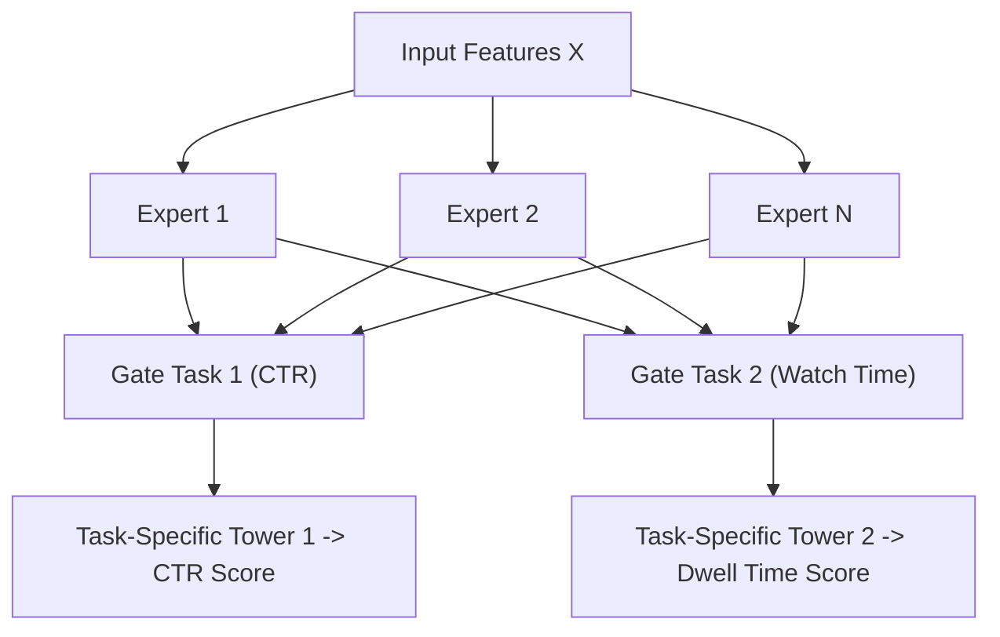

# Chương 8: Gợi ý Đa Mục tiêu & Multi-Task Learning (MMOE & ESMM)

---

## 1. Tại sao cần Gợi ý Đa Mục tiêu (Multi-Objective Recommendation)?

Trên các ứng dụng thực tế (YouTube, TikTok, Shopee), trải nghiệm người dùng là sự tổng hòa của nhiều loại hành vi khác nhau. Nếu một hệ thống chỉ tối ưu duy nhất chỉ số **Click (CTR)**, nó sẽ nhanh chóng biến thành một trang **Clickbait** toàn tin giật gân nhưng chất lượng kém.

Hệ thống gợi ý doanh nghiệp phải tối ưu hóa đồng thời nhiều mục tiêu:
- **Tác vụ 1 (CTR):** Xác suất người dùng bấm Click.
- **Tác vụ 2 (Watch Time / Dwell Time):** Thời gian xem video thực tế.
- **Tác vụ 3 (CVR):** Tỷ lệ chuyển đổi mua hàng (Conversion Rate).
- **Tác vụ 4 (Engagement):** Lượt Like, Comment, Share.

---

## 2. Mô hình MMOE (Multi-gate Mixture-of-Experts - Google, Ma et al., 2018)

Mô hình Shared-Bottom truyền thống gặp hiện tượng **Negative Transfer** (khi các tác vụ xung đột nhau, việc học tác vụ A làm suy giảm hiệu năng của tác vụ B). 

**MMOE** khắc phục hiện tượng này bằng cách sử dụng một tập hợp các **Chuyên gia (Shared Experts)** và một **Mạng Cổng Gating Network** riêng cho từng tác vụ.



### Công thức Gating Network của Task $k$:

$$g^k(x) = \text{Softmax}\left( W_g^k x \right)$$

$$f^k(x) = \sum_{i=1}^{N} g_i^k(x) \cdot \text{Expert}_i(x)$$

---

## 3. Mô hình ESMM (Entire Space Multi-Task Model - Alibaba 2018)

ESMM giải quyết 2 thử thách lớn nhất trong bài toán gợi ý mua hàng (CVR):
1. **Sample Selection Bias:** Mô hình CVR truyền thống chỉ được huấn luyện trên các sản phẩm đã được Click, nhưng khi triển khai thực tế nó lại phải dự đoán trên toàn bộ các sản phẩm chưa Click.
2. **Data Sparsity:** Lượt mua hàng (Conversion) thưa thớt hơn lượt Click gấp 100 lần.

### Giải pháp Toán học của ESMM:
Dựa trên quy tắc xác suất có điều kiện:

$$P(\text{CTCVR}) = P(\text{CTR} \times \text{CVR}) = P(\text{CTR}) \times P(\text{CVR} \mid \text{CTR})$$

```
Input Features ──┬──► [ CTR Tower ] ──────────────────────────► P(CTR) ──────┐
                 │                                                           ├──► (*) ──► P(CTCVR)
                 └──► [ CVR Tower (Shared Embeddings) ] ──────► P(CVR) ──────┘
```

ESMM huấn luyện đồng thời 2 tác vụ chính trên **toàn bộ không gian dữ liệu (Entire Space)**:
- Tác vụ 1: Dự đoán $P(\text{CTR})$.
- Tác vụ 2: Dự đoán $P(\text{CTCVR})$.
- Xác suất $P(\text{CVR})$ thu được gián tiếp bằng cách lấy $P(\text{CTCVR}) / P(\text{CTR})$, loại bỏ hoàn toàn Sample Selection Bias!
