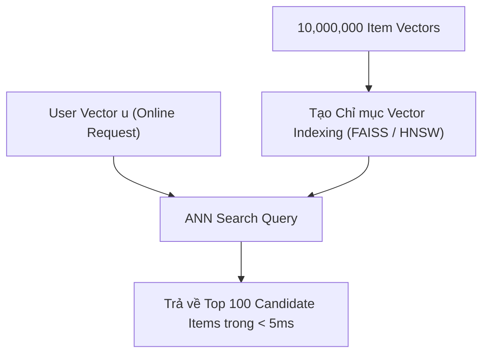

# Chương 9: Candidate Retrieval & Tìm kiếm Láng giềng Xấp xỉ (FAISS & ANN Search)

---

## 1. Thử thách Quy mô Dữ liệu Khổng lồ trong Candidate Retrieval

Trong giai đoạn **Candidate Retrieval**, ta có vector người dùng $\mathbf{u} \in \mathbb{R}^d$ và ma trận chứa $N = 10,000,000$ vector sản phẩm $\mathbf{v}_i \in \mathbb{R}^d$.

Nếu thực hiện phép tìm kiếm chính xác Exact $K$-NN (tính tích vô hướng $\mathbf{u}^T \mathbf{v}_i$ cho từng item một), độ phức tạp tính toán là $\mathcal{O}(N \cdot d)$. Phép tính này mất vài trăm miligiây đến vài giây - hoàn toàn **không thể chấp nhận được** trong hệ thống thời gian thực!

---

## 2. Tìm kiếm Láng giềng Xấp xỉ (Approximate Nearest Neighbors - ANN)

ANN chấp nhận đánh đổi một tỷ lệ nhỏ độ chính xác ($1\% - 2\%$ recall) để đổi lấy **tốc độ tìm kiếm nhanh gấp 1,000 - 10,000 lần** ($\le 5 \text{ ms}$).



---

## 3. Các Thuật toán ANN Hàng đầu trong Thực tế

### 3.1. HNSW (Hierarchical Navigable Small World Graphs)
HNSW xây dựng một cấu trúc đồ thị đa tầng phân cấp:
- **Tầng trên cùng (Top Layers):** Các liên kết dài giữa các cụm xa nhau (tương tự tuyến đường cao tốc).
- **Tầng dưới cùng (Bottom Layers):** Các liên kết ngắn giữa các điểm nằm gần nhau (đường đô thị).
- Độ phức tạp tìm kiếm: $\mathcal{O}(\log N)$. HNSW hiện là thuật toán ANN đạt chỉ số Recall/Speed cao nhất trên RAM.

---

### 3.2. Product Quantization (PQ) & IVF-PQ (FAISS - Meta AI)

FAISS (Facebook AI Similarity Search) sử dụng **Product Quantization (PQ)** để nén kích thước lưu trữ của vector và tăng tốc độ nhân ma trận:

1. **Inverted File Index (IVF):** Phân cụm $N$ vector thành $K_{\text{ivf}}$ cụm lớn bằng K-Means. Khi truy vấn, chỉ tìm kiếm trong $n_{\text{probe}}$ cụm gần nhất thay vì tìm toàn bộ dữ liệu.
2. **Product Quantization (PQ):** Chia vector $d=128$ chiều thành $m=16$ sub-vectors (mỗi sub-vector 8 chiều). Lượng tử hóa từng sub-vector thành 1 byte codebook.
   - Dung lượng bộ nhớ giảm từ $128 \times 4 \text{ bytes} = 512 \text{ bytes}$ xuống còn **16 bytes** ($97\%$ nén dung lượng)!

```python
# Ví dụ tạo chỉ mục FAISS IVF-PQ chuẩn production trong Python:
import faiss
import numpy as np

d = 128          # Chiều vector
nlist = 100      # Số cụm IVF
m = 8            # Số sub-vectors cho Product Quantization

quantizer = faiss.IndexFlatIP(d)  # Inner Product (Cosine similarity)
index = faiss.IndexIVFPQ(quantizer, d, nlist, m, 8)  # 8 bits per code

# Train & Add items
item_vectors = np.random.randn(100000, d).astype('float32')
faiss.normalize_L2(item_vectors)

index.train(item_vectors)
index.add(item_vectors)

# Tìm kiếm ANN online
user_vector = np.random.randn(1, d).astype('float32')
faiss.normalize_L2(user_vector)
index.nprobe = 10  # Kiểm tra 10 cụm gần nhất

distances, top_k_indices = index.search(user_vector, k=100)
```
