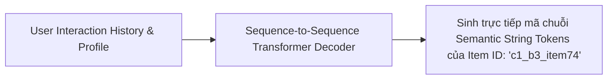

# Chương 11: Hệ thống Gợi ý Sinh & Mô hình Ngôn ngữ Lớn (Generative Retrieval & LLM4Rec)

---

## 1. Xu hướng Gợi ý Sinh (Generative Recommendation / Generative Retrieval)

Mô hình Candidate Retrieval truyền thống (như Two-Tower + FAISS) thực hiện phép nhân vector $\mathbf{u} \cdot \mathbf{v}_i$ để tìm kiếm item index.

**Generative Retrieval (như TIGER / DSI - Differential Search Index)** thay thế hoàn bộ bước tìm kiếm vector bằng một **Autoregressive Transformer Decoder**:



### Mã hóa Semantic String (Semantic ID Codebook):
Mỗi sản phẩm được gán một mã chuỗi phân cấp bằng K-Means trên vector đặc trưng (ví dụ: `[Category_3, SubCategory_12, Item_74]`). Mô hình Transformer đọc lịch sử người dùng và sinh trực tiếp mã chuỗi sản phẩm tiếp theo từng token một!

---

## 2. Mô hình Ngôn ngữ Lớn cho RecSys (LLM4Rec)

LLM4Rec tận dụng tri thức sâu sắc và khả năng hiểu bối cảnh của LLM để đóng vai trò làm bộ **Ranker / Reranker**:

```
[ User Prompt ]
"Lịch sử xem của người dùng:
1. Phim 'Inception' (Hành động, Viễn tưởng) - Đánh giá: 5/5
2. Phim 'Interstellar' (Viễn tưởng, Vũ trụ) - Đánh giá: 5/5

Hãy xếp hạng 3 bộ phim sau theo mức độ yêu thích tăng dần:
A. The Dark Knight
B. Dune: Part Two
C. Frozen"

[ LLM Response ]
"Thứ tự xếp hạng phù hợp nhất: B (Dune: Part Two) > A (The Dark Knight) > C (Frozen)"
```
