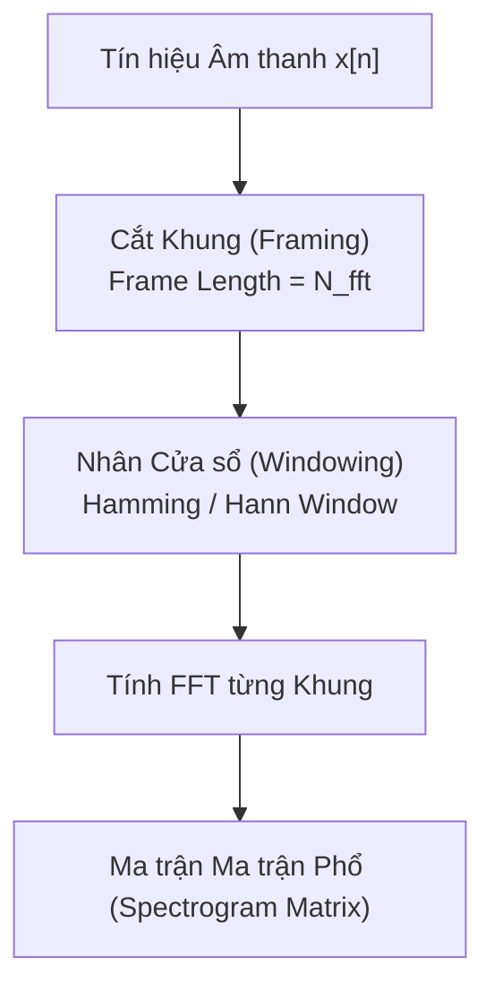
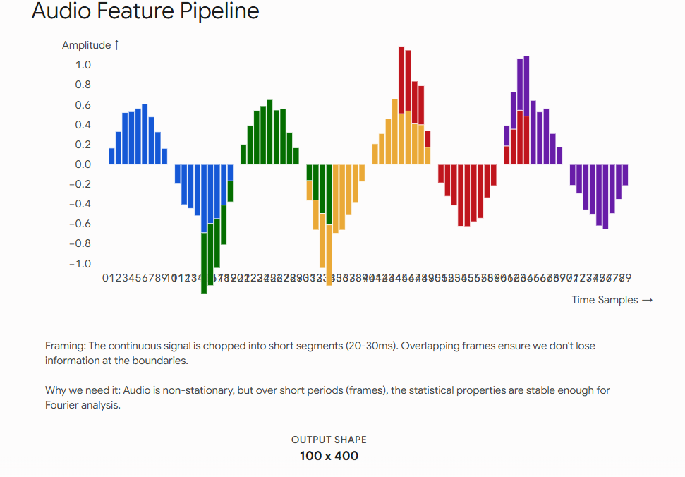
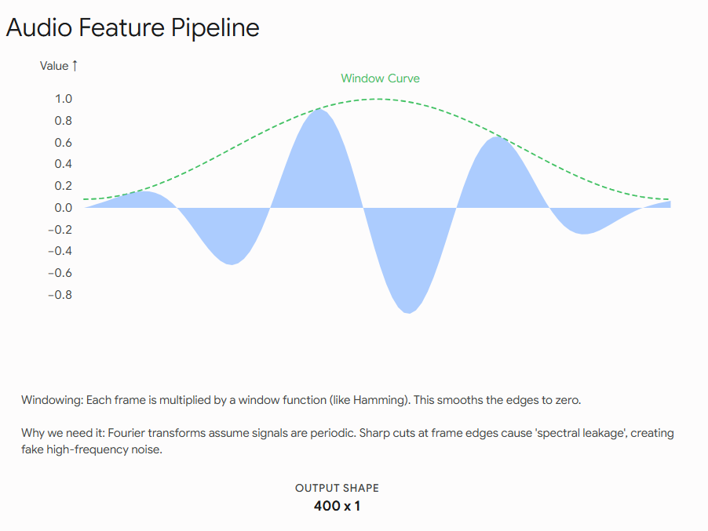
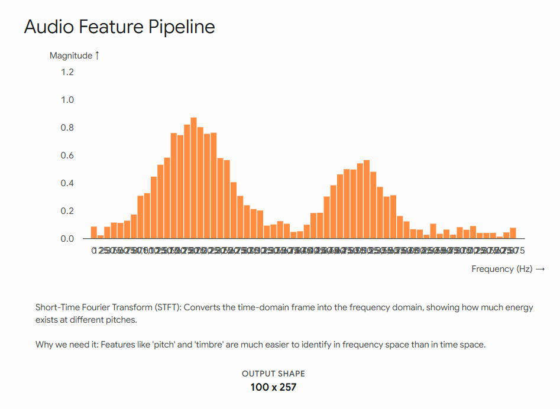
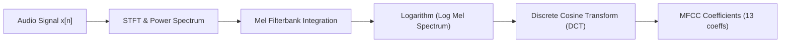

# Chương 2: Biến đổi Tín hiệu & Nền tảng Toán học (Signal Transforms & Spectral Analysis)

---

> [!IMPORTANT]
> 📌 **TỔNG QUAN & VAI TRÒ TRONG PIPELINE AI:**
> Sau khi có file âm thanh số 1D $x[t]$ ở Chương 1, tín hiệu vẫn ở miền thời gian (chỉ biết biên độ to/nhỏ theo giây) nên rất khó để AI học được âm đó là âm trầm hay bổng, nguyên âm hay phụ âm.
> **Mục tiêu của Chương 2** là giải thích bước chuyển đổi cốt lõi: **Biến chuỗi số 1D thời gian thành Bức ảnh Phổ Tần số 2D (Log Mel-Spectrogram)**.
> - **Đầu vào:** Chuỗi số thực biên độ 1D $x[t]$.
> - **Xử lý:** Framing 25ms $\to$ Windowing $\to$ STFT (FFT) $\to$ Mel-Filterbank $\to$ Logarit.
> - **Đầu ra:** Ma trận 2D Log Mel-Spectrogram (kích thước $[80, T]$).
> - **Vai trò:** Ma trận 2D này đóng vai trò như một bức ảnh phổ tần số — đây chính là đầu vào cho các mô hình AI lớn như OpenAI Whisper, Conformer, Tacotron 2!

---

## 1. Biến đổi Fourier & Cơ sở Toán học (Fourier Analysis)

Một tín hiệu âm thanh trong miền thời gian $x(t)$ rất khó để phân tích các thành phần tần số cấu tạo nên nó. Chuỗi biến đổi Fourier dựa trên nguyên lý: **Bất kỳ sóng phức tạp nào cũng có thể được phân tích thành tổng của các sóng hình sin và cosin ở các tần số khác nhau.**

### 1.1. Biến đổi Fourier Liên tục (Continuous Fourier Transform - CFT)
$$\mathcal{F}\{x(t)\} = X(f) = \int_{-\infty}^{+\infty} x(t) e^{-j 2\pi f t} \, dt$$
Trong đó $j = \sqrt{-1}$ là đơn vị ảo, và $e^{-j 2\pi f t} = \cos(2\pi f t) - j \sin(2\pi f t)$ theo Công thức Euler.

### 1.2. Biến đổi Fourier Rời rạc (Discrete Fourier Transform - DFT)
Đối với tín hiệu số rời rạc $x[n]$ gồm $N$ mẫu ($n = 0, 1, \dots, N-1$):
$$X[k] = \sum_{n=0}^{N-1} x[n] \cdot e^{-j \frac{2\pi}{N} k n}, \quad k = 0, 1, \dots, N-1$$
- $X[k]$ là số phức biểu diễn **Biên độ** và **Pha** của vạch tần số thứ $k$.
- Tần số thực tế tương ứng với vạch $k$:
  $$f_k = \frac{k \cdot f_s}{N} \text{ (Hz)}$$
- Do tính chất đối xứng Hermit của tín hiệu thực, chỉ có $N/2 + 1$ vạch tần số đầu tiên (từ $0$ đến $f_s/2$) chứa thông tin độc lập.

### 1.3. Biến đổi Fourier Nhanh (Fast Fourier Transform - FFT)
FFT (Cooley-Tukey Algorithm) là thuật toán giảm độ phức tạp tính toán của DFT từ $\mathcal{O}(N^2)$ xuống $\mathcal{O}(N \log_2 N)$, cho phép tính toán phổ tần số trong thời gian thực.

---

## 2. Biến đổi Fourier Thời gian Ngắn (STFT - Short-Time Fourier Transform)

Tín hiệu tiếng nói là tín hiệu **phi dừng (Non-Stationary Signal)** - nghĩa là nội dung tần số thay đổi liên tục theo thời gian (ví dụ: phát âm các nguyên âm, phụ âm khác nhau qua từng miligiây). Nếu áp dụng FFT trực tiếp cho toàn bộ file âm thanh, ta sẽ mất hoàn toàn thông tin **âm đó xuất hiện vào thời điểm nào**.

Giải pháp là **STFT**: Chia tín hiệu thành nhiều khung thời gian nhỏ (Frames), giả định tín hiệu là dừng (stationary) trong từng khung ngắn đó, rồi áp dụng FFT cho từng khung.



### 2.1. Phân khung (Framing) & Nhân Cửa sổ (Windowing)

#### 1. Khái niệm Tham số:
- **`n_fft` (hoặc `win_length`):** Độ dài của cửa sổ FFT (thường chọn $20 \text{ ms} - 30 \text{ ms}$, tương ứng $512, 1024, 2048$ mẫu tại $16 \text{ kHz}$).
- **`hop_length`:** Khoảng cách trượt giữa 2 khung liên tiếp (thường chọn $10 \text{ ms}$, tương ứng $160, 256, 512$ mẫu).
- **`overlap` (Độ chồng lấp):** $\text{Overlap} = \text{win\_length} - \text{hop\_length}$. Thường chọn $50\% - 75\%$ để đảm bảo sự liên tục.

#### 2. Rò rỉ phổ (Spectral Leakage) & Hàm Cửa sổ (Window Functions):
Nếu cắt khung vuông (Rectangular window), sự ngắt quãng đột ngột tại 2 biên của khung sẽ tạo ra các tần số nhiễu giả (Spectral Leakage). To giải quyết, ta nhân khung với một **Hàm Cửa sổ (Window Function)** giảm dần về 0 tại 2 biên:

- **Cửa sổ Hann (Hann Window):**
  $$w[n] = 0.5 \left( 1 - \cos\left(\frac{2\pi n}{N-1}\right) \right)$$
- **Cửa sổ Hamming (Hamming Window):**
  $$w[n] = 0.54 - 0.46 \cos\left(\frac{2\pi n}{N-1}\right)$$





### 2.2. Công thức Toán học STFT:
$$X(m, k) = \sum_{n=0}^{N-1} x[n + m \cdot R] \cdot w[n] \cdot e^{-j \frac{2\pi}{N} k n}$$
Trong đó $m$ là chỉ số khung (thời gian), $k$ là chỉ số vạch tần số, $R = \text{hop\_length}$, và $w[n]$ là hàm cửa sổ.

### 2.3. Nguyên lý Bất định Heisenberg trong Tín hiệu (Time-Frequency Trade-off)
- **Cửa sổ ngắn ($N_{\text{fft}}$ nhỏ):** Độ phân giải **Thời gian tốt**, nhưng Độ phân giải **Tần số kém**.
- **Cửa sổ dài ($N_{\text{fft}}$ lớn):** Độ phân giải **Tần số tốt**, nhưng Độ phân giải **Thời gian kém**.

---

## 3. Spectrogram & Biểu diễn Âm phổ Logarithm

Spectrogram là ma trận 2D hiển thị sự biến đổi của phổ tần số theo thời gian:
- Trục $X$: Thời gian (Time).
- Trục $Y$: Tần số (Frequency).
- Trị số điểm $(m, k)$: Biên độ / Năng lượng của tần số $k$ tại thời điểm $m$.



### 3.1. Các dạng Spectrogram:
1. **Magnitude Spectrogram:**
   $$S_{\text{mag}}(m, k) = |X(m, k)| = \sqrt{\text{Re}(X)^2 + \text{Im}(X)^2}$$
2. **Power Spectrogram:**
   $$S_{\text{power}}(m, k) = |X(m, k)|^2$$
3. **Log-Power Spectrogram (dB Spectrogram):**
   Tai người nhận biết âm lượng theo thang logarit, do đó phổ được chuyển sang decibel:
   $$S_{\text{dB}}(m, k) = 10 \log_{10} \left( \frac{S_{\text{power}}(m, k)}{\text{max}(S_{\text{power}}) + \epsilon} \right)$$

---

## 4. Thang đo Mel (Mel Scale) & Mel-Spectrogram

### 4.1. Bản chất Thính giác Con người (Psychoacoustics)
Tai người không cảm nhận tần số theo đường thẳng (linear). Chúng ta phân biệt sự thay đổi giữa $100 \text{ Hz}$ và $200 \text{ Hz}$ rất dễ dàng, nhưng hầu như không nhận ra sự khác biệt giữa $10,000 \text{ Hz}$ và $10,100 \text{ Hz}$.

**Thang đo Mel (Mel Scale)** là một thang đo tần số phi tuyến tính dựa trên cảm nhận cao độ thực tế của tai người.

#### Công thức chuyển đổi giữa Hertz ($f$) và Mel ($m$):
$$m = 2595 \cdot \log_{10} \left( 1 + \frac{f}{700} \right)$$
$$f = 700 \cdot \left( 10^{\frac{m}{2595}} - 1 \right)$$

```
Tần số Hz (Linear):  0 -- 500 -- 1000 -- 2000 -- 4000 -- 8000 Hz
Thang Mel (Nonlinear): [Độ phân giải dải thấp RẤT RỘNG] ----> [Độ phân giải dải cao HẸP LẠI]
```

### 4.2. Mel-Filterbank (Tập bộ lọc Mel) & Log-Mel Spectrogram


Mel-Filterbank gồm $M$ bộ lọc hình tam giác (Triangular Bandpass Filters) đặt xếp dồng lên nhau. Trên thang Mel, các bộ lọc này nằm cách đều nhau, nhưng khi quy đổi về thang Hertz, các bộ lọc dải thấp hẹp lại và dải cao rộng dần ra.

Ma trận Mel-Spectrogram thu được bằng cách nhân ma trận Power Spectrogram với ma trận Filterbank Mel $H(m, k)$:
$$\text{MelSpectrogram}(m, m_{\text{mel}}) = \sum_{k} S_{\text{power}}(m, k) \cdot H(m_{\text{mel}}, k)$$

---

## 5. MFCCs (Mel-Frequency Cepstral Coefficients)

### 5.1. Mô hình Nguồn - Bộ lọc (Source-Filter Model of Speech)
Trong tiếng nói con người:
- **Nguồn (Source $e[t]$):** Luồng khí từ phổi làm rung dây thanh quản (tạo ra tần số cơ bản $F_0$).
- **Bộ lọc (Filter $h[t]$):** Khoang miệng, lưỡi, môi (Vocal Tract) biến đổi luồng khí thành các âm riêng biệt.
Tín hiệu tiếng nói $x[t]$ là phép cuộn giữa Nguồn và Bộ lọc:
$$x[t] = e[t] * h[t]$$

Trong miền phổ tần số:
$$X(f) = E(f) \cdot H(f)$$
Lấy Logarithm hai vế biến phép nhân thành phép cộng:
$$\log |X(f)| = \log |E(f)| + \log |H(f)|$$

### 5.2. Cepstrum & Biến đổi Cosin Rời rạc (DCT)
Bằng cách áp dụng **Discrete Cosine Transform (DCT)** lên $\log |X(f)|$, ta chuyển tín hiệu sang **Miền Cepstral (Quefrency domain)**. 
- Bộ lọc Vocal Tract $H(f)$ biến đổi **chậm** (tần số thấp trong miền cepstral).
- Nguồn rung dây thanh $E(f)$ dao động **nhanh** (tần số cao trong miền cepstral).

Lấy 12–13 hệ số DCT đầu tiên chính là giữ lại toàn bộ hình dạng Vocal Tract $H(f)$ - thông tin quan trọng nhất để phân biệt từ vựng và âm tiết!



---

## 6. Minh họa Code Python tính toán STFT, Mel-Spectrogram & MFCC

```python
import torch
import torchaudio
import torchaudio.transforms as T

def extract_audio_features(waveform: torch.Tensor, sample_rate: int = 16000):
    """
    Trích xuất các đặc trưng Spectrogram, Mel-Spectrogram và MFCC từ audio waveform.
    waveform: Tensor shape [1, time_samples]
    """
    n_fft = 1024
    hop_length = 256
    n_mels = 80
    n_mfcc = 13

    # 1. Trích xuất Spectrogram
    spectrogram_transform = T.Spectrogram(n_fft=n_fft, hop_length=hop_length, power=2.0)
    power_spectrogram = spectrogram_transform(waveform)
    log_spectrogram = torch.log(power_spectrogram + 1e-9)

    # 2. Trích xuất Mel-Spectrogram
    mel_transform = T.MelSpectrogram(
        sample_rate=sample_rate,
        n_fft=n_fft,
        hop_length=hop_length,
        n_mels=n_mels,
        power=2.0
    )
    mel_spectrogram = mel_transform(waveform)
    log_mel_spectrogram = torch.log(mel_spectrogram + 1e-9)

    # 3. Trích xuất MFCC
    mfcc_transform = T.MFCC(
        sample_rate=sample_rate,
        n_mfcc=n_mfcc,
        melkwargs={"n_fft": n_fft, "hop_length": hop_length, "n_mels": n_mels}
    )
    mfcc = mfcc_transform(waveform)

    return {
        "log_spectrogram": log_spectrogram.squeeze(0), # [freq_bins, frames]
        "log_mel_spectrogram": log_mel_spectrogram.squeeze(0), # [n_mels, frames]
        "mfcc": mfcc.squeeze(0) # [n_mfcc, frames]
    }
```
