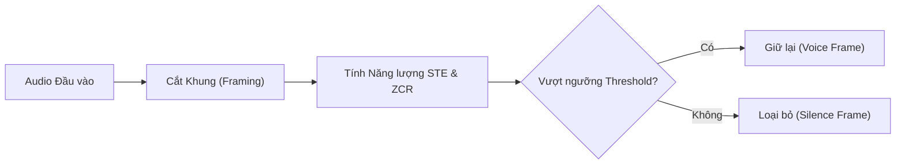

# Chương 3: Tiền xử lý & Augmentation Dữ liệu Âm thanh (Preprocessing & Data Augmentation)

---

## 1. Tiền xử lý Tín hiệu Âm thanh (Audio Preprocessing)

Trước khi đưa tín hiệu âm thanh vào mô hình học máy hoặc trích xuất đặc trưng, dữ liệu âm thanh thực tế thường chứa sai lệch phần cứng (DC offset), âm lượng không đồng đều và đoạn khoảng lặng thừa.

### 1.1. Loại bỏ DC Offset (DC Offset Removal)
DC Offset là sự lệch trung bình của tín hiệu khỏi đường mốc 0 Hz do phần cứng micro hoặc card âm thanh gây ra. 
- Công thức triệt tiêu:
  $$x_{\text{clean}}[n] = x[n] - \frac{1}{N} \sum_{k=0}^{N-1} x[k]$$

### 1.2. Chuẩn hóa Biên độ (Amplitude Normalization)

#### 1. Peak Normalization:
Đưa giá trị đỉnh biên độ tuyệt đối về mức cực đại mong muốn (ví dụ $0.95$ hoặc $1.0$) để tránh hiện tượng vỡ tiếng (Clipping):
$$x_{\text{norm}}[n] = \frac{x[n]}{\max_{k} |x[k]| + \epsilon} \times \text{Target\_Peak}$$

#### 2. RMS Normalization (Root Mean Square):
Chuẩn hóa dựa trên tổng năng lượng trung bình của âm thanh, giúp hai file có âm lượng cảm nhận (perceived loudness) tương đồng nhau:
$$\text{RMS} = \sqrt{\frac{1}{N} \sum_{n=0}^{N-1} x[n]^2}$$
$$x_{\text{norm}}[n] = \frac{x[n]}{\text{RMS} + \epsilon} \times \text{Target\_RMS}$$

#### 3. Standard Z-Score Normalization (Standardization):
Chuẩn hóa về phân phối có trung bình $\mu = 0$ và độ lệch chuẩn $\sigma = 1$:
$$x_{\text{norm}}[n] = \frac{x[n] - \mu}{\sigma + \epsilon}$$

---

## 2. Phát hiện Khoảng Lặng & Tín hiệu Tiếng nói (VAD - Voice Activity Detection)

VAD là kỹ thuật xác định chính xác các khoảng thời gian có giọng nói của con người và loại bỏ các khoảng khoảng lặng (Silence) hoặc tiếng thở/tiếng ồn nền.



### 2.1. Các kỹ thuật VAD Cổ điển

1. **Short-Time Energy (STE - Năng lượng Khung Ngắn):**
   $$E_m = \sum_{n=0}^{N-1} x[n + m \cdot R]^2$$
   Khung có tiếng nói luôn có năng lượng vượt trội so với khoảng lặng.

2. **Zero Crossing Rate (ZCR - Tỷ lệ Qua Điểm Không):**
   Đo số lần tín hiệu đổi dấu từ âm sang dương hoặc ngược lại trong một khung:
   $$\text{ZCR}_m = \frac{1}{2(N-1)} \sum_{n=1}^{N-1} |\text{sgn}(x[n]) - \text{sgn}(x[n-1])|$$
   - Phụ âm xát/bật hơi (Unvoiced Fricatives như /s/, /f/, /z/) có ZCR **rất cao**.
   - Nguyên âm (Voiced Vowels như /a/, /e/, /i/) có ZCR **thấp**, nhưng STE **rất cao**.

### 2.2. Các công cụ VAD Hiện đại
- **WebRTC VAD:** Thuật toán VAD theo thời gian thực chuẩn Google WebRTC, dựa trên mô hình Gaussian Mixture Model (GMM).
- **Silero VAD:** Mô hình Deep Learning siêu nhẹ (ONNX/PyTorch), chính xác cao ngay cả trong môi trường cực kỳ nhiễu.

---

## 3. Lọc nhiễu & Làm sạch Âm thanh (Noise Reduction)

### 3.1. Phương pháp Trừ phổ (Spectral Subtraction)
Giả định nhiễu là nhiễu cộng độc lập (Additive Stationary Noise):
$$y[n] = x[n] + d[n]$$
Trong miền phổ năng lượng:
$$|Y(f)|^2 = |X(f)|^2 + |D(f)|^2$$

1. Ứớc lượng phổ nhiễu $|D_{\text{est}}(f)|^2$ từ các khung khoảng lặng đầu file (Silence frames).
2. Trừ phổ nhiễu khỏi phổ tín hiệu quan sát:
   $$|\hat{X}(f)|^2 = \max\left( |Y(f)|^2 - \alpha |\hat{D}(f)|^2, \, \beta |Y(f)|^2 \right)$$
   Trong đó $\alpha \ge 1$ là hệ số trừ quá đà (over-subtraction factor), $\beta \approx 0.01-0.05$ là ngưỡng sàn phổ (spectral floor) để tránh nhiễu âm nhạc (musical noise).

---

## 4. Audio Data Augmentation & SpecAugment

Tăng cường dữ liệu (Data Augmentation) giúp mô hình Deep Learning chống overfitting và tăng khả năng tổng quát hóa với các môi trường thu âm thực tế.

### 4.1. Augmentation trên Miền Thời gian (Time-Domain Augmentations)

1. **Time Shift (Trượt thời gian):** Dịch chuyển dạng sóng sang trái hoặc phải theo trục thời gian và đệm số 0.
2. **Speed Perturbation (Thay đổi tốc độ phát):** Thay đổi tần số lấy mẫu giả định (resampling) để thay đổi tốc độ nói (tốc độ $0.9\times, 1.0\times, 1.1\times$).
3. **Pitch Shift (Thay đổi cao độ):** Nâng hoặc hạ cao độ của giọng nói mà không làm thay đổi thời lượng file.
4. **Background Noise Injection (Thêm tiếng ồn môi trường):**
   Trộn tín hiệu thoại $x[n]$ với tín hiệu nhiễu $d[n]$ theo Tỷ số Signal-to-Noise Ratio ($\text{SNR}_{\text{dB}}$) mong muốn:
   $$\text{Scale} = \sqrt{\frac{P_x}{P_d \cdot 10^{\frac{\text{SNR}_{\text{dB}}}{10}}}}$$
   $$y[n] = x[n] + \text{Scale} \times d[n]$$

### 4.2. SpecAugment (Augmentation trên Miền Tần số - Park et al., Google Brain)

SpecAugment áp dụng trực tiếp lên **Mel-Spectrogram** của tín hiệu mà không cần biến đổi về dạng sóng thời gian. Kỹ thuật này gồm 2 thao tác cốt lõi:

```
[ Mel-Spectrogram 2D ]
^ Frequency
|   +------------------------------------+
|   |          Time Masking              |  <--- Che T khung thời gian liên tiếp bằng 0
|   |   +------+               +------+  |
|   |   |      | Frequency     |      |  |
|   |   | MASK | Masking       | MASK |  |  <--- Che F dải tần số liên tiếp bằng 0
|   |   +------+               +------+  |
+----------------------------------------+---> Time
```


1. **Frequency Masking:** Che ngẫu nhiên $f$ dải tần số liên tiếp $[f_0, f_0 + f)$ bằng 0, với $f \sim \text{Uniform}(0, F)$.
2. **Time Masking:** Che ngẫu nhiên $t$ khung thời gian liên tiếp $[t_0, t_0 + t)$ bằng 0, với $t \sim \text{Uniform}(0, T)$.


---

## 5. Code Python Thực thi Preprocessing & Augmentation Pipeline

```python
import torch
import torchaudio
import torchaudio.transforms as T
import random

class AudioAugmenter:
    """Class hỗ trợ các kỹ thuật Augmentation chuẩn cho Audio & Mel-Spectrogram."""
    
    def __init__(self, sample_rate: int = 16000):
        self.sample_rate = sample_rate
        self.freq_masking = T.FrequencyMasking(freq_mask_param=15)
        self.time_masking = T.TimeMasking(time_mask_param=35)

    def add_white_noise(self, waveform: torch.Tensor, snr_db: float = 15.0) -> torch.Tensor:
        """Thêm White Noise vào waveform theo SNR dB chỉ định."""
        signal_power = torch.mean(waveform ** 2)
        noise_power = signal_power / (10 ** (snr_db / 10))
        noise = torch.randn_like(waveform) * torch.sqrt(noise_power)
        return waveform + noise

    def time_shift(self, waveform: torch.Tensor, max_shift_sec: float = 0.2) -> torch.Tensor:
        """Dịch chuyển thời gian ngẫu nhiên."""
        shift_samples = int(random.uniform(-max_shift_sec, max_shift_sec) * self.sample_rate)
        return torch.roll(waveform, shifts=shift_samples, dims=-1)

    def apply_spec_augment(self, mel_spectrogram: torch.Tensor) -> torch.Tensor:
        """
        Áp dụng SpecAugment (Frequency & Time Masking) cho Mel-Spectrogram Tensor [channels, mel_bins, time_frames].
        """
        aug_mel = self.freq_masking(mel_spectrogram)
        aug_mel = self.time_masking(aug_mel)
        return aug_mel
```
