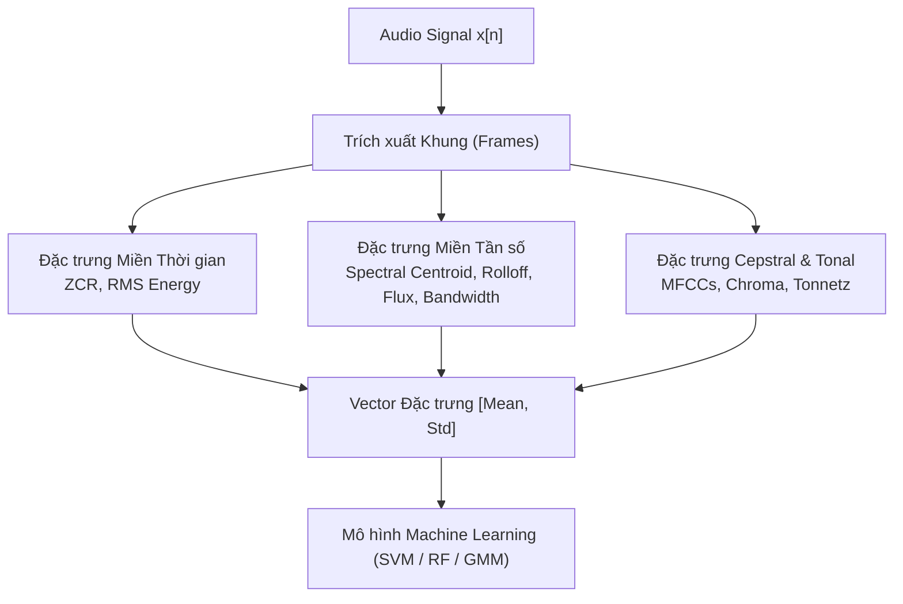
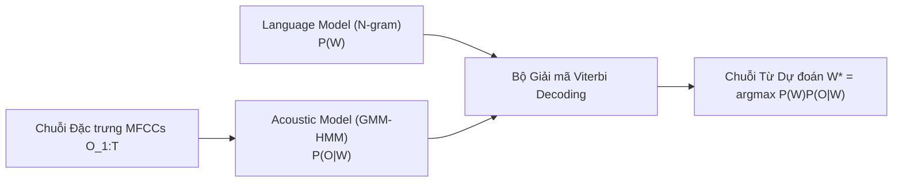

# Chương 4: Các Bài toán Xử lý Âm thanh Cổ điển (Classical Audio Processing & ML)

---

## 1. Trích xuất Đặc trưng Thủ công (Audio Feature Engineering)

Trước khi Deep Learning trở nên phổ biến, các kỹ sư xử lý tín hiệu đã phát triển tập hợp các **Đặc trưng Âm phổ (Spectral Features)** dựa trên lý thuyết vật lý để đại diện cho nội dung âm thanh.



### 1.1. Bảng tổng hợp các Đặc trưng Âm phổ Chính

| Tên đặc trưng | Công thức / Ý nghĩa | Ứng dụng thực tế |
| :--- | :--- | :--- |
| **Spectral Centroid** | Trọng tâm phổ: $C = \frac{\sum_k f_k \cdot \|X(k)\|}{\sum_k \|X(k)\|}$ | Đo độ "sáng" (brightness) của âm thanh. Phân biệt nhạc cụ và giọng nói. |
| **Spectral Rolloff** | Tần số $f_r$ sao cho $\sum_{k=0}^{r} \|X(k)\|^2 = 0.85 \sum_{k=0}^{N} \|X(k)\|^2$ | Phân biệt âm thanh có tần số cao mạnh (như phụ âm bật hơi /s/) và âm tần số thấp. |
| **Spectral Bandwidth** | Độ lệch chuẩn phổ quanh trọng tâm: $B = \sqrt{\frac{\sum (f_k - C)^2 \|X(k)\|}{\sum \|X(k)\|}}$ | Đo độ phân tán dải tần (âm thanh đơn sắc vs âm thanh băng rộng). |
| **Spectral Flux** | $F_m = \sum_k (\|X_m(k)\| - \|X_{m-1}(k)\|)^2$ | Đo tốc độ thay đổi phổ giữa 2 khung liên tiếp (phát hiện điểm bắt đầu nốt/từ - Onset Detection). |
| **Chroma STFT** | Gom 512+ vạch tần số về 12 nốt bán âm $(C, C^\sharp, D, \dots, B)$ | Phân tích hợp âm, giai điệu nhạc và giọng hát. |

---

## 2. Phân loại Âm thanh bằng Mô hình Machine Learning Cổ điển

Để phân loại file âm thanh bằng các thuật toán như **SVM (Support Vector Machine)**, **Random Forest**, hoặc **XGBoost**:
1. Chia file âm thanh thành các khung (Frames).
2. Tính toán MFCCs (13 hệ số) cùng các đặc trưng Spectral Centroid, Rolloff, ZCR cho từng khung.
3. Gom tụ các khung bằng cách tính **Giá trị Trung bình (Mean)** và **Độ lệch chuẩn (Std)** trên toàn bộ file. Thu được 1 Vector cố định $D$-chều (ví dụ $13 \times 2 + 5 \times 2 = 36$ chiều).
4. Đưa Vector vào classifier để dự đoán nhãn (ví dụ: Giọng nam / Giọng nữ, Cảm xúc âm thanh, Thể loại nhạc).

### Code Python ví dụ trích xuất đặc trưng & Phân loại với Scikit-Learn:

```python
import numpy as np
import librosa
from sklearn.ensemble import RandomForestClassifier
from sklearn.preprocessing import StandardScaler

def extract_file_features(file_path: str) -> np.ndarray:
    """Trích xuất Vector đặc trưng cố định cho 1 file audio."""
    y, sr = librosa.load(file_path, sr=16000, mono=True)
    
    # Trích xuất MFCC, Centroid, Rolloff, ZCR
    mfcc = librosa.feature.mfcc(y=y, sr=sr, n_mfcc=13) # [13, frames]
    centroid = librosa.feature.spectral_centroid(y=y, sr=sr) # [1, frames]
    rolloff = librosa.feature.spectral_rolloff(y=y, sr=sr) # [1, frames]
    zcr = librosa.feature.zero_crossing_rate(y=y) # [1, frames]
    
    features = np.vstack([mfcc, centroid, rolloff, zcr]) # [16, frames]
    
    # Tính Mean và Std trên toàn bộ các khung thời gian
    mean_feat = np.mean(features, axis=1)
    std_feat = np.std(features, axis=1)
    
    return np.concatenate([mean_feat, std_feat]) # Vector 32-dimensional

# Huấn luyện mô hình Random Forest đơn giản
def train_classical_classifier(X_train: np.ndarray, y_train: np.ndarray):
    scaler = StandardScaler()
    X_scaled = scaler.fit_transform(X_train)
    
    clf = RandomForestClassifier(n_estimators=100, random_state=42)
    clf.fit(X_scaled, y_train)
    return scaler, clf
```

---

## 3. ASR Cổ điển: Hệ thống GMM-HMM (Gaussian Mixture Model - Hidden Markov Model)

Trước sự bùng nổ của Deep Learning, các hệ thống Nhận dạng Tiếng nói (ASR) thương mại (như Kaldi, HTK, CMU Sphinx) đều dựa trên kiến trúc **GMM-HMM**.



### 3.1. Mô hình HMM (Hidden Markov Model)
Tiếng nói bao gồm chuỗi các âm tiết cơ bản (**Phonemes** - ví dụ từ "CAT" gồm 3 âm tiết `/k/ /æ/ /t/`). Mỗi âm tiết được đại diện bằng 1 trạng thái ẩn $q_i$ trong HMM (thường dùng mô hình 3 trạng thái Bakis: Đầu, Giữa, Cuối âm tiết).

- **Ma trận chuyển trạng thái $A = [a_{ij}]$:** Xác suất chuyển từ trạng thái $q_i$ sang $q_j$:
  $$a_{ij} = P(q_{t+1} = j \mid q_t = i)$$

### 3.2. Mô hình GMM (Gaussian Mixture Model)
Để tính xác suất một vector MFCC quan sát được $O_t$ tại thời điểm $t$ phát ra từ trạng thái âm tiết $q_i$, người ta dùng hỗn hợp các hàm phân phối chuẩn Gaussian:
$$b_i(O_t) = P(O_t \mid q_i) = \sum_{m=1}^{M} c_{im} \cdot \mathcal{N}(O_t; \mu_{im}, \Sigma_{im})$$
Trong đó $c_{im}$ là trọng số của thành phần Gaussian thứ $m$, $\mu_{im}$ là vector trung bình và $\Sigma_{im}$ là ma trận hiệp phương sai.

### 3.3. Thuật toán Giải mã Viterbi (Viterbi Algorithm)
Dựa trên Công thức Bayes, từ chuỗi quan sát $O = (O_1, O_2, \dots, O_T)$, ta tìm chuỗi từ $W^*$ có xác suất cao nhất:
$$W^* = \arg\max_W P(W \mid O) = \arg\max_W \frac{P(O \mid W) \cdot P(W)}{P(O)} = \arg\max_W \underbrace{P(O \mid W)}_{\text{Acoustic Model}} \cdot \underbrace{P(W)}_{\text{Language Model}}$$

Thuật toán Viterbi dùng Quy hoạch động (Dynamic Programming) để tìm đường đi trạng thái ẩn tối ưu qua ma trận trellis thời gian với độ phức tạp $\mathcal{O}(T \cdot |Q|^2)$.
