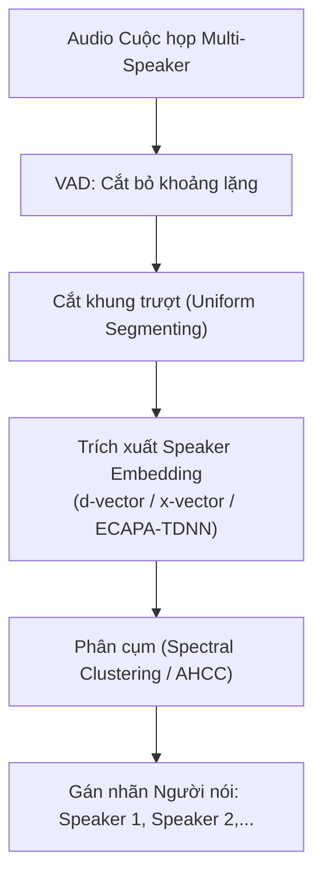
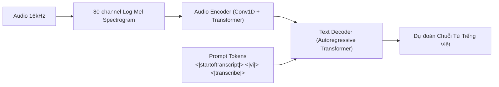

# Chương 5: Deep Learning & Pretrained Models trong Speech Processing

---

## 1. Phân loại Âm thanh bằng Deep Learning (Deep Audio Classification)

Khi chuyển đổi tín hiệu âm thanh thành Mel-Spectrogram, dữ liệu thu được là ma trận 2D với 1 kênh màu (tương tự bức ảnh xám 2D). Điều này mở ra khả năng áp dụng các mạng nơ-ron tiên tiến nhất từ Thị giác Máy tính (Computer Vision).

```
   Audio Signal ----> Mel-Spectrogram [1, 80, T] ----> CNN 2D / Transformer ----> Class Probabilities
```


### 1.1. Kiến trúc CNN 2D & PANNs (Pretrained Audio Neural Networks)
- **Mạng CNN 2D (ResNet / EfficientNet):** Các lớp Tích chập 2D trượt trên cả 2 trục: Trục Tần số (Frequency axis) và Trục Thời gian (Time axis), trích xuất các mẫu hoa văn phổ như dải họa âm (harmonics) và điểm ngắt âm (onsets).
- **PANNs (Kong et al., 2020):** Các mô hình CNN14, ResNet38 được tiền huấn luyện trên tập dữ liệu khổng lồ **AudioSet** (hơn 2 triệu clip âm thanh từ YouTube với 527 lớp âm thanh). Đây là mô hình Backbone mạnh mẽ nhất để Transfer Learning cho các bài toán phân loại âm thanh miền hẹp.

### 1.2. Audio Spectrogram Transformer (AST - Gong et al., MIT)
AST kế thừa hoàn toàn kiến trúc **Vision Transformer (ViT)** cho tín hiệu âm thanh:
1. Mel-Spectrogram cỡ $[80, S]$ được cắt thành chuỗi các mảnh 2D (Patches) kích thước $16 \times 16$.
2. Mỗi patch được phẳng hóa và chiếu tuyến tính thành Patch Embedding.
3. Thêm Positional Embedding 1D/2D và đưa qua các tầng Transformer Encoder với cơ chế Self-Attention.

---

## 2. Phân đoạn & Phân tách Âm thanh (Segmentation, Diarization & Source Separation)

### 2.1. Speaker Diarization ("Who Spoke When?")
Diarization là bài toán phân định "Ai nói vào thời điểm nào" trong một file ghi âm cuộc họp/băng đĩa chứa nhiều người nói.



- **Mô hình phổ biến:** `pyannote.audio` - Pipeline PyTorch SOTA hỗ trợ cả Voice Activity Detection, Overlapped Speech Detection và Speaker Diarization.

### 2.2. Audio Source Separation (Tách nguồn âm thanh)
- **Demucs / Hybrid Spectrogram UNet:** Tách một bài hát thành 4 track riêng biệt: Vocals (Giọng hát), Drums (Trống), Bass, và Other.
- **Conv-TasNet (Time-domain Audio Separation Network):** Tách giọng nói của 2 người bị đè lên nhau (Overlapped Speech) trực tiếp trên miền thời gian.

---

## 3. Nhận dạng Tiếng nói Tự động (ASR / STT) Modern Architecture

### 3.1. Kỹ thuật CTC Loss (Connectionist Temporal Classification - Graves et al.)

Trong bài toán ASR, chuỗi khung âm thanh đầu vào $X = (x_1, \dots, x_T)$ có độ dài $T$ lớn hơn nhiều so với chuỗi ký tự nhãn $Y = (y_1, \dots, y_U)$ với $U \le T$. Đồng thời ta không có nhãn căn chỉnh thời gian cho từng ký tự.

```
Khung âm thanh (T = 8): [f1,  f2,  f3,  f4,  f5,  f6,  f7,  f8]
Mạng nơ-ron xuất ra:   [ c,   c,   a,   a,   a,  eps,   t,   t ]
Rút gọn CTC (Collapse): c --------> a -------------> t  ====> "cat"
```

#### Cơ chế của CTC Loss:
1. Đưa vào ký tự đặc biệt **Blank token ($\epsilon$)**.
2. **Hàm Rút gọn (Collapsing Function $\mathcal{B}$):** Loại bỏ các ký tự lặp liên tiếp, sau đó loại bỏ toàn bộ ký tự $\epsilon$.
   $$\mathcal{B}(\text{c, c, a, a, eps, t}) = \text{"cat"}$$
3. **CTC Loss Function:** Tổng xác suất của tất cả các đường đi hợp lệ $\pi$ mà khi qua hàm $\mathcal{B}$ đều rút gọn về chuỗi nhãn chuẩn $Y$:
   $$P(Y \mid X) = \sum_{\pi \in \mathcal{B}^{-1}(Y)} P(\pi \mid X)$$
   $$\mathcal{L}_{\text{CTC}} = -\ln P(Y \mid X)$$
   Hàm loss này được tính toán cực nhanh bằng Thuật toán Forward-Backward Quy hoạch động.

---

### 3.2. Mạng Conformer (Convolution-augmented Transformer)

Google Conformer (Gulati et al., 2020) là kiến trúc Encoder thống trị ASR, kết hợp ưu điểm của cả Convolution (bắt đặc trưng cục bộ) và Self-Attention (bắt ngữ cảnh toàn cục).

```
[ Input Mel-Spectrogram ]
          │
          ▼
┌──────────────────┐
│  Feed Forward    │ (Half-step Macaron style)
└─────────┬────────┘
          ▼
┌──────────────────┐
│ Self-Attention   │ (Multi-Head Relative Positional Self-Attention)
└─────────┬────────┘
          ▼
┌──────────────────┐
│   Convolution    │ (Depthwise Separable 1D Conv Module)
└─────────┬────────┘
          ▼
┌──────────────────┐
│  Feed Forward    │ (Half-step Macaron style)
└─────────┬────────┘
          ▼
┌──────────────────┐
│ Layer Norm       │
└──────────────────┘
```

---

### 3.3. OpenAI Whisper: Mô hình Multitask SOTA

Whisper (Radford et al., OpenAI 2022) sử dụng kiến trúc **Encoder-Decoder Transformer** tiêu chuẩn (Seq2Seq), được huấn luyện trên 680,000 giờ dữ liệu đa ngôn ngữ và đa nhiệm.



#### Ưu điểm vượt trội của Whisper:
- Khả năng chống chịu nhiễu cực mạnh (Robustness to background noise & accents).
- Hỗ trợ vừa Transcribe vừa Translate từ tiếng Việt sang tiếng Anh và ngược lại.
- Trích xuất Timestamp chi tiết tới từng từ (Word-level timestamps).

---

## 4. Minh họa Fine-tuning OpenAI Whisper cho Tiếng Việt với Hugging Face

Code chuẩn Production để load và chuẩn bị Fine-tuning Whisper Small trên tập dữ liệu tiếng Việt:

```python
import torch
from transformers import WhisperProcessor, WhisperForConditionalGeneration

class VietnameseWhisperASR:
    """Class bọc mô hình OpenAI Whisper fine-tuned cho tiếng Việt."""
    
    def __init__(self, model_name: str = "openai/whisper-small", device: str = None):
        self.device = device or ("cuda" if torch.cuda.is_available() else "cpu")
        print(f"Loading Whisper model '{model_name}' on device '{self.device}'...")
        
        self.processor = WhisperProcessor.from_pretrained(model_name, language="vietnamese", task="transcribe")
        self.model = WhisperForConditionalGeneration.from_pretrained(model_name).to(self.device)
        self.model.eval()

    def transcribe(self, waveform_16k: torch.Tensor) -> str:
        """
        waveform_16k: Tensor 1D float32 đại diện cho âm thanh 16kHz.
        """
        # 1. Trích xuất đặc trưng Log-Mel Spectrogram 80 kênh
        input_features = self.processor(
            waveform_16k.cpu().numpy(),
            sampling_rate=16000,
            return_tensors="pt"
        ).input_features.to(self.device)

        # 2. Sinh chuỗi token autoregressively
        with torch.no_grad():
            predicted_ids = self.model.generate(
                input_features,
                language="vietnamese",
                task="transcribe"
            )

        # 3. Giải mã token thành văn bản tiếng Việt
        transcription = self.processor.batch_decode(predicted_ids, skip_special_tokens=True)[0]
        return transcription.strip()
```
