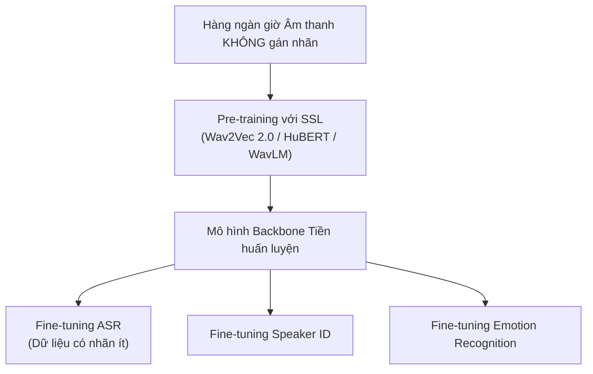
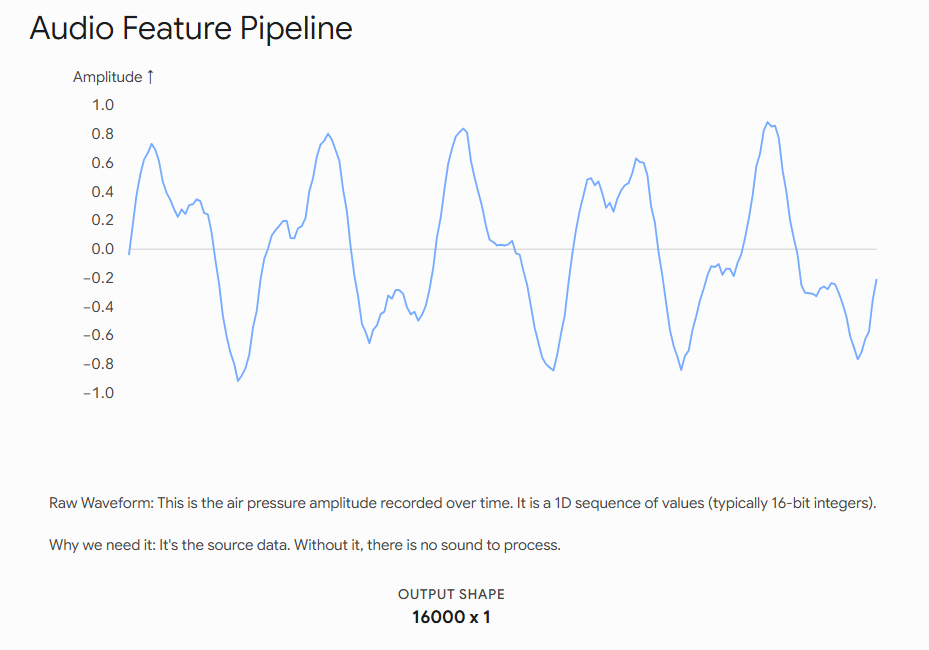
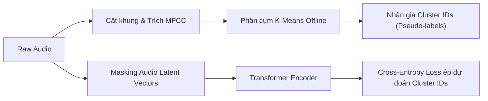

# Chương 7: Học Tự giám sát trong Tiếng nói (Self-Supervised Learning - SSL for Speech)

---

## 1. Giới thiệu về Self-Supervised Learning (SSL) trong Tiếng nói

Trong xử lý tiếng nói, việc gán nhãn thủ công cho hàng nghìn giờ dữ liệu âm thanh (như gán văn bản cho ASR, gán nhãn khoảng thời gian người nói cho Diarization) cực kỳ tốn kém và đòi hỏi nhiều nhân lực.

**Self-Supervised Learning (SSL)** cho phép mô hình học các biểu diễn đặc trưng (Representations) phong phú từ hàng trăm ngàn giờ dữ liệu **âm thanh thô không cần gán nhãn (Unlabeled Raw Audio)**, sau đó fine-tune trên tập dữ liệu nhỏ có nhãn với hiệu năng vượt trội.



---

## 2. Mô hình Wav2Vec 2.0 (Meta AI - Baevski et al., 2020)

Wav2Vec 2.0 học biểu diễn tiếng nói từ tín hiệu thời gian thô (Raw Audio Waveforms) bằng cách kết hợp cơ chế **Masked Latent Representation Learning** và **Quantized Vector Quantization (VQ)**.



```
Raw Waveform ────► [ Feature Encoder (CNN 1D) ] ────► Latent Vectors z_t
                                                         │
                                    ┌────────────────────┴────────────────────┐
                                    ▼                                         ▼
                            [ Masking 49% z_t ]                     [ Quantization Codebook (VQ) ]
                                    │                                         │
                                    ▼                                         ▼
                        [ Context Network (Transformer) ]             Quantized Targets q_t
                                    │                                         │
                                    └────────────────────┬────────────────────┘
                                                         ▼
                                              [ Contrastive Loss (InfoNCE) ]
```

### 2.1. Cấu trúc Kiến trúc Wav2Vec 2.0
1. **Feature Encoder (CNN 1D):** Biến đổi tín hiệu dạng sóng thô $x$ (16kHz) thành chuỗi các vector tiềm ẩn $z_t$ tại tần số $50 \text{ Hz}$ (mỗi 20ms có 1 vector $z_t$).
2. **Context Network (Transformer Encoder):** Nhận đầu vào là chuỗi $z_t$ đã bị che (masking) ngẫu nhiên 49% các bước thời gian liên tiếp và học ngữ cảnh toàn cục để tạo ra vector ngữ cảnh $c_t$.
3. **Quantization Module (Vector Quantization - VQ):** Chuyển đổi các vector liên tục $z_t$ thành các đại diện mã hóa rời rạc $q_t$ từ một bộ từ điển mã hóa (**Codebook**).

### 2.2. Hàm Mất mát (Loss Functions)

Wav2Vec 2.0 được huấn luyện kết hợp giữa **Contrastive Loss (InfoNCE)** và **Diversity Loss**:

$$\mathcal{L} = \mathcal{L}_{m} + \alpha \mathcal{L}_{d}$$

#### 1. Contrastive Loss ($\mathcal{L}_m$ - InfoNCE):
Ép mô hình dự đoán đúng mã lượng tử $q_t$ tại vị trí bị che $t$ giữa tập hợp $K$ mã giả (distractors) lấy ngẫu nhiên từ các vị trí khác:

$$\mathcal{L}_m = -\log \frac{\exp\left( \text{sim}(c_t, q_t) / \tau \right)}{\exp\left( \text{sim}(c_t, q_t) / \tau \right) + \sum_{\tilde{q} \in \tilde{Q}} \exp\left( \text{sim}(c_t, \tilde{q}) / \tau \right)}$$

Trong đó $\text{sim}(a, b) = \frac{a^T b}{\|a\| \|b\|}$ là Cosine Similarity và $\tau$ là tham số nhiệt độ (temperature).

#### 2. Diversity Loss ($\mathcal{L}_d$):
Khuyến khích mô hình sử dụng đều đặn tất cả các mã codebook trong từ điển (tránh hiện tượng codebook collapse - chỉ sử dụng vài mã duy nhất):

$$\mathcal{L}_d = \frac{1}{G V} \sum_{g=1}^{G} \sum_{v=1}^{V} p_{g, v} \log p_{g, v}$$

---

## 3. Mô hình HuBERT (Hidden-Unit BERT - Meta AI, Hsu et al., 2021)

Khác với Wav2Vec 2.0 dùng Contrastive Loss, HuBERT áp dụng phương pháp **Masked Language Modeling (MLM)** tương tự như mô hình BERT trong Xử lý Ngôn ngữ Tự nhiên (NLP).



### 3.1. Các bước Pre-training HuBERT:
1. **Tạo nhãn giả (Pseudo-Label Generation):** Áp dụng thuật toán phân cụm **K-Means** offline trên các vector MFCCs (hoặc đặc trưng tầng giữa ở các iteration sau) để thu được $K$ cụm đại diện ($K=100$ hoặc $K=500$).
2. **Masking:** Che ngẫu nhiên một số vùng khung thời gian của tín hiệu âm thanh.
3. **Huấn luyện Cross-Entropy:** Ép mô hình dự đoán chính xác nhãn cụm K-Means $y_t \in \{1, \dots, K\}$ tại các vùng bị che dựa trên ngữ cảnh chưa bị che xung quanh.

---

## 4. Mô hình WavLM (Microsoft, Chen et al., 2022)

WavLM mở rộng HuBERT bằng cách đưa vào cơ chế **Denoising Masked Speech Modeling**:
- Trộn ngẫu nhiên tín hiệu thoại sạch với tiếng ồn môi trường hoặc giọng người nói nhiễu đè lên (Overlap Speech).
- Ép mô hình vừa khôi phục các vùng bị mask vừa lọc bỏ tiếng ồn nền.
- WavLM đạt hiệu năng SOTA trên bảng xếp hạng **SUPERB Benchmark** cho 10+ bài toán tiếng nói khác nhau (ASR, Speaker Verification, Diarization, Emotion Recognition, Speech Enhancement).

---

## 5. Minh họa Code Python Fine-tuning Wav2Vec 2.0 cho ASR với Hugging Face

```python
import torch
import torch.nn as nn
from transformers import Wav2Vec2ForCTC, Wav2Vec2Processor

class Wav2Vec2VietnameseASR(nn.Module):
    """
    Class fine-tune mô hình Wav2Vec 2.0 Pretrained cho bài toán ASR với CTC Loss.
    """
    def __init__(self, model_name: str = "facebook/wav2vec2-base-960h", num_labels: int = 35):
        super().__init__()
        # Load mô hình Wav2Vec2 có sẵn lớp CTC Classifier phía trên
        self.model = Wav2Vec2ForCTC.from_pretrained(
            model_name,
            ctc_loss_reduction="mean",
            pad_token_id=0,
            vocab_size=num_labels
        )

    def forward(self, input_values: torch.Tensor, labels: torch.Tensor = None):
        """
        input_values: Waveform Tensor 16kHz shape [batch_size, sequence_length]
        labels: Tensor nhãn ký tự dạng ID shape [batch_size, target_length]
        """
        outputs = self.model(input_values=input_values, labels=labels)
        return outputs.loss, outputs.logits
```
