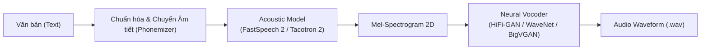
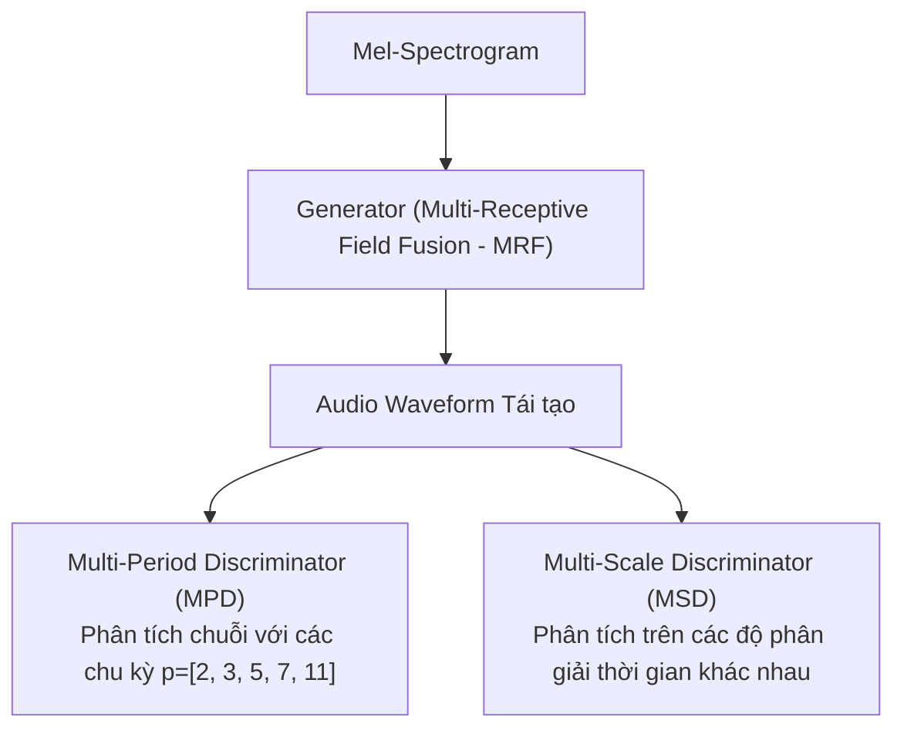

# Chương 8: Mô hình Tổng hợp Tiếng nói & Neural Vocoders (Text-to-Speech & Speech Synthesis)

---

## 1. Tổng quan Hệ thống Tổng hợp Tiếng nói (Text-to-Speech - TTS)

Tổng hợp tiếng nói (TTS) là quá trình chuyển đổi văn bản đầu vào (Text) thành giọng nói tự nhiên của con người (Speech Waveform).

Hệ thống TTS hiện đại thường được chia thành 2 kiến trúc chính:
1. **Pipeline 2 bước (Two-Stage Pipeline):**
   - **Bước 1 (Acoustic Model):** Văn bản (Text/Phonemes) $\longrightarrow$ Mel-Spectrogram (Đặc trưng âm thanh 2D).
   - **Bước 2 (Neural Vocoder):** Mel-Spectrogram $\longrightarrow$ Dạng sóng Âm thanh Thời gian (Audio Waveform PCM).
2. **Kiến trúc Đầu-cuối (End-to-End TTS):** Văn bản $\longrightarrow$ Audio Waveform trực tiếp trong một mạng nơ-ron thống nhất.




---

## 2. Các Mô hình Acoustic Models (Text to Mel-Spectrogram)

### 2.1. Tacotron 2 (Google - Shen et al., 2018)
- Mô hình **Tự hồi quy (Autoregressive)** Encoder-Decoder với cơ chế Attention.
- **Encoder:** Chuyển chuỗi ký tự/âm tiết thành biểu diễn ẩn.
- **Decoder:** Dự đoán từng khung Mel-Spectrogram liên tiếp cho tới khi gặp token dừng (`Stop Token`).
- **Nhược điểm:** Tốc độ sinh chậm (do phải sinh từng khung thời gian nối tiếp) và đôi khi bị hiện tượng lặp từ hoặc bỏ sót từ.

### 2.2. FastSpeech 2 (Microsoft - Ren et al., 2020)
FastSpeech 2 khắc phục toàn bộ nhược điểm của Tacotron 2 bằng kiến trúc **Không tự hồi quy (Non-Autoregressive)**:

```
Text Tokens ──► [ Feed-Forward Transformer ] ──► [ Variance Adaptor ] ──► [ Decoder ] ──► Mel-Spectrogram
                                                        │
                                   ┌────────────────────┼────────────────────┐
                                   ▼                    ▼                    ▼
                           Duration Predictor    Pitch Predictor      Energy Predictor
```

- **Length Regulator (Duration Predictor):** Dự đoán chính xác thời lượng (số khung âm thanh) của từng âm tiết bằng thuật toán căn chỉnh MTA (MFA / Monotonic Alignment Search), đảm bảo **tốc độ sinh nhanh gấp 10-100 lần** và không bao giờ bị lặp từ hay mất chữ.
- **Pitch & Energy Predictors:** Cho phép điều chỉnh độ trầm bổng (Pitch) và độ to nhỏ (Energy) của giọng nói sinh ra theo thời gian thực.

---

### 2.3. Mô hình VITS (Conditional VAE with Adversarial Learning - Kim et al., 2021)

VITS hiện là mô hình End-to-End TTS mạnh mẽ nhất hiện nay:
- Kết hợp **Variational Autoencoder (VAE)**, **Normalizing Flows** và **Generative Adversarial Networks (GAN)**.
- Sinh ra giọng nói có độ tự nhiên cao vượt trội (MOS score gần như tương đương giọng người thật) mà không cần bước trung gian lưu trữ Mel-Spectrogram.

---

## 3. Neural Vocoders (Mel-Spectrogram to Audio Waveform)

Neural Vocoder có nhiệm vụ khôi phục lại dạng sóng âm thanh thời gian $x[n]$ từ ma trận Mel-Spectrogram (vốn chỉ chứa thông tin biên độ đã nén và hoàn toàn mất thông tin Phase).

### 3.1. WaveNet (DeepMind - van den Oord et al., 2016)
WaveNet sử dụng các lớp Tích chập Nhân quả mở rộng (**Dilated Causal Convolutions**) để sinh từng mẫu PCM $x_t$ dựa trên các mẫu quá khứ $x_{<t}$:

$$P(x) = \prod_{t=1}^{T} P(x_t \mid x_1, x_2, \dots, x_{t-1})$$

```
Dilated Conv Layer 3 (dilation=4):  o   o   o   o   o   o   o   o
                                    │  ╱    │  ╱    │  ╱    │  ╱
Dilated Conv Layer 2 (dilation=2):  o   o   o   o   o   o   o   o
                                    │ ╱     │ ╱     │ ╱     │ ╱
Dilated Conv Layer 1 (dilation=1):  o   o   o   o   o   o   o   o
                                    │╱      │╱      │╱      │╱
Input Samples:                      o   o   o   o   o   o   o   o
```

### 3.2. HiFi-GAN (Kong et al., NeurIPS 2020)

HiFi-GAN là chuẩn Vocoder công nghiệp SOTA nhờ tốc độ tổng hợp siêu nhanh trên GPU/CPU và chất lượng âm thanh sắc nét.



- **Generator:** Dùng Transposed Convolutions 1D để tăng kích thước mẫu (Upsampling) kết hợp với khối MRF (Multi-Receptive Field Fusion) để quan sát các dải họa âm ở các độ dài cửa sổ khác nhau.
- **Discriminator song lập:**
  - **MPD (Multi-Period Discriminator):** Cắt tín hiệu 1D thành các cấu trúc 2D dựa trên các chu kỳ $p \in \{2, 3, 5, 7, 11\}$ để bắt trọn các họa âm chu kỳ của giọng nói.
  - **MSD (Multi-Scale Discriminator):** Phân tích tín hiệu ở 3 độ phân giải thời gian khác nhau (gốc, downsampled 2x, downsampled 4x) để đảm bảo độ mịn ở cả tần số cao lẫn tần số thấp.

---

## 4. Generative Diffusion Models cho Audio (DiffWave & Grad-TTS)

Các mô hình Diffusion biến đổi quá trình tạo âm thanh thành chuỗi các bước khử nhiễu **Reverse Diffusion**:

1. **Forward Process:** Thêm dần nhiễu Gaussian $q(x_t \mid x_{t-1})$ vào dạng sóng gốc $x_0$ cho đến khi trở thành nhiễu hoàn toàn $x_T \sim \mathcal{N}(0, I)$.
2. **Reverse Process:** Mạng nơ-ron (như UNet 1D / Dilated Conv) học cách dự đoán vết nhiễu $\epsilon_\theta(x_t, t, \text{Mel})$ để loại bỏ dần nhiễu khỏi $x_T$ từng bước một để khôi phục lại âm thanh gốc $x_0$.

Diffusion Models tạo ra âm thanh có chất lượng chân thực cực cao và khả năng điều khiển đa dạng (điều khiển cảm xúc, tông giọng, phong cách hát).
