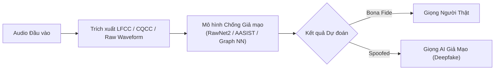
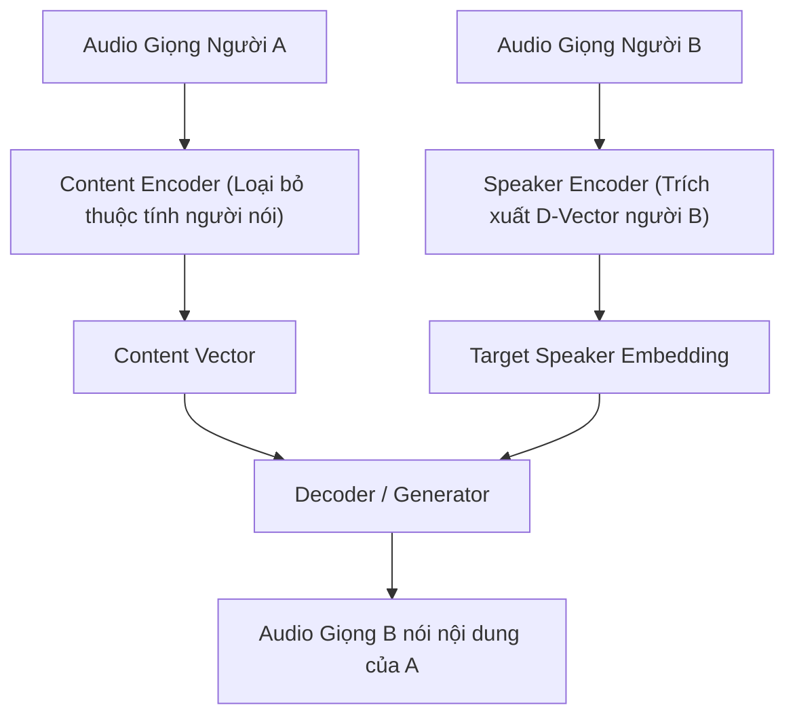

# Chương 10: Các Bài toán Xử lý Âm thanh Chuyên sâu & Ứng dụng Thực tế (Specialized Audio Tasks)

---

Ngoài các bài toán cơ bản như Phân loại Âm thanh (Audio Classification) hay Nhận dạng Tiếng nói (ASR), lĩnh vực Xử lý Tín hiệu & Tiếng nói còn bao gồm nhiều bài toán chuyên sâu ứng dụng trực tiếp trong an ninh thông tin, âm nhạc, y tế và tự động hóa.

---

## 1. Phát hiện Giả mạo Âm thanh & Deepfake Speech (Audio Deepfake Detection & Anti-Spoofing)

Với sự bùng nổ của các mô hình TTS và Voice Conversion SOTA (như VITS, Bark, ElevenLabs), kẻ xấu có thể mạo danh giọng nói của bất kỳ ai chỉ từ vài giây ghi âm. Bài toán **Anti-Spoofing / Deepfake Detection** sinh ra để bảo vệ các hệ thống xác thực sinh trắc học giọng nói.



### 1.1. Phân loại Hình thức Giả mạo (ASVspoof Benchmark):
- **Logical Access (LA):** Giọng nói sinh ra bởi các mô hình thuật toán AI (TTS hoặc Voice Conversion).
- **Physical Access (PA):** Giọng nói thật bị phát lại qua thiết bị loa đĩa (Replay Attack).
- **Speech Deepfake (DF):** Âm thanh bị nén và phát tán trên không gian mạng qua các định dạng lossy (MP3, AAC).

### 1.2. Đặc trưng Chuyên dụng cho Anti-Spoofing:
- **LFCC (Linear Frequency Cepstral Coefficients):** Khác với MFCC (dùng thang Mel phi tuyến nén dải tần cao), LFCC giữ nguyên **thang tần số tuyến tính (Linear Scale)**. Kỹ thuật này giúp bắt trọn các vạch tần số cao - nơi chứa các dấu vết nhiễu giả lập (artifacts) của thuật toán AI!
- **AASIST (Audio Anti-Spoofing using Integrated Spectro-Temporal Graph Neural Network):** Kiến trúc GNN SOTA phân tích mối liên kết giữa các nút tần số và các nút thời gian trên ma trận phổ.

---

## 2. Nhận dạng Cảm xúc Tiếng nói (Speech Emotion Recognition - SER)

SER là bài toán nhận diện trạng thái cảm xúc của người nói (Angry, Happy, Sad, Neutral, Fearful, Disgusted, Surprised) thông qua ngữ điệu âm thanh.

### 2.1. Các Đặc trưng Âm điệu (Prosodic & Acoustic Features):

```
          +------------------------------------------------------------+
          |         CÁC ĐẶC TRƯNG ÂM ĐIỆU TRONG SER (PROSODY)         |
          +-----------------------------+------------------------------+
          |  Tần số Cơ bản F0 (Pitch)   | Cao độ & Đường cong F0 contour|
          |  Cường độ (Intensity / RMS) | Âm lượng & Năng lượng âm    |
          |  Jitter & Shimmer           | Biến thiên chu kỳ & biên độ |
          |  Formants (F1, F2, F3)      | Tần số cộng hưởng khoang miệng|
          +-----------------------------+------------------------------+
```

1. **Jitter:** Đo sự biến thiên liên tục về chu kỳ thời gian giữa các chu kỳ dao động của dây thanh quản (chuẩn đoán giọng khàn/xúc động).
2. **Shimmer:** Đo sự biến thiên liên tục về biên độ cực đại giữa các chu kỳ dao động.

### 2.2. Mô hình Đa thức (Multimodal Emotion Recognition):
Hệ thống hiện đại kết hợp 2 nhánh:
- **Nhánh Acoustic:** Trích xuất đặc trưng âm thanh qua Wav2Vec 2.0 / Audio Spectrogram Transformer.
- **Nhánh Text:** Chuyển lời nói thành chữ (via ASR) và đưa qua RoBERTa / BERT để hiểu ngữ cảnh ngữ nghĩa.
- **Fusion Layer:** Gom hai vector đặc trưng để đưa ra kết luận cảm xúc cuối cùng.

---

## 3. Biến đổi Giọng nói (Voice Conversion - VC)

Biến đổi giọng nói là kỹ thuật thay đổi đặc trưng nhận dạng của người nói từ **Giọng nguồn (Source Speaker A)** sang **Giọng đích (Target Speaker B)** mà vẫn giữ nguyên **Nội dung văn bản (Content)**.



- **Zero-Shot Voice Conversion (AutoVC, FreeVC, KNN-VC):** Cho phép chuyển đổi giọng sang một người nói hoàn toàn mới chỉ với một file ghi âm mẫu kéo dài 3-5 giây mà không cần huấn luyện lại mô hình.

---

## 4. Truy vấn Thông tin Âm nhạc & Thuật toán Shazam (Music Information Retrieval - MIR)

### 4.1. Thuật toán Nhận diện Bài hát Shazam (Audio Fingerprinting)

Làm sao ứng dụng Shazam có thể nhận diện chính xác bài hát đang phát trong quán cafe chỉ sau 3 giây ghi âm từ micro điện thoại giữa môi trường cực kỳ ồn ào?

```
[ Audio Stream ] ──► [ STFT Spectrogram ] ──► [ Constellation Map (Peak Finding) ]
                                                       │
                                                       ▼
[ Query Match ] ◄── [ Hash Table Search ] ◄── [ Target Zone Pairs (Hash Keys) ]
```

#### Các bước của Thuật toán Shazam (Avery Wang, 2003):
1. **Tạo Constellation Map (Bản đồ Chòm sao):** Biến đổi file nhạc thành Spectrogram 2D. Tìm các điểm cực đại năng lượng (Peaks) trên mặt phẳng Thời gian - Tần số.
2. **Tạo Cặp Điểm (Pairing Hits):** Chọn một điểm peak làm **Anchor Point** $(f_1, t_1)$. Chọn một điểm peak tiếp theo trong một vùng cửa sổ thời gian (Target Zone) làm **Target Point** $(f_2, t_2)$.
3. **Tạo Hash Key 32-bit:**
   $$\text{Hash Key} = \text{Struct.pack}(f_1, f_2, t_2 - t_1)$$
   Giá trị lưu vào cơ sở dữ liệu: `(Hash Key, t_1)`
4. **Tìm kiếm & Khớp Thời gian (Time Offset Matching):** Khi tìm kiếm file âm thanh tải lên, thuật toán tìm các Hash Key khớp trong cơ sở dữ liệu và tính hiệu số thời gian:
   $$\Delta t = t_{\text{database}} - t_{\text{query}}$$
   Nếu tồn tại một giá trị $\Delta t$ xuất hiện dồn dập với tần suất vượt trội (Histogram peak), bài hát đó chính là kết quả tìm kiếm chuẩn xác 100%!

---

### 4.2. Các bài toán MIR khác:
- **Beat & Tempo Tracking:** Ước lượng nhịp độ (BPM - Beats Per Minute) và các mốc thời gian nảy phách (Beats/Downbeats).
- **Automatic Music Transcription (AMT):** Chuyển đổi nhạc cụ âm thanh (Piano, Guitar) thành bản ký âm số chuẩn **MIDI**.

---

## 5. Phát hiện & Định vị Sự kiện Âm thanh (Sound Event Detection & Localization - SED / SELD)

Bài toán SELD không chỉ nhận diện âm thanh đó là gì mà còn xác định chính xác thời điểm xảy ra và vị trí không gian của nguồn phát âm thanh.

```
Output SELD = { Event Class: "Tiếng súng", Onset: 1.2s, Offset: 1.8s, Azimuth: +45°, Elevation: +10° }
```

- **Ứng dụng:** Giám sát an ninh thành phố thông minh (phát hiện tiếng súng, tiếng xe va chạm), xe tự lái (phát hiện hướng còi xe cấp cứu), hệ thống nhà thông minh.
- **Độ đo không gian:** Góc phương vị (Azimuth $\phi$), Góc nâng (Elevation $\theta$) sử dụng mảng micro đa hướng (Microphone Array).

---

## 6. Mô tả Âm thanh bằng Ngôn ngữ Tự nhiên (Automated Audio Captioning - AAC)

Tương tự bài toán Image Captioning trong máy nhìn, **Audio Captioning** nhận đầu vào là một file âm thanh bất kỳ và tự động sinh ra một câu văn bản mô tả lại toàn bộ ngữ cảnh âm thanh đó bằng ngôn ngữ tự nhiên.

- **Ví dụ Đầu vào:** Clip âm thanh 10 giây.
- **Văn bản đầu ra:** *"Tiếng một con chó sủa ở phía xa, nối tiếp bằng tiếng xe máy chạy qua trên mặt đường ướt và tiếng mưa rơi nhẹ."*
- **Kiến trúc:** Audio Encoder (HTSAT / PANNs CNN) kết hợp với Text Language Model Decoder (BART / LLaMA / GPT-2).
