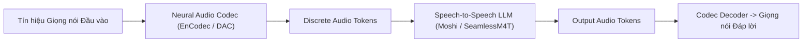
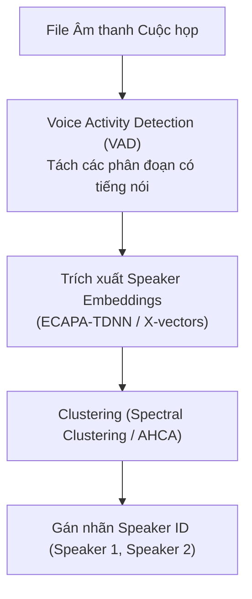

# Chương 11: Mô hình Ngôn ngữ Tiếng nói & Phân định Người nói (Speech LLMs & Speaker Diarization)

---

## 1. Mô hình Ngôn ngữ Tiếng nói (Speech LLMs & Real-Time Audio Models)

Các mô hình Speech LLMs (như SeamlessM4T, Moshi, AudioPaLM, SpeechGPT) xử lý tín hiệu âm thanh trực tiếp dưới dạng **Continuous / Discrete Audio Tokens** (trích xuất qua EnCodec, SoundStream hoặc Descript Audio Codec DAC), cho phép trò chuyện bằng giọng nói thời gian thực với độ trễ siêu thấp ($< 200 \text{ ms}$).

### 1.1. Mô hình Moshi (Kyutai 2024):
Moshi là mô hình Speech-to-Speech thời gian thực đầu tiên áp dụng kiến trúc **Helium Multi-Stream Transformer**, cho phép vừa nói vừa lắng nghe (Full-Duplex Conversation) đồng thời trên 2 kênh âm thanh độc lập mà không cần chờ người dùng nói xong!

---

## 2. Phân định Người nói (Speaker Diarization: "Ai nói vào lúc nào?")

Bài toán **Speaker Diarization** giải quyết câu hỏi: *"Who Spoke When?"* trong một cuộc họp hoặc cuộc hội thoại đa người nói.

---

## 3. Trích xuất Vector Nhận dạng Giọng nói (ECAPA-TDNN & X-Vectors)

Mô hình **ECAPA-TDNN (Emphasized Channel Attention, Propagation and Aggregation in TDNN)** trích xuất một vector nhúng cố định (d-vector $\in \mathbb{R}^{192}$) đại diện cho âm sắc đặc trưng riêng biệt của từng con người:

$$\text{Cosine Similarity}(v_{\text{speaker1}}, v_{\text{speaker2}}) = \frac{v_1 \cdot v_2}{\|v_1\| \|v_2\|}$$

Nếu điểm tương đồng $> 0.75$, hệ thống xác nhận 2 đoạn âm thanh được nói bởi cùng một người!
